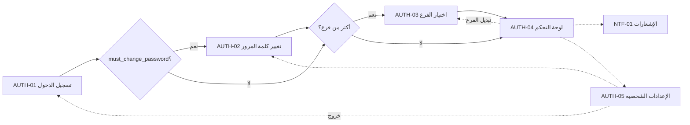
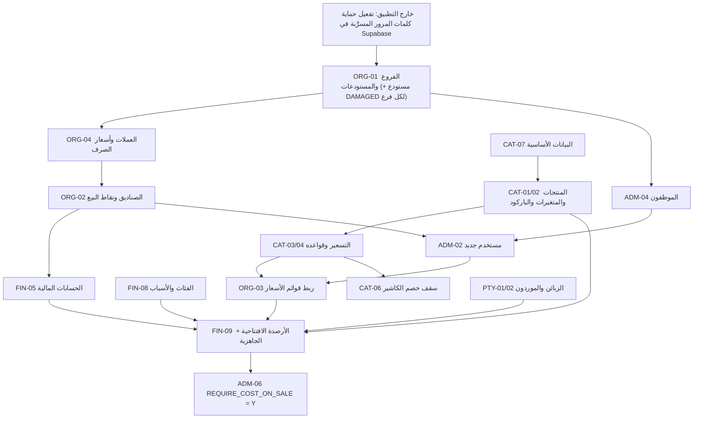
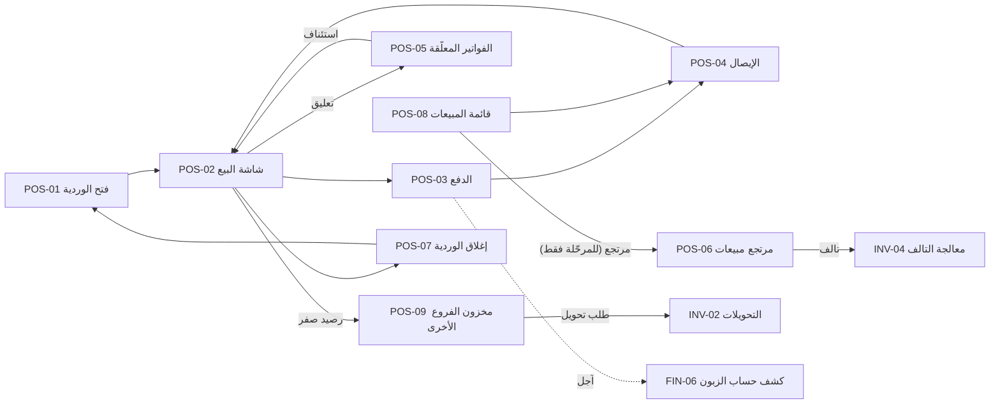
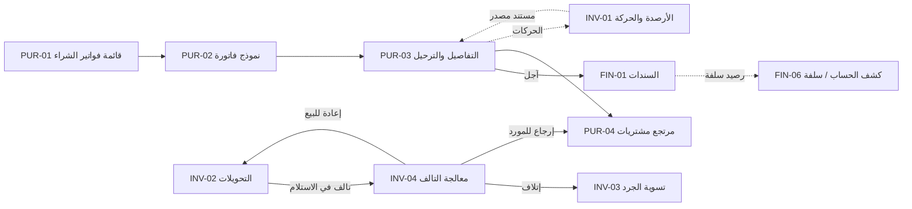

# خريطة الشاشات والتنقل

**ERP Screen & Navigation Map**

وثيقة تصميم واجهات (Flutter: ويب، موبايل، Windows) تجيب عن أربعة أسئلة: ما الشاشات التي يحتاجها النظام فعلاً؟ لمن تتبع كل شاشة؟ كيف ينتقل المستخدم بينها؟ وبأي ترتيب تُبنى، بدءاً بالطبقة الأولى على الويب؟

## 0. ورقة التحكم بالوثيقة

| البند | التفصيل |
| --- | --- |
| رمز الوثيقة | ERP-SCR-MAP |
| الإصدار والحالة | 1.0، مسودة للمراجعة |
| تاريخ الإعداد | 12 نوفمبر 2026 (1.0)، وتحديثه 15 نوفمبر 2026 (1.1) |
| المصدر الأساسي | الأقسام 4 (الشاشات) و9 (الصلاحيات) و13 (ملاحظات المصمم) من كل سيناريو، والملاحق أ وج وز وح وي |
| الارتباط بخريطة الاعتماديات | ترتيب البناء مأخوذ من الموجات (القسم 11 في ERP-DEP-MAP) وحواف NAV (الملحق ب)؛ الطبقة 0 والطبقة 1 هناك = «الطبقة الأولى» هنا |
| ما لم يُفحص | المستودع البرمجي وحالة تنفيذ الواجهات؛ القاعدة فُحصت عبر DATA_MODEL لا مباشرة. نظام التصميم مقروء من وثيقتيه لا من الكود |
| ما هو اقتراح مني | دمج 174 شاشة في 58 شاشة/مجموعة، الأرقام (AUTH-01 ...)، الدفعات (P1 إلى P3)، شجرة القائمة الجانبية، سجل الروابط العميقة (القسم 8)، ومواصفات الشاشات (القسم 12). كلها اقتراحات قابلة للتغيير، وللمنفّذ أن يضيف فوقها أو يعدّل |

**سجل المراجعات**

| الإصدار | التاريخ | التغيير |
| --- | --- | --- |
| 1.0 | 12 نوفمبر 2026 | الإصدار الأول من السيناريوهات v3 |
| 1.1 | 15 نوفمبر 2026 | (1) مطابقة مع v1 النهائي (81 سيناريو، 174 شاشة) وDATA_MODEL؛ (2) حذف FIN-10 (الضرائب، قرار-62) فصارت الشاشات 58 وأُلغيت الدفعة P4؛ (3) تفعيل تبويب الصور (قرار-63) وإرفاق إيصال المصروف (قرار-56) ومراجعة المصروف (قرار-55) وتطبيق السلف (قرار-57) وعكس الجرد المخزني والنقدي (قرار-59)؛ (4) تصحيح الأدوار: الكاشير إضافة سريعة فقط (قرار-52)، والمدير يكتب في الموظفين (قرار-54)؛ (5) تحديث النقاط المفتوحة (القسم 11)؛ (6) إضافة القسم 12: مواصفات الشاشات المقترحة وكتالوج المكوّنات الناقصة في نظام التصميم |

**فهرس الوثيقة**

1. الملخص التنفيذي
2. منهجية التوحيد والاصطلاحات
3. هيكل التطبيق والقائمة الجانبية
4. فهرس الشاشات الموحّد (58 شاشة)
5. من يرى ماذا (الأدوار × مجموعات القائمة)
6. خرائط التنقل
7. جدول حواف التنقل
8. الروابط العميقة بين المستندات
9. قواعد التنقل العامة وحراسة المسارات
10. خطة البناء (الدفعات) وعلاقتها بخريطة الاعتماديات
11. نقاط مفتوحة تؤثر على الشاشات
12. مواصفات الشاشات المقترحة والمكوّنات الناقصة (جديد في 1.1)
13. الملاحق (أ: تغطية السيناريوهات، ب: ما دُمج من شاشات المصدر)

## 1. الملخص التنفيذي

- المصدر يعدّد **174 شاشة** (الملحق ج) لتغطية **81 سيناريو**. كثير منها نماذج أو نوافذ أو تبويبات لشاشة واحدة (مثل «نموذج مصروف» و«قائمة المصروفات» و«تفاصيل المصروف»). دمجتها في **58 شاشة/مجموعة شاشات** بنمط واحد (قائمة ← تفاصيل ← نموذج) فتصير القائمة الجانبية قابلة للتنقل، وتبقى كل شاشة مربوطة بسيناريوهاتها.
- الشاشات في **11 وحدة**: الدخول (5)، الإدارة (6)، الهيكل (4)، الكتالوج (9)، الأطراف (2)، نقطة البيع (9)، المشتريات (4)، المخزون (4)، المالية (9)، المحاسبة والتقارير (5)، الإشعارات (1).
- **الطبقة الأولى على الويب = الدفعة P1: 28 شاشة**، وهي ما يلزم لإعداد النظام قبل أول عملية (الأمن والهيكل والكتالوج والأسعار والأطراف والحسابات المالية والأرصدة الافتتاحية). تنتهي بشاشة «معالج الأرصدة الافتتاحية» (FIN-09) ثم تفعيل `REQUIRE_COST_ON_SALE = Y`.
- شاشات نقطة البيع (9) على **Windows** بحسب المصدر، وتأتي في الدفعة P2. جاهزية الويب (P1) لا تعتمد عليها، لكن P1 يُنتج كل ما تحتاجه (مستخدمون، نقاط، قوائم أسعار، أصناف بأسعار وتكاليف).
- **لا شاشات مخفية في v1:** حُذفت الضرائب (قرار-62) وصار تبويب صور المنتج فعّالاً (قرار-63)؛ والمؤجل الوحيد جدول إشعارات حقيقي (NTF-01 تُحسب حياً).
- **الشاشة الوحيدة التي يتوقف عليها كل شيء هي ORG-01 ثم ORG-02**: تتصدر المسار الحرج في خريطة الاعتماديات (S04 ← S05 ← S02 ← S58 ← S14 ...).

## 2. منهجية التوحيد والاصطلاحات

**قواعد الدمج**

| القاعدة | مثال |
| --- | --- |
| قائمة + نموذج + تفاصيل لكيان واحد = شاشة واحدة بثلاث حالات | «قائمة الزبائن» و«نموذج زبون» ← PTY-01 |
| معالج متعدد الخطوات = شاشة واحدة | «خطوة المخزون» و«خطوة الصناديق» ... ← FIN-09 |
| نافذة منبثقة (Dialog) لا تُعدّ شاشة مستقلة ما لم تُستدعَ من أكثر من شاشة | «نافذة إعادة التعيين» ضمن ADM-01 |
| تبويبات التفاصيل = شاشة واحدة | تبويبات المنتج ← CAT-02 |
| الجداول المرجعية المتشابهة = شاشة عامة واحدة بقالب متغير | الألوان والماركات والوحدات ← CAT-07 |
| تقرير بجدول ومرشحات = شاشة داخل «مركز التقارير» | ACC-04 |

**الرموز**

| الرمز | المعنى |
| --- | --- |
| AUTH / ADM / ORG / CAT / PTY / POS / PUR / INV / FIN / ACC / NTF | الوحدة (الدخول، الإدارة، الهيكل، الكتالوج، الأطراف، نقطة البيع، المشتريات، المخزون، المالية، المحاسبة والتقارير، الإشعارات) |
| P1 .. P3 | دفعة البناء (القسم 10)؛ أُلغيت P4 في 1.1 |
| ويب / موبايل / Windows | المنصة الأساسية بحسب الفهرس في المصدر (اقتراح تصميمي) |
| المنفّذ | الدور الذي يعمل على الشاشة (الملحق أ) |
| اطلاع | أدوار تقرأ فقط |
| W / R / – | كتابة / قراءة / لا ظهور (القسم 5) |

## 3. هيكل التطبيق والقائمة الجانبية

### 3.1 مكوّنات الإطار الثابت (Shell)

| المكوّن | المحتوى | المصدر |
| --- | --- | --- |
| الشريط العلوي | اسم الفرع الفعّال وزر «تبديل الفرع»، جرس الإشعارات بعدّاد، قائمة المستخدم (الإعدادات الشخصية، تسجيل الخروج) | S01 S61 S44 S82 |
| شارة «عرض فقط» | تظهر على الفرع الذي `can_operate = false` وتعطّل كل أزرار الكتابة | S01 |
| شارة الجلسة (للكاشير) | «جلسة مفتوحة منذ ...» | S14 |
| القائمة الجانبية | تُبنى من الصلاحيات المحمّلة بـ `get_my_access()`؛ لا يظهر بند لمن لا يملك صلاحيته | S01 |
| فتات الخبز (Breadcrumb) | وحدة ← شاشة ← سجل | اقتراح |
| الملصق الثابت للمبالغ | يتبع تفضيل العملة (`display_preferences`) | S43 |

### 3.2 شجرة القائمة الجانبية (مقترحة)

الرمز بين القوسين هو الشاشة؛ بعد الشرطة الصلاحية التي تُظهر البند.

```
الرئيسية ................ AUTH-04 (الجميع)

المبيعات (نقطة البيع)
  ├ وردية الصندوق ........ POS-01  (pos.session)
  ├ شاشة البيع ........... POS-02  (sales.create)
  ├ الفواتير المعلّقة ..... POS-05  (sales.create)
  ├ مرتجع مبيعات ......... POS-06  (sales.return)
  ├ قائمة المبيعات ....... POS-08  (sales.view)
  └ إغلاق الوردية ........ POS-07  (reconcile.cash)

المشتريات
  ├ فواتير الشراء ........ PUR-01  (purchasing.view)
  └ مرتجع مشتريات ........ PUR-04  (purchasing.return)

المخزون
  ├ الأرصدة والحركة ...... INV-01  (inventory.view)
  ├ التحويلات ............ INV-02  (inventory.transfer)
  ├ تسوية الجرد .......... INV-03  (inventory.adjust)
  └ معالجة التالف ........ INV-04  (inventory.adjust)

الكتالوج والأسعار
  ├ المنتجات ............. CAT-01  (catalog.manage)
  ├ التسعير وقواعده ...... CAT-03/04 (pricing.manage)
  ├ التكلفة .............. CAT-05  (costs.view)
  ├ الخصومات وسقف الكاشير  CAT-06  (pricing.manage)
  ├ مستويات إعادة الطلب .. CAT-09  (catalog.manage)
  ├ طباعة الملصقات ....... CAT-08  (catalog.manage)
  └ البيانات الأساسية .... CAT-07  (masterdata.manage)

الأطراف
  ├ الزبائن .............. PTY-01  (parties.view)
  └ الموردون ............. PTY-02  (parties.view)

المالية
  ├ السندات (قبض/دفع/موظف/مالك) FIN-01 (finance.payments)
  ├ المصروفات ............ FIN-02  (finance.expenses)
  ├ مراجعة مصروفات الكاشير FIN-03  (finance.expenses)
  ├ التحويلات المالية .... FIN-04  (finance.manage)
  ├ الحسابات المالية ..... FIN-05  (finance.view)
  ├ الأرصدة وكشف الحساب .. FIN-06  (parties.view)
  ├ تسوية أرصدة الأطراف .. FIN-07  (balance.adjust)
  ├ الفئات والأسباب ...... FIN-08  (finance.manage)
  └ الأرصدة الافتتاحية ... FIN-09  (accounting.manage)

المحاسبة
  ├ دليل الحسابات والربط . ACC-01  (accounting.view)
  ├ القيود ............... ACC-02  (accounting.view)
  └ الفترات والإقفال ..... ACC-03  (accounting.manage)

التقارير ................ ACC-04  (reports.view)
سجل التدقيق ............. ACC-05  (audit.view)

الإدارة
  ├ المستخدمون ........... ADM-01  (users.manage)
  ├ الأدوار والصلاحيات ... ADM-03  (users.manage)
  ├ الموظفون ............. ADM-04  (hr.view)
  ├ الملاك ............... ADM-05  (owner.transactions)
  └ الإعدادات ............ ADM-06  (settings.manage)

الهيكل
  ├ الفروع والمستودعات ... ORG-01  (org.manage)
  ├ نقاط البيع والصناديق . ORG-02  (pos.manage)
  ├ ربط قوائم الأسعار .... ORG-03  (users.manage / pos.manage)
  └ العملات وأسعار الصرف . ORG-04  (fx.rate.manage)
```

ملاحظات: لا ضرائب ولا شيكات في v1 (قرار-35 وقرار-62). الإشعارات تُفتح من الجرس لا من القائمة (NTF-01). الإعدادات الشخصية من قائمة المستخدم (AUTH-05).

## 4. فهرس الشاشات الموحّد (58 شاشة)

أعمدة مشتركة: **النوع** (قائمة، نموذج، معالج، تفاصيل، تقرير، نافذة)، **السيناريوهات** المرتبطة، **المنفّذ** و**اطلاع** من الملحق أ، **الصلاحية** المرجعية، **المنصة**، **الدفعة**، و**تنتقل إلى** (التفاصيل في القسمين 6 و7).

### 4.1 الدخول والحساب

| الرمز | الشاشة | النوع | السيناريوهات | المنفّذ | الصلاحية | المنصة | الدفعة | تنتقل إلى |
| --- | --- | --- | --- | --- | --- | --- | --- | --- |
| AUTH-01 | تسجيل الدخول | شاشة | S01 | الجميع | — | ويب، موبايل، Windows | P1 | AUTH-02 أو AUTH-03 أو AUTH-04 |
| AUTH-02 | تغيير كلمة المرور | شاشة (إجباري قبل الفرع) أو نافذة (اختياري) | S01 S82 S59 | الجميع | المستخدم نفسه | ويب، موبايل، Windows | P1 | AUTH-03 |
| AUTH-03 | اختيار الفرع ومبدّل الفرع | شاشة + قائمة في الشريط | S01 S61 | الجميع متعدد الفروع | `user_branch_access` | ويب، موبايل، Windows | P1 | AUTH-04 |
| AUTH-04 | لوحة التحكم | شاشة | S81 | الجميع (بطاقات بحسب الدور) | بحسب البطاقة | ويب، موبايل، Windows | P1 | الشاشة الهدف لكل بطاقة (6.5) |
| AUTH-05 | الإعدادات الشخصية | شاشة | S43 S82 | الجميع | — | ويب، موبايل، Windows | P1 | AUTH-02، AUTH-01 (خروج) |

### 4.2 الإدارة

| الرمز | الشاشة | النوع | السيناريوهات | المنفّذ | اطلاع | الصلاحية | المنصة | الدفعة | تنتقل إلى |
| --- | --- | --- | --- | --- | --- | --- | --- | --- | --- |
| ADM-01 | المستخدمون (قائمة، تفاصيل، إعادة تعيين، تعطيل) | قائمة + تفاصيل + نافذة | S02 S59 | SUPER_ADMIN | — | `users.manage` | ويب | P1 | ADM-02، ORG-02 (ربط نقاط)، ORG-03 (قوائم المستخدم) |
| ADM-02 | مستخدم جديد (معالج: حساب ← أدوار ← فروع ← ملخص ← كلمة مؤقتة) | معالج | S02 S60 | SUPER_ADMIN | — | `users.manage` | ويب | P1 | ORG-02 (ربط نقاط البيع) |
| ADM-03 | الأدوار ومصفوفة الصلاحيات | قائمة + مصفوفة | S03 | SUPER_ADMIN | AUDITOR | `users.manage` | ويب | P1 | ADM-02 |
| ADM-04 | الموظفون | قائمة + نموذج | S62 | MANAGER SUPER_ADMIN | ACCOUNTANT AUDITOR | `hr.manage` / `hr.view` | ويب | P1 | ADM-02 (منح حساب)، FIN-01 (راتب/سلفة) |
| ADM-05 | الملاك | قائمة + نموذج | S72 S60 S36 | ACCOUNTANT SUPER_ADMIN | MANAGER AUDITOR | `owner.transactions` | ويب | P3 | ADM-02 (منح حساب)، FIN-01 (حركة مالك) |
| ADM-06 | الإعدادات (مفاتيح GLOBAL وBRANCH وUSER) | قائمة + نموذج | S78 | SUPER_ADMIN | — | `settings.manage` | ويب | P1 | CAT-06 (سقف الخصم)، FIN-09 (جاهزية التكلفة) |

### 4.3 الهيكل

| الرمز | الشاشة | النوع | السيناريوهات | المنفّذ | اطلاع | الصلاحية | المنصة | الدفعة | تنتقل إلى |
| --- | --- | --- | --- | --- | --- | --- | --- | --- | --- |
| ORG-01 | الفروع والمستودعات (شجرة) | قائمة + نموذجان | S04 | SUPER_ADMIN | بحسب الفروع المسموحة | `org.manage` | ويب | P1 | ORG-02، ADM-02 |
| ORG-02 | نقاط البيع والصناديق (معالج: صندوق ← نقطة ← كاشيرات) + تبويب قوائم النقطة | قائمة + معالج | S05 | MANAGER SUPER_ADMIN | — | `pos.manage` | ويب | P1 | ORG-03، FIN-05 |
| ORG-03 | ربط قوائم الأسعار (تبويب مستخدمين، تبويب نقاط، معاينة) | تبويبات | S58 | SUPER_ADMIN (مستخدمين)، MANAGER (نقاط) | — | `users.manage` / `pos.manage` | ويب | P1 | CAT-03 |
| ORG-04 | العملات وأسعار الصرف | قائمتان + نموذج | S06 | ACCOUNTANT SUPER_ADMIN | AUDITOR | `fx.rate.manage` | ويب | P1 | CAT-03، ADM-06 |

### 4.4 الكتالوج والتسعير

| الرمز | الشاشة | النوع | السيناريوهات | المنفّذ | اطلاع | الصلاحية | المنصة | الدفعة | تنتقل إلى |
| --- | --- | --- | --- | --- | --- | --- | --- | --- | --- |
| CAT-01 | قائمة المنتجات | قائمة | S07 | MANAGER PURCHASER WAREHOUSE | AUDITOR | `catalog.manage` | ويب | P1 | CAT-02 |
| CAT-02 | تفاصيل المنتج (تبويبات: أساسي، المتغيرات، الألوان، المقاسات، الوصف، الخصائص، الباركود، النشر، الصور) | تفاصيل بتبويبات + معالج إنشاء | S07 S08 S46 S48 S51 S53 S54 S55 S56 | MANAGER PURCHASER WAREHOUSE | AUDITOR | `catalog.manage` | ويب | P1 | CAT-03، CAT-05، CAT-07، CAT-08 |
| CAT-03 | التسعير (شبكة لون × مقاس + نافذة «سعر الموديل») | شاشة | S09 | MANAGER | ACCOUNTANT AUDITOR | `pricing.manage` | ويب | P1 | CAT-04، CAT-05 |
| CAT-04 | قواعد التسعير (Markup/Margin) + معاينة | قائمة + نموذج | S57 | MANAGER | AUDITOR | `pricing.manage` | ويب | P1 | CAT-03 |
| CAT-05 | التكلفة وسجل التعديلات | قائمة + نافذة | S10 | ACCOUNTANT MANAGER | PURCHASER AUDITOR | `costs.manage` / `costs.view` | ويب | P1 | CAT-02 |
| CAT-06 | الخصومات وسقف خصم الكاشير (تبويبان) | قائمتان + نموذج | S11 S63 | MANAGER SUPER_ADMIN | CASHIER | `pricing.manage` | ويب | P1 (السقف) / P3 (الخصومات) | ADM-06 |
| CAT-07 | مركز البيانات الأساسية (تبويبات: ماركات، تصنيفات، أنواع منتجات، ألوان، أنظمة مقاسات، وحدات، جداول وصفية، خصائص وخيارات، ربط النوع بالمقاسات والخصائص) | شاشة عامة بقالب متغير | S46 S47 S48 S49 S50 S52 S53 | MANAGER PURCHASER WAREHOUSE | AUDITOR | `masterdata.manage` | ويب | P1 | CAT-02 |
| CAT-08 | طباعة ملصقات الباركود | شاشة | S56 | MANAGER PURCHASER WAREHOUSE | — | `catalog.manage` | Windows (الطباعة) | P1 | CAT-02 |
| CAT-09 | مستويات إعادة الطلب | جدول قابل للتحرير | S29 | MANAGER PURCHASER WAREHOUSE | — | `catalog.manage` | ويب | P2 | INV-01 (المنخفض) |

تبويب الصور فعّال في v1: bucket عام `product-images`، والرفع والحذف لـ `catalog.manage` (قرار-63).

### 4.5 الأطراف

| الرمز | الشاشة | النوع | السيناريوهات | المنفّذ | اطلاع | الصلاحية | المنصة | الدفعة | تنتقل إلى |
| --- | --- | --- | --- | --- | --- | --- | --- | --- | --- |
| PTY-01 | الزبائن (قائمة، نموذج، عناوين، حد الائتمان، قائمة الأسعار المقترحة، ونافذة الإضافة السريعة للكاشير) | قائمة + نموذج + نافذة | S12 | MANAGER ACCOUNTANT PURCHASER (كامل)، CASHIER (إضافة سريعة فقط) | AUDITOR | `parties.manage` / `parties.quick_add` | Windows (والويب) | P1 | FIN-06 (كشف حساب) |
| PTY-02 | الموردون (قائمة، نموذج) + تبويب ملاحظات المورد | قائمة + نموذج + تبويب | S13 S24 | PURCHASER | ACCOUNTANT WAREHOUSE (الملاحظات) AUDITOR | `parties.manage` / `purchasing.create` | ويب | P1 | PUR-02، FIN-06 |

### 4.6 نقطة البيع (Windows)

| الرمز | الشاشة | النوع | السيناريوهات | المنفّذ | اطلاع | الصلاحية | المنصة | الدفعة | تنتقل إلى |
| --- | --- | --- | --- | --- | --- | --- | --- | --- | --- |
| POS-01 | لوحة الكاشير وفتح الوردية | شاشة | S14 | CASHIER MANAGER | — | `pos.session` | Windows | P2 | POS-02 |
| POS-02 | شاشة البيع (بحث/مسح، سلة، اختيار قائمة الأسعار والزبون، خصم) | شاشة | S15 S64 S67 | CASHIER MANAGER | — | `sales.create` | Windows (الموبايل للمسح) | P2 | POS-03، POS-05، POS-09 |
| POS-03 | الدفع (متعدد الوسائل والعملات، آجل/جزئي) | شاشة | S16 S17 | CASHIER MANAGER | — | `sales.post` + `finance.payments` | Windows | P2 | POS-04 |
| POS-04 | الإيصال (طباعة، واتساب، «بيع جديد») | شاشة | S16 S80 | CASHIER MANAGER | — | — | Windows | P2 | POS-02 |
| POS-05 | الفواتير المعلّقة (قائمة، تفاصيل، تنبيه تغيّر الأسعار) | قائمة + تفاصيل | S20 | CASHIER MANAGER | — | `sales.create` | Windows | P2 | POS-02 (استئناف) |
| POS-06 | مرتجع مبيعات (بحث، بنود، حالة، طريقة الاسترداد، إيصال) | معالج | S19 | CASHIER MANAGER | ACCOUNTANT AUDITOR | `sales.return` | Windows | P2 | INV-04 (التالف) |
| POS-07 | إغلاق الوردية والجرد النقدي (ملخص، عدّ لكل عملة، عكس الجرد) | معالج | S18 | CASHIER MANAGER | ACCOUNTANT AUDITOR | `reconcile.cash` | Windows | P2 | POS-01 |
| POS-08 | قائمة المبيعات وتفاصيل الفاتورة | قائمة + تفاصيل | S80 | CASHIER MANAGER | ACCOUNTANT AUDITOR | `sales.view` | Windows | P2 | POS-06، POS-04 (إعادة طباعة) |
| POS-09 | مخزون الفروع الأخرى (نافذة) | نافذة | S66 S67 | CASHIER MANAGER WAREHOUSE PURCHASER | — | `inventory.view_other_branches` | Windows وموبايل وويب | P2 | INV-02 (طلب تحويل) |

### 4.7 المشتريات

| الرمز | الشاشة | النوع | السيناريوهات | المنفّذ | اطلاع | الصلاحية | المنصة | الدفعة | تنتقل إلى |
| --- | --- | --- | --- | --- | --- | --- | --- | --- | --- |
| PUR-01 | قائمة فواتير الشراء | قائمة | S21 | PURCHASER MANAGER | WAREHOUSE ACCOUNTANT AUDITOR | `purchasing.view` | ويب | P2 | PUR-02، PUR-03 |
| PUR-02 | نموذج فاتورة شراء (رأس، شبكة لون × مقاس، ملخص) | نموذج | S21 | PURCHASER | MANAGER | `purchasing.create` | ويب | P2 | PUR-03 |
| PUR-03 | تفاصيل الفاتورة ونافذة الترحيل | تفاصيل + نافذة | S22 | PURCHASER | MANAGER ACCOUNTANT | `purchasing.post` | ويب | P2 | PUR-04، FIN-01 (سند دفع)، INV-01 (الحركات) |
| PUR-04 | مرتجع مشتريات | نموذج | S23 | PURCHASER | ACCOUNTANT | `purchasing.return` | ويب | P2 | PUR-03 |

### 4.8 المخزون

| الرمز | الشاشة | النوع | السيناريوهات | المنفّذ | اطلاع | الصلاحية | المنصة | الدفعة | تنتقل إلى |
| --- | --- | --- | --- | --- | --- | --- | --- | --- | --- |
| INV-01 | أرصدة المخزون وبطاقة حركة الصنف (تبويب «منخفض» وتبويب «بالطريق») | قائمة + تفاصيل | S25 | WAREHOUSE MANAGER | CASHIER ACCOUNTANT PURCHASER AUDITOR | `inventory.view` | موبايل وويب | P2 | المستند المصدر (الفقرة 8)، POS-09 |
| INV-02 | التحويلات (قائمة، نموذج، تفاصيل، شحن، واردات، استلام) | قائمة + نموذج + نوافذ | S26 S27 | WAREHOUSE | MANAGER AUDITOR | `inventory.transfer` / `.approve` | موبايل وويب | P2 | INV-04 |
| INV-03 | تسوية الجرد (عدّ بالباركود + عكس) | قائمة + نموذج | S28 | WAREHOUSE MANAGER | ACCOUNTANT AUDITOR | `inventory.adjust` | موبايل وويب | P2 | INV-01 |
| INV-04 | معالجة المخزون التالف (إتلاف، إرجاع للمورد، إعادة للبيع) | نافذة + توجيه | S71 | WAREHOUSE MANAGER | PURCHASER | `inventory.adjust` + `inventory.transfer` | موبايل وويب | P2 | INV-03 (إتلاف)، PUR-04 (إرجاع)، INV-02 (إعادة للبيع) |

### 4.9 المالية

| الرمز | الشاشة | النوع | السيناريوهات | المنفّذ | اطلاع | الصلاحية | المنصة | الدفعة | تنتقل إلى |
| --- | --- | --- | --- | --- | --- | --- | --- | --- | --- |
| FIN-01 | السندات: قبض من زبون، دفع لمورد، دفعة موظف، حركة مالك (نموذج واحد بأربعة أنواع) | قائمة + نموذج | S30 S31 S69 S36 | ACCOUNTANT CASHIER MANAGER PURCHASER (بحسب النوع، القرار 46) | AUDITOR | `finance.payments` | ويب | P3 | FIN-06، ACC-02 |
| FIN-02 | المصروفات (مع إرفاق إيصال اختياري) | قائمة + نموذج + تفاصيل | S32 | ACCOUNTANT CASHIER | MANAGER AUDITOR | `finance.expenses` | ويب | P3 | FIN-03، ACC-02 |
| FIN-03 | مراجعة مصروفات الكاشير (تمت المراجعة + ملاحظة) | قائمة | S65 | ACCOUNTANT | MANAGER CASHIER AUDITOR | `finance.expenses` | ويب | P3 | FIN-02 |
| FIN-04 | التحويلات المالية بين الحسابات | قائمة + نموذج | S33 | ACCOUNTANT | AUDITOR | `finance.manage` | ويب | P3 | ACC-02 |
| FIN-05 | الحسابات المالية والبنوك (بطاقات بالأرصدة) | قائمة + نماذج | S37 | ACCOUNTANT | AUDITOR | `finance.manage` | ويب | P1 | ORG-02 (الصناديق) |
| FIN-06 | الأرصدة وكشف حساب الطرف + نموذج تطبيق سلفة | قائمة + تفاصيل + نموذج | S34 S79 | ACCOUNTANT | AUDITOR PURCHASER MANAGER | `parties.view` | ويب | P3 | FIN-01، FIN-07، المستند المصدر |
| FIN-07 | تسوية أرصدة الأطراف | قائمة + نموذج | S35 | ACCOUNTANT | AUDITOR | `balance.adjust` | ويب | P3 | FIN-06 |
| FIN-08 | فئات المصروف وأسباب الدفع (تبويبان) | قائمتان + نموذجان | S70 | ACCOUNTANT | AUDITOR | `accounting.manage` أو `finance.manage` | ويب | P1 | ACC-01 |
| FIN-09 | معالج الأرصدة الافتتاحية (مخزون ← صناديق وبنوك ← زبائن ← موردون ← جاهزية) | معالج | S68 | ACCOUNTANT SUPER_ADMIN | MANAGER | `accounting.manage` | ويب | P1 | ADM-06 |

### 4.10 المحاسبة والتقارير والرقابة

| الرمز | الشاشة | النوع | السيناريوهات | المنفّذ | اطلاع | الصلاحية | المنصة | الدفعة | تنتقل إلى |
| --- | --- | --- | --- | --- | --- | --- | --- | --- | --- |
| ACC-01 | دليل الحسابات (شجرة) والربط المحاسبي (تبويبان) | شجرة + جدول | S38 | ACCOUNTANT | AUDITOR | `accounting.manage` | ويب | P1 | FIN-08، FIN-05 |
| ACC-02 | القيود (قائمة، تفاصيل، نافذة العكس) | قائمة + تفاصيل | S39 | ACCOUNTANT | AUDITOR | `accounting.view` / `accounting.post` | ويب | P3 | المستند المصدر |
| ACC-03 | الفترات المحاسبية + قيد إقفال السنة | قائمة + تفاصيل + نموذج | S40 S75 | ACCOUNTANT | AUDITOR | `accounting.manage` / `accounting.post` | ويب | P3 | ACC-02 |
| ACC-04 | مركز التقارير (مبيعات يومية، مخزون، ورديات، أرصدة الحسابات، أرصدة الأطراف، حسابات مالية، مستندات مفتوحة، ربحية، أسعار المتغيرات، الوصول، خصائص المتغيرات) | بطاقات + تقارير | S41 S45 S73 S74 | MANAGER ACCOUNTANT | AUDITOR PURCHASER SUPER_ADMIN | `reports.view` (والربحية `costs.view`) | ويب | P3 | المستند أو الشاشة المصدر |
| ACC-05 | سجل التدقيق (مرشحات + مقارنة قبل/بعد) | قائمة + تفاصيل | S42 | AUDITOR SUPER_ADMIN | MANAGER ACCOUNTANT | `audit.view` | ويب | P3 | الكيان المعني (الفقرة 8) |

### 4.11 الإشعارات

| الرمز | الشاشة | النوع | السيناريوهات | المنفّذ | الصلاحية | المنصة | الدفعة | تنتقل إلى |
| --- | --- | --- | --- | --- | --- | --- | --- | --- |
| NTF-01 | لوحة الإشعارات (تُحسب حياً: مخزون منخفض، تحويلات بانتظار الموافقة، فواتير مستحقة) | لوحة من الجرس | S44 | الجميع، كل بحسب ما يعنيه | بحسب الجدول المصدر | ويب وموبايل وWindows | P3 | INV-01، INV-02، PUR-03، FIN-01 |

## 5. من يرى ماذا (الأدوار × مجموعات القائمة)

مصدرها صلاحيات 1.3 والملحق ز ومتن السيناريوهات. **W** كتابة، **R** قراءة، **–** لا يظهر. يجب التحقق منها مقابل `get_my_access()` عند البناء (القاعدة هي المرجع).

| المجموعة | SUPER_ADMIN | MANAGER | CASHIER | WAREHOUSE | ACCOUNTANT | PURCHASER | AUDITOR |
| --- | --- | --- | --- | --- | --- | --- | --- |
| لوحة التحكم | W | W | W | W | W | W | R |
| المبيعات (POS) | W | W | W | – | R | – | R |
| المشتريات | W | W | – | R | R | W | R |
| المخزون: أرصدة وحركة | W | W | R | W | R | R | R |
| المخزون: تحويل وجرد وتالف | W | W | – | W | – | – | R |
| الكتالوج: منتجات وبيانات أساسية | W | W | – | W | – | W | R |
| الأسعار والخصومات وسقف الكاشير | W | W | R (السقف) | – | R | – | R |
| التكلفة | W | W | – | – | W | R | R |
| الزبائن | W | W | إضافة سريعة | – | W | W | R |
| الموردون وملاحظاتهم | W | W | – | R (الملاحظات) | W | W | R |
| سندات قبض ودفع | W | W (قبض) | W (قبض) | – | W | W (دفع للمورد فقط) | R |
| المصروفات | W | W | W (صغير من صندوقه) | – | W | – | R |
| الحسابات المالية والتحويلات والتسويات | W | R | – | – | W | – | R |
| الأرصدة الافتتاحية | W | R | – | – | W | – | – |
| المحاسبة: دليل وقيود وفترات | W | R | – | – | W | – | R |
| التقارير | W | W | – | – | W | W | R |
| سجل التدقيق | W | R | – | – | R | – | R |
| الإدارة: مستخدمون وأدوار وإعدادات | W | – | – | – | – | – | – |
| الموظفون | W | W (بلا منح حسابات) | – | – | R | – | R |
| الملاك | W | R | – | – | W | – | R |
| الهيكل: فروع | W | R | – | – | – | – | – |
| الهيكل: نقاط البيع وربط قوائم النقاط | W | W | – | – | – | – | – |
| العملات وأسعار الصرف | W | R | – | – | W | – | R |

ملاحظات: (1) الكاشير والمدير على Windows يرون POS؛ والمدير يبيع بلا دور ثانٍ (قرار-40) بشرط `can_operate` وربطه بنقطة. (2) المدير يعدّل سقف الخصم بلا `settings.manage` (دالة `set_discount_cap`). (3) المشتري لا يرحّل دفعات المالك أو الموظف (قرار-46). (4) AUDITOR بلا أي زر كتابة في أي شاشة. (5) تعارض غير محسوم: ADM-03 يذكر AUDITOR للاطلاع في الفهرس 4.2، وهذا الجدول يضع «–» له في «الإدارة»؛ يُحسم من `get_my_access()` عند البناء.

## 6. خرائط التنقل

### 6.1 الدخول والإطار



قاعدة: لا يصل مستخدم بكلمة مؤقتة إلى شاشة الفرع ولا اللوحة قبل تغيير كلمته (S01-AC2). لا رابط «نسيت كلمة المرور»؛ يُعرض نص «تواصل مع مدير النظام» (قرار-05).

### 6.2 رحلة الإعداد (الطبقة الأولى على الويب)

الترتيب مطابق لقائمة التهيئة قبل أول بيع في ERP-DEP-MAP (11.4) وحواف REQ بين المتطلَّبات.



بعد الخطوة الأخيرة: حذف قاعدة التسعير التجريبية `TEST-CAP-MU20` من CAT-04 عند أول إدخال حقيقي.

### 6.3 دورة البيع (Windows)



### 6.4 المشتريات والمخزون والمالية



### 6.5 بطاقات لوحة التحكم ووجهتها

من حواف NAV في الملحق ب (E-185 إلى E-193)، والتركيب النهائي للبطاقات اقتراح يُعتمد بقرار (S81).

| الدور | البطاقة | الوجهة |
| --- | --- | --- |
| CASHIER | بدء/متابعة الوردية | POS-01 |
| CASHIER MANAGER | الفواتير المعلّقة | POS-05 |
| MANAGER | مبيعات اليوم | ACC-04 (تقرير المبيعات اليومية) |
| MANAGER WAREHOUSE PURCHASER | مخزون منخفض | INV-01 (تبويب منخفض) |
| MANAGER WAREHOUSE | تحويلات بانتظار الموافقة / واردات بالطريق | INV-02 |
| MANAGER | جلسات مفتوحة | POS-07 |
| WAREHOUSE | مخزون التالف | INV-04 |
| ACCOUNTANT | أرصدة الحسابات المالية | FIN-05 |
| ACCOUNTANT | مستندات متأخرة | ACC-04 (المستندات المفتوحة) |
| ACCOUNTANT | مصروفات الكاشير للمراجعة | FIN-03 |
| ACCOUNTANT | الفترات المفتوحة | ACC-03 |
| PURCHASER | فواتير الشراء المستحقة والمسودات | PUR-01 |
| AUDITOR | آخر سجلات التدقيق | ACC-05 |
| SUPER_ADMIN | المستخدمون والإعدادات | ADM-01، ADM-06 |
| SUPER_ADMIN ACCOUNTANT | جاهزية بدء التشغيل | FIN-09 |

## 7. جدول حواف التنقل

«المصدر»: S = منصوص في السيناريو (حواف E1/E2 في ERP-DEP-MAP)، م = اقتراح مني.

| من | إلى | المحفّز | الشرط | المصدر |
| --- | --- | --- | --- | --- |
| AUTH-01 | AUTH-02 | تسجيل دخول ناجح | `must_change_password = true` | S (S01) |
| AUTH-02 | AUTH-03 | حفظ كلمة المرور | أكثر من فرع | S (S01) |
| AUTH-04 | AUTH-03 | زر «تبديل الفرع» | أكثر من صف في `user_branch_access` | S (S61) |
| AUTH-03 | تحذير | تبديل الفرع | سلة مفتوحة | S (S61) |
| ADM-01 | ADM-02 | «مستخدم جديد» | `users.manage` | S |
| ADM-02 | ORG-02 | «ربط بنقاط بيع» | بعد الإنشاء | S (S02) |
| ADM-04 | ADM-02 | «منح حساب دخول» | موظف بلا حساب | S (S62) |
| ADM-05 | ADM-02 | «منح حساب» | مالك يعمل بالنظام | S (S60) |
| ADM-05 | FIN-01 | «سحب» / «مساهمة» | `owner.transactions` | S (S36) |
| ADM-06 | CAT-06 | رابط «سقف الخصم» | `pricing.manage` | S (S63) |
| ORG-02 | ORG-03 | «قوائم الأسعار» | `pos.manage` | S (S05) |
| ORG-02 | FIN-05 | رابط «الصناديق» | `finance.manage` | م |
| CAT-01 | CAT-02 | فتح منتج | — | S |
| CAT-02 | CAT-07 | «إضافة سريعة» (ماركة، تصنيف، لون) | `masterdata.manage` | S (S07 S46) |
| CAT-02 | CAT-03 | زر السعر في تبويب المتغيرات | `pricing.manage` | S (S08) |
| CAT-02 | CAT-05 | زر التكلفة | `costs.manage` | S (S08) |
| CAT-02 | CAT-08 | زر «طباعة الملصقات» | — | S (S56) |
| CAT-03 | CAT-04 | «قواعد التسعير» | — | م |
| CAT-07 | CAT-02 | «ربط النوع بمقاساته» | — | S (S48) |
| POS-02 | POS-09 | زر «مخزون الفروع الأخرى» | رصيد الصنف صفر | S (S15 S66) |
| POS-09 | INV-02 | «اطلب تحويلاً» | `inventory.transfer` | S (S67) |
| POS-02 | POS-05 | «تعليق» | سلة فيها بنود | S (S15) |
| POS-05 | POS-02 | «استئناف» | فاتورة DRAFT من جلسته | S (S20) |
| POS-02 | POS-03 | «دفع» | سلة غير فارغة | S (S16) |
| POS-03 | FIN-06 | «تسديد لاحق» | بيع آجل | S (S17 S30) |
| POS-08 | POS-06 | زر «مرتجع» | فاتورة POSTED فقط، ولا زر إلغاء | S (S80 S19) |
| POS-06 | INV-04 | «مصير التالف» | بند تالف أُعيد للمخزون | S (S19 S71) |
| POS-02 | POS-07 | «إغلاق الوردية» | جلسة OPEN | S (S18) |
| PUR-03 | FIN-01 | «سند دفع» | فاتورة آجل | S (S22 S31) |
| PUR-03 | PUR-04 | «مرتجع» | فاتورة POSTED | S (S22) |
| INV-02 | INV-04 | عرض التالف بعد الاستلام | كمية تالفة | S (S27 S71) |
| INV-04 | INV-03 / PUR-04 / INV-02 | إتلاف / إرجاع / إعادة للبيع | بحسب المصير | S (S71) |
| FIN-02 | FIN-03 | قائمة المراجعة | مصروف سجّله كاشير | S (S32 S65) |
| FIN-06 | FIN-01 | «سند قبض/دفع» | — | م |
| FIN-06 | FIN-07 | «تسوية» | `balance.adjust` | م |
| FIN-09 | ADM-06 | «تفعيل منع البيع بلا تكلفة» | جاهزية كاملة | S (S68) |
| ACC-03 | ACC-02 | «قيد الإقفال» | `accounting.post` | S (S75) |
| ACC-04 | ACC-01 / ACC-03 | رابط الحساب / الفترة | — | م |
| NTF-01 | INV-01 / INV-02 / PUR-03 / FIN-01 | ضغط الإشعار | بحسب نوعه | S (S44) |

## 8. الروابط العميقة بين المستندات

القيم المؤكدة من DATA_MODEL: `journal_entries.source_type` ∈ SALE, SALES_RETURN, PURCHASE, PURCHASE_RETURN, TRANSFER_SHIP, TRANSFER_RECEIVE, PAYMENT, EXPENSE, MONEY_TRANSFER, BALANCE_ADJ, STOCK_ADJ, CASH_RECON؛ و`stock_movements.movement_type` ∈ PURCHASE_IN, SALE_OUT, TRANSFER_IN, TRANSFER_OUT, ADJUSTMENT_IN, ADJUSTMENT_OUT, SALES_RETURN, PURCHASE_RETURN, OPENING. أما `reference_type` في الحركات المالية والمخزنية وأنواع `entity_type` في التدقيق فقيمها غير مسرودة في DATA_MODEL، فيُطابَق جدول الوجهات أدناه معها قبل البناء.

| نوع المستند (مصدر الرابط) | شاشة الوجهة | تُستخدم من |
| --- | --- | --- |
| فاتورة بيع | POS-08 (تفاصيل الفاتورة) | INV-01 (حركة بيع)، ACC-02، FIN-06، ACC-05 |
| مرتجع مبيعات | POS-06 | INV-01، ACC-02 |
| فاتورة شراء | PUR-03 | INV-01، FIN-06، NTF-01 |
| مرتجع مشتريات | PUR-04 | INV-01 |
| تحويل مخزون | INV-02 | INV-01، NTF-01 |
| تسوية جرد | INV-03 | INV-01 |
| دفعة / سند | FIN-01 | FIN-06، ACC-02 |
| مصروف | FIN-02 | ACC-02، POS-07 (المتوقع) |
| تحويل مالي | FIN-04 | ACC-02 |
| تسوية رصيد | FIN-07 | FIN-06، ACC-02 |
| جرد نقدي | POS-07 | ACC-02 |
| أرصدة افتتاحية | FIN-09 | INV-01، FIN-06، ACC-02 |
| قيد إقفال السنة | ACC-03 | ACC-02 |

قاعدة: القيد المرتبط بمستند لا يُعكس من ACC-02 (ترفضه `reverse_journal_entry`)؛ تعرض الشاشة رابط «اذهب إلى المستند لعكسه» (قرار-44). دوال العكس: `reverse_payment` (FIN-01 وFIN-06) و`reverse_expense` (FIN-02) و`reverse_money_transfer` (FIN-04) و`reverse_balance_adjustment` (FIN-07) و`reverse_stock_adjustment` (INV-03) و`reverse_cash_reconciliation` (POS-07)؛ والأصل بعد العكس حالته REVERSED (قرار-58).

## 9. قواعد التنقل العامة وحراسة المسارات

| # | القاعدة | المصدر |
| --- | --- | --- |
| 1 | الحراسة في الواجهة تخفي المسار؛ الحراسة الحقيقية في القاعدة (كل RPC تفحص الصلاحية، ERP16). لا يُكتفى بإخفاء الأزرار. | 1.1 |
| 2 | `must_change_password = true` يحجب كل المسارات عدا AUTH-02 وتسجيل الخروج. | S01 |
| 3 | البيع يتطلب جلسة OPEN تخص المستخدم؛ بلا جلسة يُحوَّل من POS-02 إلى POS-01. | S14 |
| 4 | مستند POSTED: لا زر «إلغاء» ولا «حذف» ولا تعديل بنود؛ البدائل «مرتجع» (بيع وشراء) أو «عكس» (سند، مصروف، تحويل مالي، تسوية رصيد، تسوية جرد، جرد نقدي، قيد يدوي). المعكوس يصير REVERSED بشارة خاصة، و`CANCELLED` للمسودات فقط. | قرار-15، قرار-44، قرار-58، قرار-59 |
| 5 | الفرع `can_operate = false`: شارة «عرض فقط» وتعطيل كل أزرار الكتابة. | S01 |
| 6 | أعمدة التكلفة لا تُعرض إلا بـ `costs.view`، ولا تظهر في بطاقات الأوحة ولا الأدلة لمن لا يملكها. | قرار-07 |
| 7 | الضريبة وطريقة «شيك»: خارج v1 ولا تظهر، ويسمح التخطيط بإظهارها لاحقاً دون إعادة تصميم. (تبويب الصور فعّال.) | قرار-35، قرار-62 |
| 8 | لا حقل رقم قابل للتعديل في أي مستند؛ الرقم يظهر بعد الحفظ. | S77 |
| 9 | رسائل الرفض تمر بنظام الأخطاء والترجمة الحالي: رمز الخطأ (`ERPnn`) يُربط بـ AppKey بنصين عربي وإنجليزي، والنص العربي مأخوذ من الملحقين هـ وو دون تغيير المعنى. لا يُعرض نص الخادم الخام للمستخدم؛ يُحفظ مع الرمز للتشخيص فقط. المتغيرات (اسم الصنف، النسبة، المعتمد) تُستخرج من `details` إن توفرت وإلا تُعرض الرسالة العامة للرمز. | قرار-76، S16 |
| 10 | تأكيد مضاعف للعمليات التي لا تُعاد: القفل النهائي للفترة، ترحيل الأرصدة الافتتاحية، حركات المالك. | S40 S68 S36 |
| 11 | خطأ «الفترة مغلقة» (ERP08/ERP13) يعرض رابطاً إلى ACC-03 لمن يملك الصلاحية. | م |
| 12 | الشاشات ذات اللمس (POS-01 .. POS-04) بأزرار كبيرة وحقل بحث دائم التركيز؛ الباركود بلا نقرات إضافية. | S15 |

## 10. خطة البناء (الدفعات) وعلاقتها بخريطة الاعتماديات

| الدفعة | المعنى | الموجات في ERP-DEP-MAP | عدد الشاشات | الشاشات |
| --- | --- | --- | --- | --- |
| **P1 (الطبقة الأولى، الويب)** | الأمن والهيكل والكتالوج والأسعار والأطراف والإعداد المالي حتى جاهزية بدء التشغيل | الطبقة 0 والطبقة 1 (موجات 0 إلى 3 فعلياً) | 28 | AUTH-01..05، ADM-01..04، ADM-06، ORG-01..04، CAT-01..08، PTY-01..02، FIN-05، FIN-08، FIN-09، ACC-01 |
| **P2 (حلقة التشغيل)** | البيع والشراء والمخزون | الطبقة 2 (موجات 4 إلى 9) | 18 | POS-01..09، PUR-01..04، INV-01..04، CAT-09 |
| **P3 (المالية والمحاسبة والتقارير)** | السندات والمصروفات والتحويلات والقيود والإقفال والتقارير والتدقيق | الطبقتان 3 و4 | 12 | FIN-01..04، FIN-06، FIN-07، ACC-02..05، ADM-05، CAT-06 (تبويب الخصومات)، NTF-01 |

**ملاحظات على الترتيب**

1. **AUTH-01 في الموجة 3** في خريطة الاعتماديات لأنه يعتمد على S02، لكن المستخدم `admin` (SUPER_ADMIN) مبذور (11.3)؛ فتُبنى شاشة الدخول والإطار **أولاً** ثم تتبعها ADM-01/02. (الدخول بحساب الاختبار غير مشروط بإنشاء مستخدمين.)
2. **المسار الحرج** (ERP-DEP-MAP 11.2) يمر بـ ORG-01 ← ORG-02 ← ADM-02 ← ORG-03 ← POS-01 ← POS-02/03 ← POS-06 ← INV-04. شاشات P1 الأربع الأولى منه هي أكثر ما يستحق الاختبار الدقيق لأن أثرها يتجاوز 28 سيناريو.
3. **FIN-09 ختام P1 وشرط لتفعيل P2** لأن `REQUIRE_COST_ON_SALE` يبقى N حتى اكتمال الأرصدة بتكاليفها (قرار-24).
4. **CAT-06 يُقسم**: تبويب سقف الكاشير (S63) في P1 لأن ERP26 يُفرض في S16؛ تبويب الخصومات (S11، أولوية 3) في P3.
5. إن بدأ المتجر **بيعاً آجلاً من اليوم الأول** فاقل FIN-01 (سند قبض) من P3 إلى P2، لأن S17 يتبعه S30.
6. **POS-09 وINV-02** يلزمان معاً لحل «صنف غير متوفر» (S67)؛ ولا يعمل الأول بلا الثاني.

## 11. نقاط مفتوحة تؤثر على الشاشات

> **سجل البنود الموحّد:** [`docs/OPEN_DECISIONS.md`](../OPEN_DECISIONS.md). يبقى هذا القسم للتفصيل التاريخي؛ لا تُضف فيه بنداً جديداً.


| # | البند | الحالة في 1.1 | الأثر على الشاشات |
| --- | --- | --- | --- |
| 1 | الكاشير يملك `parties.manage` كاملة | **محلول** (قرار-52) | PTY-01: الكاشير إضافة سريعة فقط بـ `quick_add_customer` |
| 2 | `admin_provision_user` تمنح `can_operate` واحدة لكل الفروع | **محلول** (قرار-53) | ADM-02: خطوة فروع بمفتاحين لكل فرع وفرع واحد على الأقل |
| 3 | لا حالة مراجعة للمصروف الصغير | **محلول** (قرار-55) | FIN-03: «تمت المراجعة» مع ملاحظة تُخزَّن (`reviewed_by` و`reviewed_at` و`review_note`) |
| 4 | دالة تطبيق السلفة غير مؤكدة | **محلول** (قرار-57) | FIN-06: نموذج «تطبيق سلفة» فعّال |
| 5 | لا عكس لتسوية الجرد ولا للجرد النقدي | **محلول** (قرار-59) | INV-03 وPOS-07: زر «عكس» بسبب |
| 6 | جدول إشعارات حقيقي | **خارج v1** | NTF-01 تُحسب حياً ولا حالة «مقروء» في القاعدة |
| 7 | لا Storage bucket | **محلول** (قرار-63) | تبويب الصور فعّال في CAT-02، وإيصال المصروف في FIN-02 |
| 8 | رمز خطأ ملكية الجلسة غير مؤكد | **محلول** (قرار-48 وقرار-60) | POS-03: ERP16 «هذه الوردية تخص كاشيراً آخر ولا يجوز استعمالها» |
| 9 | مطابقة نصوص الرسائل (الملحقان هـ وو) | **لم يُتحقق منه** | تُراجع رسائل الشاشات مع `error_codes` (29 رمزاً في DATA_MODEL) |
| 10 | قيم `reference_type` | **جزئي** | `source_type` وأنواع الحركات مؤكدة (القسم 8)، والبقية تُحسم قبل بناء الروابط |
| 11 | ADM-03: هل يطّلع AUDITOR؟ | **جديد، مفتوح** | تعارض بين 4.2 والقسم 5 |
| 12 | `payments` بلا `payment_number` (الرقم في `reference_number` والسلف القديمة `PAY-<id>`) | **جديد، مفتوح** (DM §13/1) | FIN-01 وFIN-06: عرض رقم السند |
| 13 | `list_party_advances` تُصفّي بفروع القراءة بينما `apply_advance` يستهلك من أي فرع | **جديد، مفتوح** (DM §13/2) | FIN-06: «المتاح» في ERP22 قد يخالف ما يعرضه النموذج |
| 14 | `v_open_documents` لا تخصم المرتجعات | **جديد، مفتوح** (DM §13/6) | ACC-04 «المستندات المفتوحة» وFIN-06: المتبقي قد يخالف |
| 15 | استبدال إيصال المصروف لا يحذف الملف القديم | **جديد، مقبول** (DM §13/3) | FIN-02: لا أثر على الواجهة |

## 12. مواصفات الشاشات المقترحة والمكوّنات الناقصة

> **ملاحظة مهمة:** كل ما في هذا القسم **اقتراح** لتوزيع الشاشات بحيث يسهل الاستعمال ويتبع Ledger Design System. المنفّذ حرّ في الإضافة فوقه أو التعديل أو الاستغناء عن أي بند، والمرجع الملزم دائماً هو القاعدة ثم وثيقة السيناريوهات (قرار-51). المصدر الذي بُنيت عليه الحقول والقواعد: الأقسام 6 و10 و13 من كل سيناريو، وقرارات 1 إلى 82، وDATA_MODEL.

### 12.1 قواعد التصميم العامة المأخوذة من نظام التصميم

- **الألوان:** هوية واحدة (أخضر `green-600` ومحايدات). نصل إلى الألوان بالأسماء الدلالية (`context.ui.theme.semanticColors`) لا بقيم ثابتة، فيتغير لون الهوية دون المساس بالشاشات.
- **المدين والدائن:** محايدان ويرافقهما نص أو أيقونة؛ الرصيد السالب بعلامة `−`؛ الأحمر للخطأ وللفرق النقدي فقط. اللون وحده لا ينقل حالة (ADR-0003 بند 9).
- **الأرقام:** أدوار `amountKpi` و`amountLg` و`amountTable` و`docCode` بأرقام متناسقة العرض؛ والباركود وSKU بـ `codeMono`.
- **العمق بالحدود:** البطاقات حد `outlineVariant` بلا ظل؛ الظل للطبقات العائمة فقط (نوافذ، قوائم).
- **التجاوب:** نقطتا 600 و1200؛ أقصى عرض محتوى 720 على الهاتف و1200 على المكتب؛ شبكة 4/8/12 عموداً. كثافة `comfortable` (صف 48) افتراضية، و`compact` (صف 36) لجداول المكتب الطويلة، وحد لمس 44 على الهاتف وفي POS.
- **الاتجاه:** RTL كامل، وانعكاس الأيقونات الاتجاهية.
- **الحالات:** كل شاشة تعرض Skeleton للتحميل وEmptyState للفراغ وInlineBanner برسالة الخطأ المترجمة من رمز القاعدة (قرار-76) للخطأ. لا حالات مزامنة أو اتصال في v1 (قرار-02)، فبند «حالات الاتصال» في DESIGN_SYSTEM غير مطلوب الآن.
- **الصلاحيات:** ما لا يملك المستخدم صلاحيته لا يظهر (لا يُعطَّل فقط)، والقاعدة تحرس فعلياً (ERP16).

### 12.2 قوالب الشاشات

سبعة قوالب تغطي الشاشات الـ 58، فيتعلم المستخدم نمطاً واحداً. الشاشة تذكر قالبها وما يخصها فقط.

| القالب | الاسم | البنية |
| --- | --- | --- |
| T1 | قائمة ← تفاصيل | رأس الصفحة (العنوان وعدد السجلات والإجراء الأساسي بـ AppButton medium) ← FilterBar (البحث أولاً ثم شرائح الحالة ثم الفرع) ← DataTable ← حالات: Skeleton أثناء التحميل، EmptyState مع زر الإضافة، InlineBanner عند الخطأ. فتح سجل: SidePanel ≥ 900 وصفحة كاملة تحتها. كثافة comfortable افتراضياً وcompact للجداول الطويلة على المكتب. |
| T2 | مستند (رأس + بنود + ملخص) | بطاقة الرأس (رقم المستند للقراءة فقط ويظهر بعد الحفظ، DocStatusBadge، الطرف، العملة والصرف) ← بنود بـ EditableGrid أو DataTable ← StickySummaryBar للإجماليات ← شريط إجراءات ثابت: «حفظ كمسودة» و«ترحيل» (حسب الصلاحية). المستند POSTED للقراءة فقط وبدائله «مرتجع» أو «عكس». الترحيل بـ ConfirmDialog يلخّص الأثر. |
| T3 | نموذج | بطاقات أقسام على شبكة AppGrid (4/8/12 عموداً)، حقول بتحقق فوري، خطأ القاعدة بنصه في InlineBanner، أزرار الحفظ والإلغاء في الذيل. النموذج القصير (حتى 6 حقول) في Dialog على المكتب وBottomSheet على الهاتف، والأطول صفحة كاملة. |
| T4 | معالج | Stepper علوي، بطاقة الخطوة، زر «السابق/التالي»، خطوة ملخص أخيرة، ConfirmDialog قبل التنفيذ (حرجة إن كان لا يُعاد). |
| T5 | لوحة | شبكة KpiCard حسب الدور (ما لا يملك صلاحيته لا يظهر)، كل بطاقة رابط إلى شاشتها، وأزرار إجراءات سريعة. |
| T6 | تقرير | FilterBar (الفترة، الفرع أو كل الفروع، العملة) ← شريط KpiCard اختياري ← DataTable برأس ثابت وصف مجاميع ← أعمدة التكلفة لمن يملك `costs.view` فقط. |
| T7 | نقطة بيع باللمس | PosLayout: عمود السلة وعمود الكتالوج وشريط الإجمالي، ScanInput دائم التركيز، أزرار ≥ 44 وكثافة comfortable، وSegmentedToggle للخيارات. |

### 12.3 المكوّنات: الموجود والناقص

**موجودة في الكود الآن (من DESIGN_SYSTEM):** `AppButton`، `AppCard`، `AppTextField`، `AppNavigationRail / AppSidebar / AppNavigationBar`، `Dialog`، `Chip`، `BottomSheet`، `SnackBar / خدمة الرسائل العامة`.

**ناقصة وواردة في «المتبقي» في DESIGN_SYSTEM.md (بند 4 و6 و7 و10):**

| الرمز | المكوّن | الوصف | تحتاجه الشاشات |
| --- | --- | --- | --- |
| C01 | DataTable | جدول بيانات بثلاث تمثيلات: جدول كامل (≥1200)، جدول مضغوط (600 إلى 1199)، بطاقات (<600). رأس ثابت، صف مجاميع اختياري، فرز، تحديد صف. يستعمل `tableHeader` و`amountTable`. | ADM-01، ADM-04، ADM-05، ADM-06، ORG-04، CAT-01، CAT-04، CAT-05، CAT-06، PTY-01، PTY-02، POS-05، POS-08، POS-09، PUR-01، INV-01، INV-04، FIN-03، FIN-08، ACC-02، ACC-03، ACC-04 |
| C02 | DocStatusBadge | شارة حالة المستند من الحالات الخمس (`StatusColor`): DRAFT وPOSTED وREVERSED وCANCELLED وحالة السداد. تحمل نصاً لا لوناً فقط. | ADM-05، ORG-04، CAT-01، POS-08، PUR-01، PUR-03، FIN-02، FIN-03 |
| C03 | AmountField | حقل مبلغ مع منتقي عملة، بكسور حسب العملة وأرقام `tnum`، ويقبل الإدخال العشري حتى أربع منازل. | AUTH-05، ORG-04، CAT-03، CAT-04، CAT-05، CAT-06، POS-01، POS-03، PUR-02، FIN-01، FIN-02، FIN-04 |
| C04 | SearchableDropdown | قائمة منسدلة ببحث (زبون، مورد، صنف، حساب مالي، سبب). | ADM-02، ORG-03، CAT-02، CAT-05، POS-02، PUR-02، FIN-01، FIN-02، FIN-04 |
| C05 | DatePicker / PeriodPicker | منتقي تاريخ وفترة (يوم، شهر، سنة مالية، نطاق مخصص). | CAT-06، FIN-06، ACC-04، ACC-05 |
| C06 | KpiCard | بطاقة مؤشر بدور `amountKpi` ورابط إلى الشاشة الهدف وشارة عدّاد. | AUTH-04، ORG-04، FIN-05 |
| C07 | ConfirmDialog | نافذة تأكيد بثلاث درجات: عادية، تحذيرية (تلخّص الأثر)، حرجة بلون الخطأ واسم الهدف (قفل فترة، ترحيل أرصدة، حركة مالك). | AUTH-03، AUTH-05، ADM-01، ADM-04، ADM-05، ADM-06، ORG-01، PTY-01، POS-05، POS-07، PUR-03، PUR-04، INV-03، FIN-01، FIN-09، ACC-02، ACC-03 |
| C08 | EmptyState | حالة فارغة برسالة وإجراء مقترح. | AUTH-04، NTF-01 |
| C09 | Skeleton | هيكل تحميل بنفس شكل الجدول والبطاقة. | عام |
| C10 | FilterBar | شريط فلاتر: بحث أولاً، شرائح الحالة، التاريخ، الفرع. يطوى في ورقة سفلية على الهاتف. | ADM-01، ADM-03، ADM-04، CAT-01، CAT-07، CAT-09، PTY-01، POS-08، PUR-01، INV-01، FIN-03، ACC-04، ACC-05 |
| C11 | PosLayout | تخطيط شاشة البيع باللمس (سلة + كتالوج + شريط إجمالي) بكثافة comfortable وأزرار ≥ 44. | POS-01، POS-02، POS-03 |
| C12 | ScopeSelector | منتقي فرع / مستودع / عملة (يُستعمل في الشريط العلوي وفي الفلاتر). | AUTH-03، ACC-04 |
| C13 | AmountFormatter | تنسيق المبالغ: فواصل الآلاف، كسور العملة، علامة `−`، Bidi isolate (بند 6 في DESIGN_SYSTEM). شرط لكل شاشة فيها مبالغ. | AUTH-05 |
| C14 | أيقونات Material Symbols + أيقونات مخصصة | بند 7: مستودع، جلسة صندوق، ميزان، تحويل، تالف. | عام |
| C15 | توكن نقطة 900 | تخطيط قائمة + تفاصيل داخل التابلت (بند 10). شرط لـ C24. | عام |

**ناقصة غير واردة في DESIGN_SYSTEM (اقتراح هذه الوثيقة):**

| الرمز | المكوّن | الوصف | تحتاجه الشاشات |
| --- | --- | --- | --- |
| C20 | Tabs | تبويبات التفاصيل (CAT-02 وFIN-05 وORG-03 وCAT-06 وPTY-02 وACC-01). | ORG-02، ORG-03، CAT-02، CAT-06، CAT-07، PTY-02، INV-01، FIN-05، FIN-06، FIN-08، ACC-01 |
| C21 | Stepper / Wizard | شريط خطوات مرقّمة مع تقدّم، يحفظ الخطوة، ويدعم صفحة ملخص (ADM-02 وORG-02 وFIN-09 وPOS-06 وPOS-07). | ADM-02، ORG-02، CAT-02، POS-06، POS-07، FIN-09 |
| C22 | TreeView | شجرة قابلة للطي مع إضافة سريعة وسحب لتغيير الأب اختيارياً (ORG-01 وACC-01 وCAT-07). | ORG-01، CAT-07، ACC-01، ACC-04 |
| C23 | EditableGrid | شبكة لون × مقاس قابلة للتحرير بلوحة المفاتيح مع «املأ الكل بـ N» وتنقل بالأسهم وTab (CAT-02 وCAT-03 وPUR-02 وFIN-09 وINV-03). | CAT-02، CAT-03، CAT-08، CAT-09، PUR-02، PUR-04، INV-02، INV-03، FIN-09 |
| C24 | MasterDetail | تخطيط قائمة + لوحة تفاصيل جانبية ≥ 900 وصفحة كاملة تحتها (يعتمد على C15). | ADM-01، POS-08، ACC-02 |
| C25 | SidePanel / Drawer | لوحة جانبية للتفاصيل السريعة دون مغادرة القائمة. | PUR-04، NTF-01 |
| C26 | ColorSwatch | عيّنة لون دائرية، وللمركّب دائرة مقسّمة (CAT-02 وCAT-07 وCAT-03). | CAT-01، CAT-02، CAT-03، CAT-07 |
| C27 | PermissionMatrix | مصفوفة صلاحيات: وحدات صفوف وصلاحيات أعمدة مع بحث (ADM-03). | ADM-03 |
| C28 | StickySummaryBar | شريط ملخص ثابت أسفل المستند (إجماليات، رصيد قبل/بعد، المتبقي) يتلوّن عند الاختلال. | POS-07، PUR-02، INV-02، INV-03، FIN-04، FIN-07، ACC-03 |
| C29 | ScanInput | حقل بحث/باركود دائم التركيز يقبل مسح الماسح الضوئي بلا نقرات، وزر الكاميرا على الموبايل. | POS-02، POS-06، PUR-02، INV-03 |
| C30 | BigNumberInput | حقل رقمي كبير للمس (مبلغ افتتاحي، كمية، مبلغ مدفوع) مع لوحة أرقام. | POS-01، POS-03، POS-07، INV-02 |
| C31 | SegmentedToggle | مفتاح اختيار من 2 إلى 4 خيارات كبيرة (تجزئة/جملة، نقداً/رصيد، العملة، المصير). | POS-02، POS-03، POS-06، INV-04 |
| C32 | DiffView | عرض فرق القيم قبل/بعد بلونين (ACC-05). | ACC-05 |
| C33 | StatusStepper | مخطط حالة علوي للمستند: مسودة ← موافق ← بالطريق ← مستلم (INV-02). | INV-02 |
| C34 | MoneyText | عرض مبلغ للقراءة مع اتجاه مدين/دائن بنص أو أيقونة وليس باللون وحده، ورصيد سالب بعلامة `−`. | CAT-03، PTY-01، PTY-02، FIN-05، FIN-06، ACC-02، ACC-03 |
| C35 | AllocationTable | جدول تخصيص دفعة على فواتير: توزيع تلقائي من الأقدم، وتعديل يدوي، والباقي يصير سلفة (FIN-01 وFIN-06). | FIN-01، FIN-06 |
| C36 | ImageUploader | رفع صورة (ملف أو كاميرا) مع معاينة وتحديد «أساسية» وحذف (CAT-02 وFIN-02). | CAT-02، FIN-02 |
| C37 | PrintLayout | قوالب طباعة: إيصال حراري، فاتورة، ملصق باركود، كشف حساب، مع شارة «نسخة» عند إعادة الطباعة (POS-04 وPOS-06 وCAT-08). | CAT-08، POS-04، POS-06 |
| C38 | InlineBanner | شريط تنبيه داخل الصفحة: معلومة، تحذير أصفر (لا يمنع)، خطأ برسالة مترجمة من رمز القاعدة (قرار-76). | AUTH-01، AUTH-02، ADM-02، ADM-03، ADM-05، ORG-01، ORG-02، ORG-03، POS-02، POS-03، POS-05، POS-09، FIN-09 |
| C39 | DenominationCounter | عدّادات فئات نقدية تجمع المبلغ تلقائياً (POS-07). | POS-07 |
| C40 | SecretReveal | عرض كلمة المرور المؤقتة مرة واحدة مع نسخ وتنبيه (ADM-02 وADM-01). | ADM-01، ADM-02 |
| C41 | CountBadge | شارة عدّاد (جرس الإشعارات، تبويب منخفض). | AUTH-04، INV-01، NTF-01 |
| C42 | KeyValueList | قائمة اسم/قيمة لعرض الرأس والملخصات. | PUR-03 |
| C43 | DynamicFormRenderer | نموذج يُبنى من تعريف الخصائص (`v_product_type_attribute_defs`) مع نجمة للإلزامي (CAT-02). | CAT-02، CAT-07 |
| C44 | ChipSelect | اختيار متعدد بالشرائح مع بحث (CAT-02 تبويب الوصف). | CAT-02 |
| C45 | BalanceStrip | شريط «الرصيد السابق + المبلغ = الرصيد الجديد» (POS-03 وFIN-01 وFIN-06 وFIN-07). | POS-03، FIN-01، FIN-06، FIN-07 |

**ترتيب الأولوية المقترح للبناء** (الأقل الذي يفتح أكثر شاشات P1 على الويب): C13 وC01 وC10 وC02 وC03 وC04 وC07 وC08 وC09 ثم C20 وC21 وC23 وC22 وC24 (مع C15). مكوّنات POS (C11 وC29 وC30 وC31 وC39 وC37) تُؤجَّل مع الدفعة P2.

### 12.4 مواصفات كل شاشة

الصيغة: القالب ← التوزيع ← الحقول ← الإجراءات ← القواعد والحالات الخاصة ← المكوّنات الخاصة (الرموز في 12.3؛ ما لم يُكتب هنا فمن القالب).

#### الدخول والحساب

**AUTH-01 تسجيل الدخول** — القالب T3 · ويب وموبايل وWindows · P1

- **التوزيع:** بطاقة وسطية بعرض أقصى 400: الشعار، حقل المستخدم، حقل كلمة المرور، زر «دخول» بعرض كامل.
- **الحقول:** المستخدم، كلمة المرور (زر إظهار اختياري).
- **الإجراءات:** «دخول» ثم AUTH-02 أو AUTH-03 أو AUTH-04.
- **القواعد والحالات:** لا رابط «نسيت كلمة المرور»؛ نص «تواصل مع مدير النظام». الإيميل الداخلي يُولَّد من اسم المستخدم ولا يُعرض. مؤشر تحميل على الزر أثناء الانتظار.
- **المكوّنات الخاصة:** AppTextField، AppButton، C38

**AUTH-02 تغيير كلمة المرور** — القالب T3 · ويب وموبايل وWindows · P1

- **التوزيع:** شاشة كاملة إجبارية قبل اختيار الفرع عند `must_change_password`، ونافذة اختيارية من الإعدادات الشخصية.
- **الحقول:** كلمة جديدة، تأكيدها (إخفاء افتراضي وزر إظهار).
- **الإجراءات:** «حفظ»، ثم AUTH-03.
- **القواعد والحالات:** يحجب كل المسارات عدا الخروج حتى الحفظ. لا إظهار لكلمة المرور بنص صريح.
- **المكوّنات الخاصة:** AppTextField، C38

**AUTH-03 اختيار الفرع ومبدّل الفرع** — القالب T3 · ويب وموبايل وWindows · P1

- **التوزيع:** قائمة بطاقات فروع (الاسم + شارة «عرض فقط» إن `can_operate = false`) وزر «متابعة». ومبدّل في الشريط العلوي (C12).
- **الحقول:** الفروع المسموحة من `user_branch_access`.
- **الإجراءات:** «متابعة» ثم AUTH-04. التبديل من الشريط.
- **القواعد والحالات:** تحذير ConfirmDialog عند التبديل وفي السلة بنود مفتوحة. اسم الفرع ظاهر دائماً. لا تظهر الشاشة لمن له فرع واحد.
- **المكوّنات الخاصة:** AppCard، Chip، C12، C07

**AUTH-04 لوحة التحكم** — القالب T5 · ويب وموبايل وWindows · P1

- **التوزيع:** شبكة بطاقات حسب الدور (6.5 في هذه الوثيقة). على Windows للكاشير تُلاصق لوحة الوردية شاشة البيع.
- **الحقول:** بطاقات مؤشرات وأزرار إجراءات سريعة.
- **الإجراءات:** كل بطاقة تنتقل إلى شاشتها.
- **القواعد والحالات:** لا أعمدة تكلفة في أي بطاقة لمن لا يملك `costs.view`. بطاقة بلا صلاحية لا تظهر.
- **المكوّنات الخاصة:** C06، C41، C08

**AUTH-05 الإعدادات الشخصية** — القالب T3 · ويب وموبايل وWindows · P1

- **التوزيع:** أقسام: العرض (عملة العرض)، الحساب (تغيير كلمة المرور)، الخروج.
- **الحقول:** تفضيل عرض العملة (`display_preferences`) مع معاينة فورية لمبلغ نموذجي تُطبَّق على الطباعة.
- **الإجراءات:** «حفظ»، «تغيير كلمة المرور» (AUTH-02)، «تسجيل الخروج» بتأكيد.
- **القواعد والحالات:** الخروج بـ ConfirmDialog عادية.
- **المكوّنات الخاصة:** C03، C13، C07

#### الإدارة

**ADM-01 المستخدمون** — القالب T1 · ويب · P1

- **التوزيع:** قائمة مع بحث وشرائح (الدور، الفرع، فعّال/معطّل) ولوحة تفاصيل جانبية.
- **الحقول:** الاسم، الأدوار، الفروع (يعرض/ينفّذ)، الحالة.
- **الإجراءات:** «مستخدم جديد» (ADM-02)، «إعادة تعيين كلمة المرور»، «تعطيل».
- **القواعد والحالات:** إعادة التعيين تعرض الكلمة المؤقتة مرة واحدة مع زر نسخ. تعطيل بتأكيد.
- **المكوّنات الخاصة:** C01، C10، C24، C40، C07

**ADM-02 مستخدم جديد** — القالب T4 · ويب · P1

- **التوزيع:** معالج: حساب ← أدوار ← فروع ← ملخص ← كلمة مؤقتة.
- **الحقول:** اسم المستخدم، الاسم الظاهر، الأدوار (متعددة)، فروع بصف لكل فرع بمفتاحي «يعرض» و«ينفّذ»، الطرف المرتبط (مالك أو موظف إن وُجد).
- **الإجراءات:** «إنشاء» بعد الملخص، ثم «ربط بنقاط بيع» (ORG-02).
- **القواعد والحالات:** لا يُفعَّل «ينفّذ» دون «يعرض»؛ فرع واحد على الأقل لغير SUPER_ADMIN وإلا ERP22 (قرار-53). الكلمة المؤقتة تظهر مرة واحدة.
- **المكوّنات الخاصة:** C21، C04، C40، C38

**ADM-03 الأدوار ومصفوفة الصلاحيات** — القالب T1 · ويب · P1

- **التوزيع:** قائمة الأدوار السبعة (أدوار نظام) وتفاصيل الدور بمصفوفة: وحدات صفوف وصلاحيات أعمدة مع بحث.
- **الحقول:** الدور، عدد الصلاحيات، الصلاحية، المعنى (من الملحق ز).
- **الإجراءات:** تعديل ربط صلاحية بدور (SUPER_ADMIN).
- **القواعد والحالات:** تنبيه: التغيير يسري عند الدخول التالي لحاملي الدور. للمدقق قراءة فقط (يُحسم تعارض الفهرس مع الجدول 5).
- **المكوّنات الخاصة:** C27، C10، C38

**ADM-04 الموظفون** — القالب T1 · ويب · P1

- **التوزيع:** قائمة + نموذج. المدير يكتب والمحاسب والمدقق يقرآن.
- **الحقول:** الاسم، الوظيفة، الطرف المرتبط، فعّال.
- **الإجراءات:** «موظف جديد»، «منح حساب دخول» (ADM-02، لمن يملك `users.manage` فقط)، «راتب/سلفة» (FIN-01).
- **القواعد والحالات:** المدير يضيف ويعدّل ولا يمنح حسابات (قرار-54).
- **المكوّنات الخاصة:** C01، C10، C07

**ADM-05 الملاك** — القالب T1 · ويب · P3

- **التوزيع:** قائمة بشارة «له حساب» ومجموع النسب بتنبيه إن لم يساوِ 100.
- **الحقول:** الاسم، النسبة، فعّال.
- **الإجراءات:** «مالك جديد»، «منح حساب» (ADM-02)، «سحب/مساهمة» (FIN-01).
- **القواعد والحالات:** حركة المالك شاشة حساسة بتأكيد حرج بصيغة واضحة.
- **المكوّنات الخاصة:** C01، C38، C07، C02

**ADM-06 الإعدادات** — القالب T1 · ويب · P1

- **التوزيع:** قائمة المفاتيح الخمسة مجموعة بالنطاق (GLOBAL وBRANCH وUSER).
- **الحقول:** المفتاح، الوصف، القيمة الحالية، النطاق.
- **الإجراءات:** تعديل قيمة، رابط «سقف الخصم» إلى CAT-06.
- **القواعد والحالات:** `REQUIRE_COST_ON_SALE` لا يُفعَّل قبل اكتمال الجاهزية (FIN-09).
- **المكوّنات الخاصة:** C01، C07

#### الهيكل

**ORG-01 الفروع والمستودعات** — القالب T1 · ويب · P1

- **التوزيع:** شجرة: الفرع ← مستودعاته، لون مختلف لكل نوع مستودع (GENERAL SHOP_FLOOR CENTRAL RETURNS DAMAGED).
- **الحقول:** الفرع (الرمز، الاسم، `can_operate` عام)، المستودع (النوع، `is_sellable`).
- **الإجراءات:** «فرع جديد»، «مستودع جديد»، تعطيل.
- **القواعد والحالات:** إنشاء فرع يذكّر بإنشاء مستودع DAMAGED (قرار-42).
- **المكوّنات الخاصة:** C22، C38، C07

**ORG-02 نقاط البيع والصناديق** — القالب T4 · ويب · P1

- **التوزيع:** قائمة نقاط البيع + معالج: صندوق ← نقطة ← كاشيرات، وتبويب قوائم النقطة.
- **الحقول:** الصندوق (حساب مالي)، النقطة (الفرع، المستودع)، الكاشيرون.
- **الإجراءات:** «التالي»، رابط «قوائم الأسعار» (ORG-03)، رابط «الصناديق» (FIN-05).
- **القواعد والحالات:** تحذير إن لم يكن للمستودع `is_sellable`.
- **المكوّنات الخاصة:** C21، C20، C38

**ORG-03 ربط قوائم الأسعار** — القالب T3 · ويب · P1

- **التوزيع:** تبويبان: مستخدمون ونقاط، ومعاينة القوائم المسموحة.
- **الحقول:** قوائم الأسعار المسموحة لكل مستخدم أو نقطة، الافتراضية.
- **الإجراءات:** «حفظ» لكل تبويب.
- **القواعد والحالات:** ربط المستخدمين لـ SUPER_ADMIN فقط، والمدير يربط النقاط.
- **المكوّنات الخاصة:** C20، C04، C38

**ORG-04 العملات وأسعار الصرف** — القالب T1 · ويب · P1

- **التوزيع:** بطاقات آخر سعر لكل زوج في الأعلى، ثم جدول الأسعار وقائمة العملات.
- **الحقول:** العملتان، السعر، المصدر (system manual bank market) بشارة، الملاحظة.
- **الإجراءات:** «سعر جديد».
- **القواعد والحالات:** الملاحظة إلزامية عند `source = manual` فقط (قرار-49).
- **المكوّنات الخاصة:** C06، C01، C03، C02

#### الكتالوج والتسعير

**CAT-01 قائمة المنتجات** — القالب T1 · ويب · P1

- **التوزيع:** قائمة مع بحث بالاسم والباركود وشرائح الحالة (شارة ملونة لـ `status`).
- **الحقول:** الاسم، الماركة، التصنيف، الحالة، عدد المتغيرات.
- **الإجراءات:** «منتج جديد» (CAT-02).
- **القواعد والحالات:** —
- **المكوّنات الخاصة:** C01، C10، C02، C26

**CAT-02 تفاصيل المنتج** — القالب T1 · ويب · P1

- **التوزيع:** صفحة بتبويبات: أساسي، المتغيرات، الألوان، المقاسات، الوصف، الخصائص، الباركود، النشر، الصور. الشبكة المركزية: لون × مقاس مع عمود الباركود الأساسي ظاهراً. معالج إنشاء عند أول منتج.
- **الحقول:** الأساسي: الاسم، slug تلقائي قابل للتعديل، النوع، الماركة، التصنيف، الوحدة.
- **الإجراءات:** «حفظ»، «نشر» مع قائمة الناقص بجانبه، «طباعة الملصقات» قرب الباركود الأساسي، «السعر» و«التكلفة» (CAT-03 وCAT-05).
- **القواعد والحالات:** الإنشاء كمسودة ثم النشر (ERP28 وERP29). المقاس الإضافي بشارة والمخفي بلون خافت. الصور: «الكاميرا» أول خيار على الموبايل، والأساسية تُلغي السابقة. ألوان مركّبة خلف زر اختياري.
- **المكوّنات الخاصة:** C20، C21، C23، C26، C36، C43، C44، C04

**CAT-03 التسعير** — القالب T2 · ويب · P1

- **التوزيع:** شبكة لون × مقاس بسعر الخلية، المتغيرات بلا سعر أولاً، وأدوات من الأسهل للأصعب: الموديل ثم لون أو مقاس ثم متغير واحد.
- **الحقول:** السعر، قائمة الأسعار، التاريخ، وهامش الربح بجانب السعر لمن يملك `costs.view`.
- **الإجراءات:** «سعر الموديل» (نافذة)، «قواعد التسعير» (CAT-04).
- **القواعد والحالات:** —
- **المكوّنات الخاصة:** C23، C26، C03، C34

**CAT-04 قواعد التسعير** — القالب T1 · ويب · P1

- **التوزيع:** قائمة قواعد (Markup/Margin) مع نموذج ومعاينة.
- **الحقول:** النوع، النسبة، النطاق، معاينة السعر والهامش (لمن يملك `costs.view`).
- **الإجراءات:** «قاعدة جديدة»، «معاينة».
- **القواعد والحالات:** حذف قاعدة TEST-CAP-MU20 عند أول إدخال حقيقي.
- **المكوّنات الخاصة:** C01، C03

**CAT-05 التكلفة وسجل التعديلات** — القالب T1 · ويب · P1

- **التوزيع:** قائمة التكاليف ونافذة تعديل وسجل التعديلات.
- **الحقول:** المتوسط المرجّح وآخر شراء، السبب (إلزامي بقائمة أسباب شائعة).
- **الإجراءات:** «تعديل التكلفة».
- **القواعد والحالات:** المدقق يرى قراءة فقط (قرار-07).
- **المكوّنات الخاصة:** C01، C03، C04

**CAT-06 الخصومات وسقف الخصم** — القالب T1 · ويب · P1 (السقف) / P3

- **التوزيع:** تبويبان: سقف خصم الكاشير (القيمة العامة وجدول الفروع) والخصومات.
- **الحقول:** السقف 0 إلى 100، «استعمال السقف العام»، الخصم: الاسم والنوع والقيمة والنطاق والفترة و«قابل للجمع».
- **الإجراءات:** «حفظ» لكل فرع.
- **القواعد والحالات:** يظهر «عام» للفروع بلا قيمة خاصة. المدير بلا حدود. تجاوز السقف يُرفض بـ ERP26.
- **المكوّنات الخاصة:** C20، C01، C03، C05

**CAT-07 مركز البيانات الأساسية** — القالب T1 · ويب · P1

- **التوزيع:** تبويبات: ماركات، تصنيفات (شجرة)، أنواع منتجات، ألوان، أنظمة مقاسات (نظام ← مجموعة ← مقاسات)، وحدات، جداول وصفية، خصائص وخيارات. قالب واحد بحث وتعطيل سريع.
- **الحقول:** الاسم، الرمز، فعّال، ولون: عيّنة ومركّب.
- **الإجراءات:** إضافة سريعة للصفوف، تعطيل سريع.
- **القواعد والحالات:** حقول التحويل مخفية في الوحدات (قرار-26). الخاصية الإلزامية بنجمة.
- **المكوّنات الخاصة:** C20، C22، C26، C43، C10

**CAT-08 طباعة ملصقات الباركود** — القالب T3 · Windows · P1

- **التوزيع:** معاينة الملصق، اختيار الأصناف والكمية، وحجم الملصق.
- **الحقول:** الباركود بخط `codeMono`، الاسم، اللون، المقاس، السعر.
- **الإجراءات:** «طباعة».
- **القواعد والحالات:** —
- **المكوّنات الخاصة:** C37، C23

**CAT-09 مستويات إعادة الطلب** — القالب T1 · ويب · P2

- **التوزيع:** جدول قابل للتحرير مع مرشح المستودع، وتلوين ما هو تحت الحد.
- **الحقول:** SKU، المتوفر، الحد الأدنى، كمية الطلب.
- **الإجراءات:** «حفظ»، تعبئة جماعية.
- **القواعد والحالات:** —
- **المكوّنات الخاصة:** C23، C10

#### الأطراف

**PTY-01 الزبائن** — القالب T1 · Windows والويب · P1

- **التوزيع:** قائمة والهاتف مفتاح البحث الأول، والرصيد وحد الائتمان بجانب الاسم.
- **الحقول:** الاسم، الهاتف، واتساب (اختياري)، حد الائتمان، قائمة الأسعار المقترحة، العناوين.
- **الإجراءات:** «زبون جديد»، «كشف حساب» (FIN-06).
- **القواعد والحالات:** للكاشير نافذة مختصرة (الاسم والهاتف وواتساب) بسقف ائتمان 0 وبلا قائمة أسعار؛ هاتف مكرر يعيد الموجود؛ هاتف مورد يُرفض بـ ERP22 (قرار-52).
- **المكوّنات الخاصة:** C01، C10، C34، C07

**PTY-02 الموردون** — القالب T1 · ويب · P1

- **التوزيع:** قائمة + نموذج + تبويب ملاحظات المورد؛ الرصيد المستحق في رأس الصفحة.
- **الحقول:** الاسم، الشركة، شروط الدفع، عملة افتراضية، الملاحظة (نوع: نقص/لون/فاتورة بشارة).
- **الإجراءات:** «مورد جديد»، «فاتورة شراء» (PUR-02)، «كشف حساب».
- **القواعد والحالات:** المشتري يكتب الملاحظات وأمين المستودع يقرأ فقط.
- **المكوّنات الخاصة:** C20، C01، C34

#### نقطة البيع

**POS-01 لوحة الكاشير وفتح الوردية** — القالب T7 · Windows · P2

- **التوزيع:** زر «بدء وردية جديدة» ثم شاشة فتح: النقاط المعيّنة (الافتراضية محددة) وحقل مبلغ كبير لكل عملة بالعملة الأساسية أولاً.
- **الحقول:** النقطة، الرصيد الافتتاحي لكل عملة، ملاحظات.
- **الإجراءات:** «فتح الجلسة» ثم POS-02.
- **القواعد والحالات:** جلسة OPEN واحدة لكل كاشير (قرار-48).
- **المكوّنات الخاصة:** C11، C30، C03

**POS-02 شاشة البيع** — القالب T7 · Windows (والموبايل للمسح) · P2

- **التوزيع:** يمين: السلة (بطاقات أسطر +/−) وإجمالي وخصم وزبون وقائمة أسعار بشارة نوعها. يسار: بحث/مسح دائم التركيز ونتائج كبطاقات (الاسم واللون والمقاس والسعر وشارة المتاح).
- **الحقول:** الباركود المكرر يزيد الكمية في السطر نفسه (قرار-41). السعر يُثبَّت لحظة الإضافة. الخصم رقم أو نسبة تُحفظ مبلغاً.
- **الإجراءات:** «دفع» (POS-03)، «تعليق» (POS-05)، «مخزون الفروع الأخرى» عند الصفر (POS-09)، «إغلاق الوردية» (POS-07)، «تحديث الأسعار».
- **القواعد والحالات:** بلا جلسة يُحوَّل إلى POS-01. خصم فوق السقف يُرفض بـ ERP26 بنص القاعدة. الباركود بلا نقرات إضافية.
- **المكوّنات الخاصة:** C11، C29، C31، C38، C04

**POS-03 الدفع** — القالب T7 · Windows · P2

- **التوزيع:** المتبقي بخط ضخم أحمر ثم أخضر عند الصفر؛ وسائل الدفع كأزرار بأيقونات؛ سطر لكل (وسيلة، عملة، مبلغ، سعر صرف)؛ الباقي بعملة قابلة للاختيار.
- **الحقول:** المبلغ المدفوع وتاريخ الاستحقاق للآجل.
- **الإجراءات:** «إتمام البيع» أو «ترحيل كآجل/جزئي»، ثم POS-04.
- **القواعد والحالات:** للآجل شريط أصفر لا يمنع ويعرض: الرصيد السابق + الفاتورة = الجديد. لا مرحلة موافقة (قرار-09).
- **المكوّنات الخاصة:** C11، C30، C03، C31، C45، C38

**POS-04 الإيصال** — القالب T7 · Windows · P2

- **التوزيع:** معاينة الإيصال وأزرار: طباعة، واتساب، PDF، «بيع جديد».
- **الحقول:** رقم الفاتورة، البنود، الدفعات، الباقي، باركود الفاتورة.
- **الإجراءات:** «بيع جديد» ثم POS-02.
- **القواعد والحالات:** إعادة الطباعة واجهة فقط وتحمل شارة «نسخة» (S80).
- **المكوّنات الخاصة:** C37، AppButton

**POS-05 الفواتير المعلّقة** — القالب T1 · Windows · P2

- **التوزيع:** قائمة (الرقم، الوقت، الزبون، الإجمالي) ومدة التعليق، والقديمة بلون تحذيري، وتفاصيل بشريط تنبيه بالأسطر التي تغيّر سعرها (المثبَّت والحالي).
- **الحقول:** أسطر الفاتورة.
- **الإجراءات:** «استئناف»، «تحديث السعر» لسطر أو للكل، «حذف المسودة» بتأكيد.
- **القواعد والحالات:** التحقق من الأسعار عند الترحيل مع تحذير لا يفشل.
- **المكوّنات الخاصة:** C01، C38، C07

**POS-06 مرتجع مبيعات** — القالب T4 · Windows · P2

- **التوزيع:** معالج: بحث ← بنود ← حالة وطريقة الاسترداد ← إيصال. بنود الفاتورة كبطاقات قابلة للتحديد بنقرة.
- **الحقول:** المباع والمرتجع سابقاً، كمية الإرجاع، الحالة (قابل للبيع/تالف/معيب)، السبب، «إعادة للمخزون».
- **الإجراءات:** «ترحيل المرتجع»، ثم INV-04 للتالف.
- **القواعد والحالات:** الاسترداد بمفتاح كبير: نقداً أو رصيد للزبون. للفاتورة المرحّلة فقط.
- **المكوّنات الخاصة:** C21، C31، C29، C37

**POS-07 إغلاق الوردية والجرد النقدي** — القالب T4 · Windows · P2

- **التوزيع:** معالج: ملخص (الافتتاحي والمبيعات والمقبوضات والمتوقع لكل عملة) ← جرد (حقل مبلغ لكل عملة والفرق لحظياً).
- **الحقول:** المبلغ المعدود لكل عملة، السبب، عدّادات الفئات اختيارياً.
- **الإجراءات:** «ترحيل الجرد»، «إغلاق نهائي»، و«عكس» الجرد (قرار-59).
- **القواعد والحالات:** الفرق أخضر عند الصفر وأحمر غير ذلك. الإغلاق قبل الجرد يُرفض بـ ERP12. جلسة مغلقة لا تُعاد فتحها، وجلسة OPEN تحتاج جرداً جديداً.
- **المكوّنات الخاصة:** C21، C39، C30، C28، C07

**POS-08 قائمة المبيعات** — القالب T1 · Windows · P2

- **التوزيع:** جدول (الرقم، الوقت، الزبون، الإجمالي، حالة السداد) ومرشحات (التاريخ، الزبون، الحالة، الكاشير، الجلسة) وبحث برقم الفاتورة، وتفاصيل بالبنود والمدفوعات.
- **الحقول:** —
- **الإجراءات:** «إعادة طباعة»، «واتساب»، «PDF»، «مرتجع» للمرحّلة فقط.
- **القواعد والحالات:** لا إلغاء ولا حذف لفاتورة مرحّلة (قرار-15). الفواتير المعلّقة من POS-05.
- **المكوّنات الخاصة:** C01، C10، C24، C02

**POS-09 مخزون الفروع الأخرى** — القالب T3 · Windows وموبايل وويب · P2

- **التوزيع:** نافذة جدول: الفرع والمستودع والكمية والمتاح، مع «لا يمكن البيع من هنا» بجانب الأرقام.
- **الحقول:** الصنف، الكميات بحسب الفرع.
- **الإجراءات:** «اطلب تحويلاً» (INV-02).
- **القواعد والحالات:** قراءة فقط ولا بيع من فرع آخر (قرار-36).
- **المكوّنات الخاصة:** C01، C38

#### المشتريات

**PUR-01 فواتير الشراء** — القالب T1 · ويب · P2

- **التوزيع:** قائمة بشرائح الحالة والاستحقاق، والمتأخرة بارزة.
- **الحقول:** الرقم، المورد، التاريخ، الحالة، حالة السداد، الإجمالي.
- **الإجراءات:** «فاتورة شراء جديدة» (PUR-02).
- **القواعد والحالات:** —
- **المكوّنات الخاصة:** C01، C10، C02

**PUR-02 نموذج فاتورة شراء** — القالب T2 · ويب · P2

- **التوزيع:** رأس: المورد والتاريخ ورقم فاتورة المورد والعملة والصرف والاستحقاق. بنود: بحث/باركود وشبكة لون × مقاس بالكمية والتكلفة والمستودع والخصم. ملخص: الإجمالي بعملة الفاتورة والأساسية.
- **الحقول:** المورد، البنود.
- **الإجراءات:** «حفظ كمسودة»، «ترحيل» (PUR-03)، «حذف المسودة».
- **القواعد والحالات:** تحرير سريع بلوحة المفاتيح؛ الإدخال من الأسهل للأصعب: «املأ الكل بـ N».
- **المكوّنات الخاصة:** C23، C29، C03، C28، C04

**PUR-03 تفاصيل فاتورة الشراء والترحيل** — القالب T2 · ويب · P2

- **التوزيع:** عرض الفاتورة وحالتها، ونافذة الترحيل: «دفع عند الاستلام» أو «آجل» مع ملخص الأثر.
- **الحقول:** حركات المخزون الناتجة.
- **الإجراءات:** «ترحيل»، «مرتجع» (PUR-04)، «سند دفع» (FIN-01).
- **القواعد والحالات:** النافذة تقول «سيزداد المخزون بـ X صنفاً وسيُسجَّل دين Y». التكلفة لمن يملك `costs.view` فقط.
- **المكوّنات الخاصة:** C07، C02، C42

**PUR-04 مرتجع مشتريات** — القالب T2 · ويب · P2

- **التوزيع:** بنود الفاتورة الأصلية مرجعاً ثابتاً على جانب الشاشة وبنود المرتجع في الجهة الأخرى.
- **الحقول:** الكميات والسبب.
- **الإجراءات:** «ترحيل المرتجع».
- **القواعد والحالات:** للفاتورة المرحّلة فقط.
- **المكوّنات الخاصة:** C25، C23، C07

#### المخزون

**INV-01 أرصدة المخزون وبطاقة الحركة** — القالب T1 · موبايل وويب · P2

- **التوزيع:** قائمة الأرصدة بتبويبي «منخفض» (CountBadge) و«بالطريق»، وبطاقة حركة الصنف.
- **الحقول:** الصنف، المستودع، الكمية، الحد الأدنى، النوع (حركة).
- **الإجراءات:** فتح المستند المصدر من الحركة.
- **القواعد والحالات:** شارة حمراء تحت الحد الأدنى. التكلفة عبر `v_stock_movements_costs` لمن يملك `costs.view`.
- **المكوّنات الخاصة:** C01، C20، C41، C10

**INV-02 التحويلات** — القالب T1 · موبايل وويب · P2

- **التوزيع:** قائمة التحويلات (الواردة والصادرة) وتفاصيل بمخطط حالة علوي. نافذة الشحن والاستلام بحقول رقمية كبيرة ومجموع ثابت يتلوّن عند الاختلال.
- **الحقول:** من/إلى، البنود، المطلوب، المشحون، المستلم، التالف، الناقص.
- **الإجراءات:** «موافقة»، «إلغاء»، «شحن»، «استلام».
- **القواعد والحالات:** المرسل يوافق (قرار-17). التالف يذهب إلى DAMAGED في الفرع المستلم ويُرفض بـ ERP22 إن لم يوجد (قرار-42).
- **المكوّنات الخاصة:** C33، C23، C28، C30

**INV-03 تسوية الجرد** — القالب T2 · موبايل وويب · P2

- **التوزيع:** شاشة العدّ بالباركود: كل مسح يزيد المعدود واحداً، والأصناف ذات الفرق أعلى القائمة.
- **الحقول:** المتوقع، المعدود، الفرق، السبب.
- **الإجراءات:** «ترحيل»، «عكس» لمن يملك `inventory.adjust` مع سبب (قرار-59).
- **القواعد والحالات:** بلا موافقة (قرار-18).
- **المكوّنات الخاصة:** C29، C23، C28، C07

**INV-04 معالجة المخزون التالف** — القالب T3 · موبايل وويب · P2

- **التوزيع:** نافذة بثلاثة أزرار كبيرة: إتلاف، إرجاع للمورد، إعادة للبيع.
- **الحقول:** أصناف مستودع DAMAGED.
- **الإجراءات:** يوجّه إلى INV-03 أو PUR-04 أو INV-02.
- **القواعد والحالات:** —
- **المكوّنات الخاصة:** C31، C01

#### المالية

**FIN-01 السندات** — القالب T1 · ويب · P3

- **التوزيع:** قائمة بأربعة أنواع: قبض، دفع، دفعة موظف، حركة مالك، ونموذج بتخصيص الدفعة على الفواتير.
- **الحقول:** الطرف، الأسطر (وسيلة، حساب مالي، عملة، مبلغ، صرف)، التخصيص، الباقي سلفة.
- **الإجراءات:** «ترحيل»، «عكس» (`payment.cancel`).
- **القواعد والحالات:** توزيع تلقائي من الأقدم مع تعديل، والرصيد قبل وبعد. دفع المورد: المتأخر بارز. النوعان الأخيران بتأكيد حرج وصلاحية (قرار-46).
- **المكوّنات الخاصة:** C35، C45، C03، C04، C07

**FIN-02 المصروفات** — القالب T1 · ويب · P3

- **التوزيع:** قائمة ونموذج وتفاصيل مع إرفاق إيصال اختياري يُستبدل قبل المراجعة فقط.
- **الحقول:** الفئة، المبلغ، العملة، الحساب المالي، التاريخ، الإيصال.
- **الإجراءات:** «ترحيل»، «عكس»، «إرفاق الإيصال».
- **القواعد والحالات:** لا سقف لمصروف الكاشير (قرار-19) والضبط بالمراجعة.
- **المكوّنات الخاصة:** C36، C03، C04، C02

**FIN-03 مراجعة مصروفات الكاشير** — القالب T1 · ويب · P3

- **التوزيع:** قائمة بالكبيرة بلون تحذيري، والمراجِع والوقت بجانب شارة «مراجَع».
- **الحقول:** المصروف، الكاشير، المبلغ، الإيصال، ملاحظة المراجعة.
- **الإجراءات:** «تمت المراجعة» مع ملاحظة.
- **القواعد والحالات:** المدقق لا يعلّم والكاشير لا يراجع مصروفاته؛ التكرار يُرفض بـ ERP22 (قرار-55).
- **المكوّنات الخاصة:** C01، C02، C10

**FIN-04 التحويلات المالية** — القالب T1 · ويب · P3

- **التوزيع:** قائمة ونموذج: من حساب إلى حساب، والمبلغ المكافئ بالعملة الثانية فور إدخال السعر.
- **الحقول:** الحسابان، المبلغ، الصرف، السبب.
- **الإجراءات:** «ترحيل»، «عكس».
- **القواعد والحالات:** —
- **المكوّنات الخاصة:** C03، C04، C28

**FIN-05 الحسابات المالية والبنوك** — القالب T1 · ويب · P1

- **التوزيع:** بطاقات حسابات بالرصيد الحالي (عملة وفرع)، ونماذج بنك وحساب بنكي وحساب مالي.
- **الحقول:** الاسم، النوع (صندوق/بنك)، العملة، الفرع، الرصيد.
- **الإجراءات:** «حساب جديد».
- **القواعد والحالات:** —
- **المكوّنات الخاصة:** C06، C20، C34

**FIN-06 الأرصدة وكشف الحساب** — القالب T1 · ويب · P3

- **التوزيع:** تبويبا زبائن/موردين، وكشف حساب بالرصيد الجاري عمود ثابت وبطاقة «رصيد السلف».
- **الحقول:** الفترة والعملة، الافتتاحي والختامي، مدين/دائن بلونين هادئين، رابط المستند المصدر.
- **الإجراءات:** «سند قبض/دفع»، «تسوية» (FIN-07)، «تطبيق سلفة»، PDF/Excel.
- **القواعد والحالات:** تطبيق السلفة: الأقدم أولاً بالعملة نفسها وفي فرع واحد (قرار-57)، مع رصيد قبل/بعد، ورسالة النقص بالمتاح والمطلوب.
- **المكوّنات الخاصة:** C20، C34، C45، C35، C05

**FIN-07 تسوية أرصدة الأطراف** — القالب T1 · ويب · P3

- **التوزيع:** قائمة ونموذج بملخص ثابت للرصيد قبل/بعد.
- **الحقول:** الطرف، العملة، المبلغ، السبب.
- **الإجراءات:** «ترحيل»، «عكس».
- **القواعد والحالات:** —
- **المكوّنات الخاصة:** C45، C28

**FIN-08 الفئات والأسباب** — القالب T1 · ويب · P1

- **التوزيع:** تبويبان: فئات المصروف وأسباب الدفع، والحساب المرتبط بجانب كل فئة.
- **الحقول:** الاسم، الحساب المحاسبي، نوع الدفعة.
- **الإجراءات:** «إضافة».
- **القواعد والحالات:** EMP_SAL وEMP_ADV وEXP-SAL (قرار-50).
- **المكوّنات الخاصة:** C20، C01

**FIN-09 معالج الأرصدة الافتتاحية** — القالب T4 · ويب · P1

- **التوزيع:** Stepper: مخزون (شبكة لون × مقاس بالكمية والتكلفة والعملة) ← صناديق وبنوك ← زبائن ← موردون ← جاهزية (أعداد: متغيرات بلا تكلفة، أصناف بمخزون بلا تكلفة، حسابات بلا افتتاحي).
- **الحقول:** حسب الخطوة.
- **الإجراءات:** «ترحيل» لكل خطوة، ثم «تفعيل منع البيع بلا تكلفة» (ADM-06).
- **القواعد والحالات:** تأكيد حرج قبل كل ترحيل لأنه لا يُعاد.
- **المكوّنات الخاصة:** C21، C23، C07، C38

#### المحاسبة والتقارير

**ACC-01 دليل الحسابات والربط المحاسبي** — القالب T1 · ويب · P1

- **التوزيع:** تبويبان: شجرة الحسابات (سحب لتغيير الأب اختياري) والربط المحاسبي.
- **الحقول:** الرمز، الاسم، النوع، الأب، الربط.
- **الإجراءات:** «حساب جديد».
- **القواعد والحالات:** —
- **المكوّنات الخاصة:** C20، C22

**ACC-02 القيود** — القالب T1 · ويب · P3

- **التوزيع:** قائمة وتفاصيل (سطور مدين/دائن) ونافذة العكس.
- **الحقول:** الرقم، التاريخ، المصدر، الحالة.
- **الإجراءات:** «عكس» للقيد اليدوي فقط.
- **القواعد والحالات:** القيد المرتبط بمستند لا يُعكس بل يُعرض «اذهب إلى المستند لعكسه» (قرار-44).
- **المكوّنات الخاصة:** C01، C24، C34، C07

**ACC-03 الفترات المحاسبية** — القالب T1 · ويب · P3

- **التوزيع:** قائمة فترات وتفاصيل ونموذج قيد إقفال السنة بمجموع المدين والدائن الذي يخضر عند التوازن.
- **الحقول:** الفترة، الحالة (مفتوحة/مغلقة/مقفلة).
- **الإجراءات:** «إغلاق»، «قفل نهائي»، «قيد الإقفال».
- **القواعد والحالات:** القفل النهائي بتأكيد حرج بلون الخطأ واسم الفترة.
- **المكوّنات الخاصة:** C01، C07، C28، C34

**ACC-04 مركز التقارير** — القالب T6 · ويب · P3

- **التوزيع:** بطاقات التقارير: المبيعات اليومية، المخزون، الورديات، أرصدة الحسابات (ميزان بشجرة قابلة للطي ومجاميع ثابتة)، أرصدة الأطراف، الحسابات المالية، المستندات المفتوحة، الربحية، أسعار المتغيرات، الوصول، خصائص المتغيرات.
- **الحقول:** حسب التقرير (الأعمدة الفعلية في الملحق ح).
- **الإجراءات:** تشغيل تقرير بمرشحاته، رابط المستند.
- **القواعد والحالات:** الربحية: العمودان متجاورين بلونين مختلفين ولمن يملك `costs.view`. كل الفروع افتراضياً في التقارير (قرار-39).
- **المكوّنات الخاصة:** C01، C05، C10، C22، C12

**ACC-05 سجل التدقيق** — القالب T1 · ويب · P3

- **التوزيع:** مرشحات (المستخدم، الكيان، الإجراء، التاريخ) وتفاصيل بفرق ملوّن بين القيم.
- **الحقول:** الإجراء، الكيان، قبل/بعد، السبب.
- **الإجراءات:** فتح الكيان المعني.
- **القواعد والحالات:** قراءة فقط.
- **المكوّنات الخاصة:** C32، C10، C05

#### الإشعارات

**NTF-01 لوحة الإشعارات** — القالب T5 · ويب وموبايل وWindows · P3

- **التوزيع:** قائمة من الجرس مجمّعة: مخزون منخفض، تحويلات بانتظار الموافقة، فواتير مستحقة.
- **الحقول:** تُحسب حياً بلا حالة «مقروء» في القاعدة.
- **الإجراءات:** ضغط الإشعار ينتقل إلى شاشته.
- **القواعد والحالات:** كل دور يرى ما يعنيه.
- **المكوّنات الخاصة:** C41، C08، C25


## 13. الملاحق

### الملحق أ: تغطية السيناريوهات (81 من 81)

| السيناريو | الشاشات | السيناريو | الشاشات |
| --- | --- | --- | --- |
| S01 | AUTH-01 AUTH-02 AUTH-03 | S42 | ACC-05 |
| S02 | ADM-01 ADM-02 | S43 | AUTH-05 |
| S03 | ADM-03 | S44 | NTF-01 |
| S04 | ORG-01 | S45 | ACC-04 |
| S05 | ORG-02 | S46 | CAT-07 CAT-02 |
| S06 | ORG-04 | S47 | CAT-07 |
| S07 | CAT-01 CAT-02 | S48 | CAT-07 CAT-02 |
| S08 | CAT-02 | S49 | CAT-07 |
| S09 | CAT-03 | S50 | CAT-07 |
| S10 | CAT-05 | S51 | CAT-02 |
| S11 | CAT-06 | S52 | CAT-07 |
| S12 | PTY-01 | S53 | CAT-02 CAT-07 |
| S13 | PTY-02 | S54 | CAT-02 |
| S14 | POS-01 | S55 | CAT-02 |
| S15 | POS-02 | S56 | CAT-02 CAT-08 |
| S16 | POS-02 POS-03 POS-04 | S57 | CAT-04 |
| S17 | POS-03 FIN-06 | S58 | ORG-03 |
| S18 | POS-07 | S59 | ADM-01 AUTH-02 |
| S19 | POS-06 | S60 | ADM-02 ADM-05 |
| S20 | POS-05 | S61 | AUTH-03 |
| S21 | PUR-01 PUR-02 | S62 | ADM-04 |
| S22 | PUR-03 | S63 | CAT-06 |
| S23 | PUR-04 | S64 | POS-02 |
| S24 | PTY-02 | S65 | FIN-03 |
| S25 | INV-01 | S66 | POS-09 |
| S26 | INV-02 | S67 | POS-02 POS-09 INV-02 |
| S27 | INV-02 | S68 | FIN-09 |
| S28 | INV-03 | S69 | FIN-01 |
| S29 | CAT-09 | S70 | FIN-08 |
| S30 | FIN-01 | S71 | INV-04 |
| S31 | FIN-01 | S72 | ADM-05 |
| S32 | FIN-02 | S73 | ACC-04 |
| S33 | FIN-04 | S74 | ACC-04 |
| S34 | FIN-06 | S75 | ACC-03 |
| S35 | FIN-07 | — | — |
| S36 | FIN-01 ADM-05 | S77 | بلا شاشة (يظهر الرقم في الإيصال والمستندات) |
| S37 | FIN-05 | S78 | ADM-06 |
| S38 | ACC-01 | S79 | FIN-06 |
| S39 | ACC-02 | S80 | POS-08 POS-04 |
| S40 | ACC-03 | S81 | AUTH-04 |
| S41 | ACC-04 | S82 | AUTH-02 AUTH-05 |

### الملحق ب: ما دُمج من شاشات المصدر (الملحق ج، 174 شاشة)

| الشاشة الموحّدة | شاشات المصدر المدمجة |
| --- | --- |
| AUTH-01..03 | شاشة تسجيل الدخول، شاشة التحميل، شاشة اختيار الفرع، شاشة تغيير كلمة المرور |
| ADM-01 | قائمة المستخدمين، تفاصيل المستخدم، نافذة إعادة التعيين |
| ADM-02 | نموذج مستخدم جديد، شاشة تأكيد الإنشاء |
| ADM-03 | قائمة الأدوار، تفاصيل الدور، مصفوفة الصلاحيات |
| ORG-01 | قائمة الفروع، نموذج فرع، نموذج مستودع |
| ORG-02 | قائمة نقاط البيع، نموذج صندوق، نموذج نقطة بيع، تعيين المستخدمين، تعيين قوائم الأسعار |
| ORG-03 | ربط قوائم الأسعار، ربط قوائم المستخدم، ربط قوائم النقطة، معاينة قوائم الأسعار المسموحة |
| ORG-04 | قائمة العملات، نموذج سعر صرف، قائمة أسعار الصرف |
| ADM-06 | شاشة الإعدادات، نموذج إعداد |
| CAT-02 | تفاصيل المنتج، نموذج منتج، نافذة الألوان، نافذة المقاسات، معاينة التوليد، تبويب المتغيرات، تبويب صور اللون |
| CAT-03 | شاشة التسعير، نافذة «سعر الموديل» |
| CAT-05 | شاشة التكلفة، نافذة تعديل التكلفة، سجل التكلفة |
| CAT-06 | قائمة الخصومات، نموذج خصم، سقف الخصم |
| CAT-07 | قائمة الألوان، نموذج لون، نافذة اللون المركّب، قائمة أنظمة المقاسات، نموذج نظام مقاسات، نموذج مجموعة مقاسات، شبكة المقاسات، نموذج نطاق، تفاصيل نوع المنتج، قائمة البيانات الأساسية، نموذج ماركة، نموذج تصنيف، نموذج نوع منتج، قائمة الوحدات، نموذج وحدة، البيانات المرجعية، قائمة مرجعية، نموذج قيمة، نموذج مجموعة خيارات، نموذج خاصية |
| CAT-04 | قائمة قواعد التسعير، نموذج قاعدة، معاينة القاعدة |
| PTY-01 / PTY-02 | قائمة الزبائن، نموذج زبون، قائمة الموردين، نموذج مورد، ملف المورد، نموذج ملاحظة، قائمة الملاحظات |
| POS-02 | شاشة البيع (كل السيناريوهات) |
| POS-03 | شاشة الدفع |
| POS-06 | شاشة المرتجعات، شاشة المرتجع، إيصال المرتجع |
| POS-07 | ملخص الوردية، شاشة الجرد النقدي |
| POS-05 | قائمة الفواتير المعلّقة، تفاصيل فاتورة معلّقة |
| POS-08 | قائمة المبيعات، تفاصيل فاتورة البيع |
| PUR-01..03 | قائمة فواتير الشراء، نموذج فاتورة شراء، تفاصيل فاتورة الشراء، نافذة الترحيل |
| INV-02 | قائمة التحويلات، تفاصيل التحويل، نافذة الشحن، قائمة الواردات، نافذة الاستلام، نموذج تحويل |
| INV-03 | قائمة التسويات، نموذج تسوية، تفاصيل التسوية |
| FIN-01 | قائمة السندات، نموذج سند قبض، نموذج سند دفع، نموذج دفعة موظف، نموذج حركة مالك |
| FIN-02 | قائمة المصروفات، نموذج مصروف، تفاصيل المصروف |
| FIN-04 | قائمة التحويلات المالية، نموذج تحويل مالي |
| FIN-05 | قائمة الحسابات المالية، نموذج بنك، نموذج حساب بنكي، نموذج حساب مالي |
| FIN-06 | شاشة الأرصدة، كشف حساب، كشف حساب الزبون، نموذج تطبيق سلفة |
| FIN-07 | قائمة تسويات الأرصدة، نموذج تسوية رصيد، تفاصيل تسوية |
| FIN-08 | الفئات والأسباب، نموذج فئة، نموذج سبب |
| FIN-09 | معالج بدء التشغيل وخطواته الخمس |
| ACC-01 | دليل الحسابات، نموذج حساب، شاشة الربط المحاسبي |
| ACC-02 | قائمة القيود، تفاصيل القيد، نافذة العكس |
| ACC-03 | قائمة الفترات المحاسبية، نموذج فترة، تفاصيل الفترة، نموذج قيد إقفال |
| ACC-04 | قائمة التقارير، تقرير المبيعات اليومية، تقرير المخزون، تقرير الورديات، تقرير أرصدة الحسابات، تقرير أرصدة الأطراف، تقرير أرصدة الحسابات المالية، تقرير المستندات المفتوحة، تقرير الربحية، تقرير أسعار المتغيرات، تقرير الوصول، تقرير المتغيرات |
| ACC-05 | سجل التدقيق، تفاصيل سجل |


## تحديث التنفيذ — C46/C48 (2026-11-18)

- الشريط العلوي أصبح قابلاً لاستقبال عنوان الشاشة والـ Breadcrumb ومبدّل الفرع وقائمة المستخدم وشارة جلسة الكاشير.
- جرس الإشعارات يظهر معطلاً في v1، دون فتح لوحة NTF-01.
- مكوّنا T3 وT5 أُنشئا في Core، لكن AUTH-01/AUTH-05 وAUTH-04 لم تُربط بهما بعد؛ لا يُعد ذلك إنجازاً للشاشة أو للقالب وفق R12.
- حالة جلسة الكاشير ما زالت slot من الشاشة، لأن مصدر حالة POS غير متاح في AccessSnapshot الحالي.


## متابعة تنفيذ C46/C48 — 2026-11-19

- قائمة المستخدم موصولة في AppRouter: الملف الشخصي وتسجيل الخروج عبر AppMenu العام.
- عند زيادة الوجهات على الجوال عن خمس، تظهر أربع وجهات وعنصر «المزيد» يفتح قائمة بالوجهات المتبقية.
- T3 وT5 يعرضان حالات التحميل والفراغ والخطأ؛ لم يتم اعتمادهما بعد داخل AUTH-01/AUTH-05/AUTH-04.
- لم تُنفذ بعد خاصية طي Sidebar وحفظ حالته، ولا مصدر جلسة POS الفعلية.
