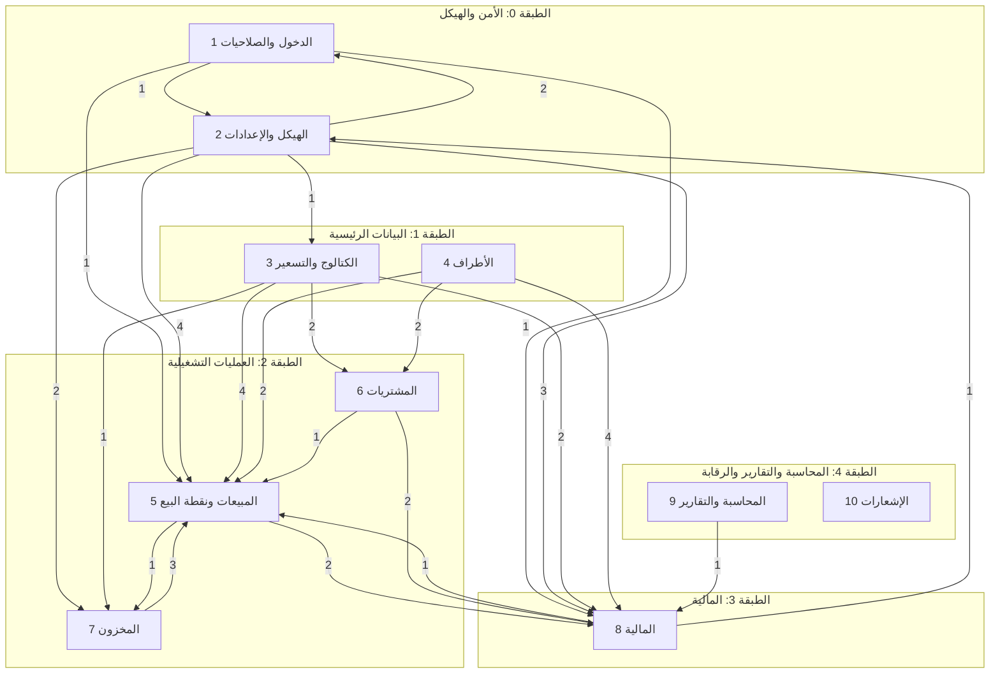
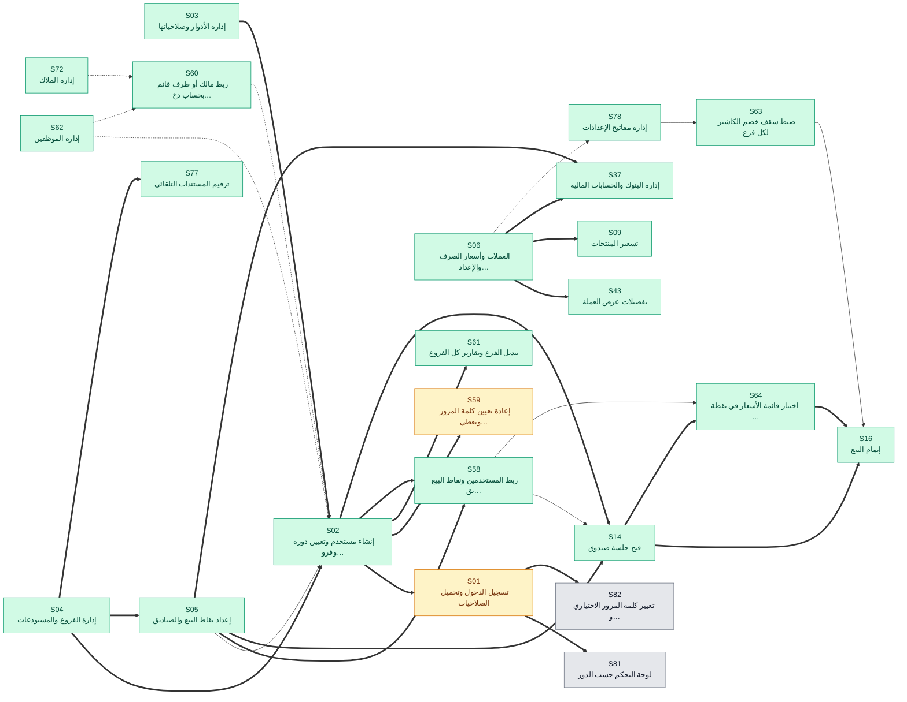
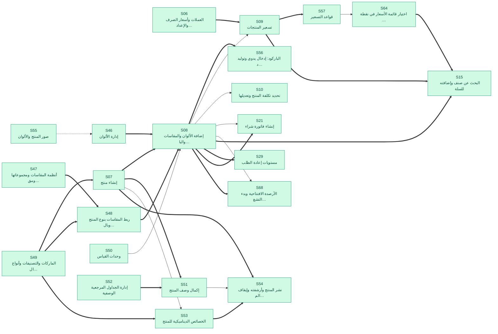
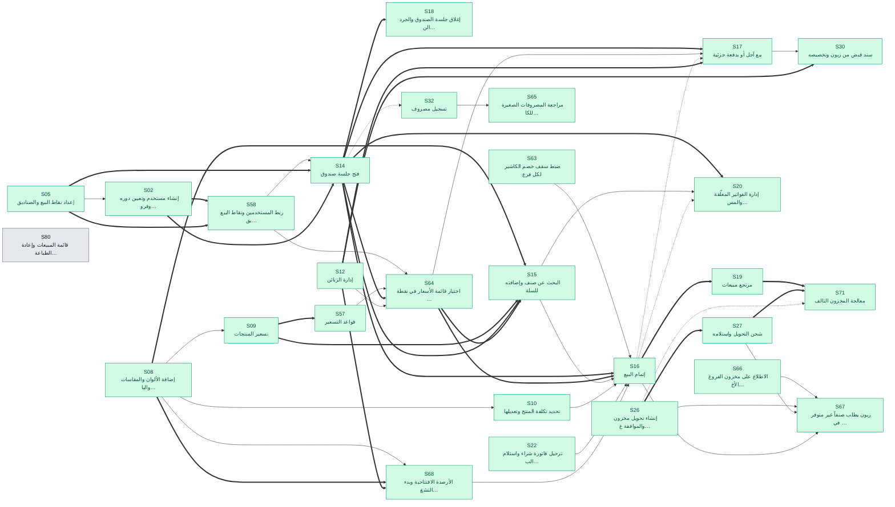
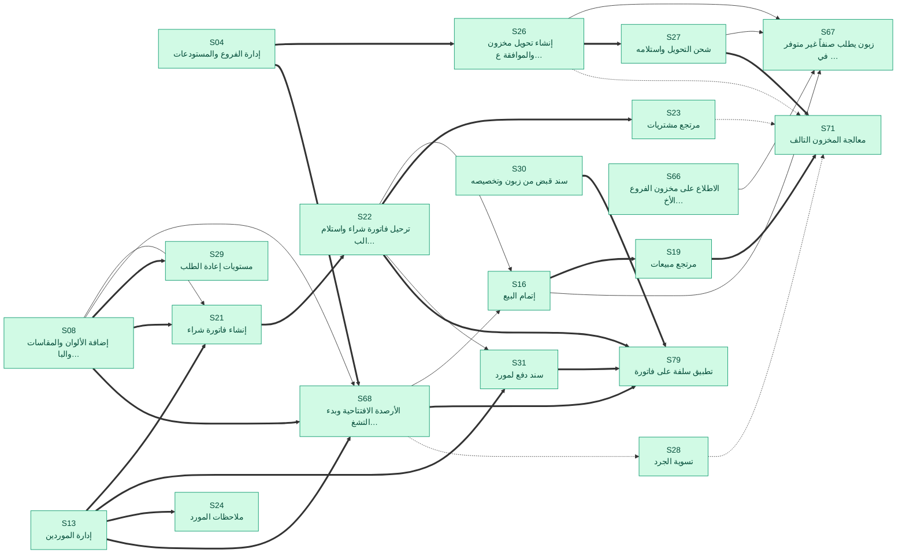
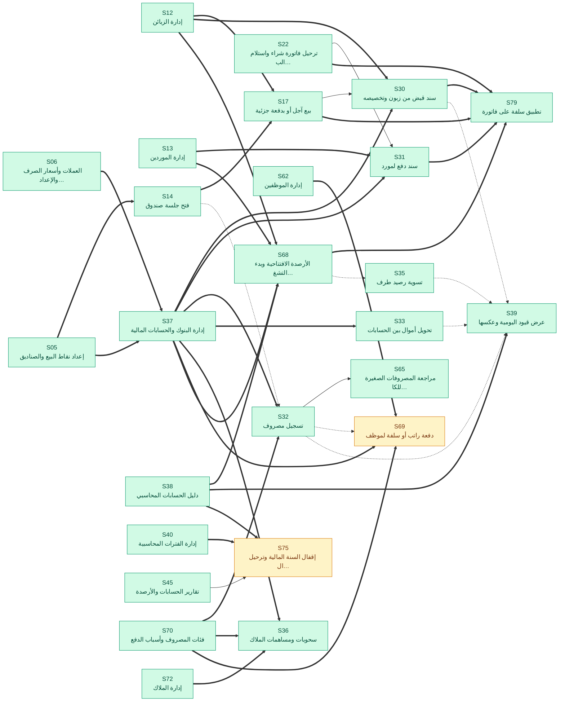
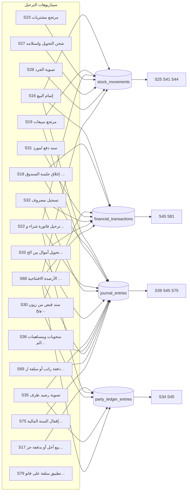

# خريطة اعتماديات نظام ERP

**ERP System Dependency Map**

نظام محاسبة وإدارة مخزون وحسابات مالية لمتجر (Flutter على ويب وموبايل وWindows، وقاعدة Supabase)

## 0. ورقة التحكم بالوثيقة

| البند | التفصيل |
| --- | --- |
| رمز الوثيقة | ERP-DEP-MAP |
| الإصدار والحالة | 1.0، مسودة للمراجعة |
| تاريخ الإعداد | 12 نوفمبر 2026 (الإصدار 1.0)، وتحديثه 15 نوفمبر 2026 (الإصدار 1.1) |
| المصدر الأساسي | ERP_Use_Case_Scenarios_AR_v1_Final.md: 81 سيناريو (حُذف S76 بقرار-62)، والملاحق أ وب وج وهـ وو وز وح وط، والأقسام 1.1 إلى 1.4. لم يعد في المصدر القسم 1.5 ولا الملحق ي (حُسمت بنودهما في القرارات 52 إلى 63) |
| المصدر المساعد | DATA_MODEL.md: مستخرج من القاعدة نفسها بتاريخ 15 نوفمبر 2026 (الجداول والدوال والـ Views وStorage وسجل الدفعة s1 إلى s6)، ويُستعمل للتحقق من البنود التي كانت «غير مؤكدة». ملف ERP_Change_Log_AR لم يُرفق في هذه المراجعة |
| ما لم يُفحص | المستودع البرمجي، وحالة تنفيذ الواجهات. القاعدة لم تُفحص مباشرة بل عبر DATA_MODEL. عند أي اختلاف مع القاعدة فالقاعدة هي المرجع (قرار-51) |
| منهج القالب | مزيج من ثلاثة أطر شائعة: (1) مصفوفة التتبع (Traceability Matrix) بروح ISO/IEC/IEEE 29148، (2) مصفوفة هيكل الاعتماد (Dependency Structure Matrix) على مستوى الوحدات، (3) مخططات Mermaid طبقية قريبة من C4 للمستوى الأعلى. القالب مستلهم من هذه الأطر وليس ادعاءً بالمطابقة الرسمية لأي منها |
| المراجع | يُعيَّن عند الاعتماد |


**سجل مراجعات الوثيقة**

| الإصدار | التاريخ | التغيير |
| --- | --- | --- |
| 1.0 | 12 نوفمبر 2026 | الإصدار الأول: استخراج الاعتماديات من النسخة الثالثة لوثيقة السيناريوهات |
| 1.1 | 15 نوفمبر 2026 | مطابقة مع «السيناريوهات v1 النهائي» (81 سيناريو) وDATA_MODEL: (1) حذف S76 وحافته E-081 بقرار-62؛ (2) ترقية E-071 (S12 ← S17) من E3 إلى E1 لأن S17 صار يذكر S12 صراحةً؛ (3) إضافة أربع حواف E-194 إلى E-197 (S09 ← S58 وS18 ← S39 وS28 ← S39 وS80 ← S20) من إحالات المتن؛ (4) إعادة حساب الأرقام والمصفوفة والمتطلَّبات الإجمالية؛ (5) إغلاق البنود التي حُسمت (قرارات 45 إلى 63)؛ (6) إضافة فجوات DATA_MODEL §13 التي تمس السيناريوهات؛ (7) تحديث قائمة التهيئة قبل أول بيع من القسم 6 في المصدر |

**فهرس الوثيقة**

1. الملخص التنفيذي
2. النطاق والمنهجية والاصطلاحات
3. الرؤية المعمارية للاعتماديات
4. مصفوفة اعتماد الوحدات
5. خرائط اعتماد السيناريوهات
6. الاعتماديات العابرة للوحدات
7. سلسلة الترحيل والأثر على البيانات
8. اعتماد الصلاحيات والأدوار
9. اعتماد الدوال والإعدادات والقرارات
10. التقارب على البيانات (الجداول المشتركة)
11. تسلسل البناء والتشغيل والمسار الحرج
12. تحليل الأثر (ماذا يتأثر عند تغيير سيناريو)
13. الاعتماديات المعلّقة وسجل المخاطر
14. فحوص الجودة وملاحظات على المصدر
15. الملاحق (أ: دليل السيناريوهات، ب: سجل الحواف، ج: ملف CSV، د: المسرد، هـ: إجراء التحديث)

## 1. الملخص التنفيذي

رُسمت **196 حافة اعتماد** بين **81 سيناريو** في 10 وحدات. منها **109 حافة ملزِمة للترتيب** (إلزامي 80، إعداد 12، تسلسل 17)، والباقي مسارات بديلة (21) وتغذية بيانات (37) وتنقل واجهة (29). رسم الحواف الملزِمة للترتيب لا يحوي دورات، فيمكن ترتيب كل السيناريوهات ترتيباً طوبولوجياً في **10 موجات بناء** (من الموجة 0 إلى الموجة 9؛ لم تتغير الموجات بحذف S76).

**أبرز النتائج**

1. **عنق الزجاجة في الهيكل (الفروع ونقاط البيع) وتعريف الكتالوج.** أكثر السيناريوهات أثراً على ما بعدها: S04 إدارة الفروع والمستودعات (34)، S05 إعداد نقاط البيع والصناديق (29)، S49 الماركات والتصنيفات وأنواع المنتجات (28)، S07 إنشاء منتج (26)، S47 أنظمة المقاسات ومجموعاتها ومقاساتها (24) (الرقم بين القوسين عدد السيناريوهات المعتمِدة عليه مباشرة أو غير مباشرة).
2. **المسار الحرج بطول 10 سيناريو:** S04 ← S05 ← S02 ← S58 ← S14 ← S64 ← S15 ← S16 ← S19 ← S71؛ أي تأخر أو تغيير في أي حلقة منه يدفع آخره.
3. **عشرة مكوّنات عابرة** (الصلاحيات، صلاحية الفرع، الفترة المحاسبية، الربط المحاسبي، الترقيم، العملة وسعر الصرف، الإعدادات، حماية المستند المرحّل، قوائم الأسعار، التدقيق) تعتمد عليها سيناريوهات كثيرة دون أن تظهر في شروطها المسبقة (القسم 6).
4. **الاعتماديات موثّقة صراحةً بضعف:** 15 سيناريو فقط من 81 يذكر رقم سيناريو سابق في «الشروط المسبقة»، و19 حافة من 196 فقط (E1) منصوصة هكذا؛ أما 102 حافة (52%) فمستنتجة من الجداول والدوال والنص (E3) وتحتاج مراجعة المحلل (القسم 14).
5. **البنود التي كانت «غير مؤكدة» حُسمت في v1 النهائي وDATA_MODEL:** S79 (دالة `apply_advance` موجودة، قرار-57)، وS55 (bucket `product-images` والدوال الأربع موجودة، قرار-63)، وعكس الجرد المخزني والنقدي S28 وS18 (قرار-59)، ومراجعة المصروف S65 (قرار-55). المتبقي «واجهة فقط» هو S44 وS80 وS81 وS82، وفجوات جديدة من DATA_MODEL §13 مذكورة في القسم 13.

## 2. النطاق والمنهجية والاصطلاحات

**النطاق:** كل سيناريو (S01 إلى S82) عقدة واحدة. الحافة تعبّر عن أن سيناريو **يحتاج** إلى سيناريو آخر ليعمل أو ليكتمل تدفّقه. لا تُرسم اعتماديات على مستوى الأعمدة أو الشاشات.

**اتجاه الحافة:** `أ ← ب` في الجداول و`أ --> ب` في المخططات تعني أن **ب يعتمد على أ** (أ متطلَّب سابق). فالأسهم تتبع اتجاه البناء والتشغيل.

**أنواع الحواف**

| الرمز | النوع | المعنى | يدخل في الترتيب الطوبولوجي |
| --- | --- | --- | --- |
| REQ | إلزامي | لا يعمل المعتمِد دون بيانات أو حالة ينتجها المتطلَّب | نعم |
| CFG | إعداد/تهيئة | يتأثر سلوك المعتمِد بإعداد أو قاعدة يضبطها المتطلَّب | نعم |
| FLOW | تسلسل عملية | المتطلَّب خطوة سابقة في المسار نفسه | نعم |
| DATA | تغذية بيانات | المعتمِد يقرأ بيانات أو Views ينتجها المتطلَّب | لا |
| ALT | مسار بديل | علاقة معالجة استثناء أو بديل (عكس، تصحيح، تمييز) | لا |
| NAV | تنقل | رابط واجهة بين شاشتين، اعتماد ضعيف | لا |

**مستويات الدليل** (تُسجَّل لكل حافة، وتبيّن مدى الثقة)

| المستوى | المعنى |
| --- | --- |
| E1 | شرط مسبق منصوص صراحةً برقم السيناريو في القسم 4 من السيناريو المعتمِد |
| E2 | إحالة صريحة في متن السيناريو (خطوة أو مسار بديل أو ملاحظة) تحدد الاتجاه |
| E3 | استنتاج من نص الشروط المسبقة أو الجداول (الملحق ب) أو الدوال أو النتائج اللاحقة (القسم 11) دون ذكر الرقم؛ يحتاج مراجعة |

**الموجة (Wave):** رتبة السيناريو في أطول سلسلة متطلَّبات ملزِمة تنتهي عنده؛ سيناريوهات الموجة نفسها لا يعتمد بعضها على بعض فيمكن بناؤها بالتوازي.

**حدود الوثيقة**

- الحواف المستنتجة (E3) من عمل المحلل لا من نص صريح، وتُراجع قبل الاعتماد.
- «الدخول إلى الشاشة» (NAV) لا يعني أن المعتمِد لا يعمل بدون المتطلَّب.
- بعض المتطلَّبات **مبذورة** في القاعدة فلا يلزم تنفيذ سيناريوها قبل غيره (الجدول في القسم 11).
- القاعدة هي المرجع (قرار-51)، فالحالات الواردة هنا (منفَّذ وغيره) منقولة من المصدر كما هي.

## 3. الرؤية المعمارية للاعتماديات

المخطط التالي يلخّص اعتماد الوحدات العشر بحسب الحواف الملزِمة للترتيب (الرقم على السهم عدد الحواف). الطبقات وصفية لتسهيل القراءة.



**قراءة المخطط**

- الطبقتان 0 و1 مصدر معظم الاعتماديات الداخلة إلى العمليات: الوحدة 1 (الدخول) والوحدة 2 (الهيكل) والوحدة 3 (الكتالوج) والوحدة 4 (الأطراف).
- **اعتماد متبادل على مستوى الوحدات** بين: الدخول والهيكل، الهيكل والمالية، المبيعات والمالية، المبيعات والمخزون؛ ومع ذلك فلا دورة على مستوى السيناريوهات (التبادل بين سيناريوهين مختلفين في كل اتجاه).
- الوحدة 10 مستهلِكة فقط. والوحدة 9 تغذّي وحدات أخرى بحواف ملزِمة عبر: S38→S68 فقط؛ وما عدا ذلك تقرأ ما تنتجه غيرها.

## 4. مصفوفة اعتماد الوحدات (DSM)

الصف = وحدة **متطلَّبة** (مصدر)، والعمود = وحدة **معتمِدة**. الخلية «ملزِم/كل الأنواع». الخلايا القطرية اعتماد داخل الوحدة نفسها.

| من \ إلى | 1 الدخول | 2 الهيكل | 3 الكتالوج | 4 الأطراف | 5 المبيعات | 6 المشتريات | 7 المخزون | 8 المالية | 9 المحاسبة | 10 الإشعارات | مجموع الصادر |
| --- | --- | --- | --- | --- | --- | --- | --- | --- | --- | --- | --- |
| **1 الدخول** | 6/12 | 1/1 | · | · | 1/1 | · | · | 1/1 | 0/1 | · | 16 |
| **2 الهيكل** | 2/2 | 5/6 | 1/2 | · | 4/4 | · | 2/2 | 3/3 | · | · | 19 |
| **3 الكتالوج** | · | 0/1 | 18/19 | · | 4/4 | 2/2 | 1/1 | 2/2 | 0/5 | · | 34 |
| **4 الأطراف** | · | · | · | · | 2/2 | 2/2 | · | 4/4 | · | · | 8 |
| **5 المبيعات** | 0/4 | · | · | · | 13/21 | · | 1/3 | 2/4 | 0/5 | · | 37 |
| **6 المشتريات** | 0/1 | · | · | · | 1/1 | 2/2 | 0/3 | 2/3 | 0/2 | 0/1 | 13 |
| **7 المخزون** | 0/5 | · | · | · | 3/4 | · | 2/7 | · | 0/3 | 0/3 | 22 |
| **8 المالية** | 0/5 | 1/1 | · | · | 1/2 | · | 0/2 | 15/21 | 0/5 | 0/1 | 37 |
| **9 المحاسبة** | 0/1 | · | · | · | · | · | · | 1/1 | 4/8 | · | 10 |
| **10 الإشعارات** | · | · | · | · | · | · | · | · | · | · | 0 |
| **مجموع الوارد** | 30 | 9 | 21 | 0 | 39 | 6 | 18 | 39 | 29 | 5 |  |


أكثر الوحدات **استهلاكاً** من غيرها (وارد من وحدات أخرى، كل الأنواع): المحاسبة (21)، ثم المبيعات والدخول والمالية (18 لكل منها). أكثرها **تغذية** لغيرها (صادر إلى وحدات أخرى): المالية والمبيعات (16 لكل منهما)، ثم الكتالوج والمخزون (15 لكل منهما). (الأرقام بعد حذف S76 وإضافة E-194 إلى E-197.)

## 5. خرائط اعتماد السيناريوهات

**مفتاح الرسوم:** لون العقدة = حالة التنفيذ الموروثة من v3 (أخضر منفَّذ، أصفر منفَّذ جزئياً، أحمر غير مؤكد، رمادي واجهة فقط). في 1.1 صارت S55 وS65 وS79 خضراء لأن DATA_MODEL يثبت وجود دواليها وbuckets الصور؛ وحُذفت S76. الحافتان الجديدتان E-195 وE-196 (من S18 وS28 إلى S39) مسجّلتان في الملحق ب فقط لأن العقدتين ليستا في رسم واحد مع S39. السهم السميك `==>` إلزامي، والعادي `-->` إعداد أو تسلسل، والمنقّط `-.->` مسار بديل. حواف DATA وNAV خارج الرسوم وتُسجَّل في الملحق ب.

### 5.1 الدخول والهيكل والإعدادات



### 5.2 الكتالوج والتسعير



### 5.3 المبيعات ونقطة البيع



### 5.4 المشتريات والمخزون



### 5.5 المالية والمحاسبة



### 5.6 المتطلَّبات المباشرة لكل سيناريو

الجدول يجمع الحواف **الملزِمة** (REQ وCFG وFLOW) فقط؛ لسجل كل الحواف بأنواعها يُنظر الملحق ب.

| السيناريو | الاسم | الوحدة | يعتمد على (مباشر) | يعتمد عليه (مباشر) |
| --- | --- | --- | --- | --- |
| S01 | تسجيل الدخول وتحميل الصلاحيات | الدخول والمستخدمون والصلاحيات | S02 | S81 S82 |
| S02 | إنشاء مستخدم وتعيين دوره وفروعه | الدخول والمستخدمون والصلاحيات | S03 S04 S05 | S01 S14 S58 S59 S61 |
| S03 | إدارة الأدوار وصلاحياتها | الدخول والمستخدمون والصلاحيات | — | S02 |
| S59 | إعادة تعيين كلمة المرور وتعطيل الحساب | الدخول والمستخدمون والصلاحيات | S02 | — |
| S60 | ربط مالك أو طرف قائم بحساب دخول | الدخول والمستخدمون والصلاحيات | — | — |
| S61 | تبديل الفرع وتقارير كل الفروع | الدخول والمستخدمون والصلاحيات | S02 | — |
| S62 | إدارة الموظفين | الدخول والمستخدمون والصلاحيات | — | S69 |
| S81 | لوحة التحكم حسب الدور | الدخول والمستخدمون والصلاحيات | S01 | — |
| S82 | تغيير كلمة المرور الاختياري وتسجيل الخروج | الدخول والمستخدمون والصلاحيات | S01 | — |
| S04 | إدارة الفروع والمستودعات | الهيكل والإعدادات | — | S02 S05 S25 S26 S68 S77 |
| S05 | إعداد نقاط البيع والصناديق | الهيكل والإعدادات | S04 | S02 S14 S37 S58 |
| S06 | العملات وأسعار الصرف والإعدادات | الهيكل والإعدادات | — | S09 S37 S43 |
| S43 | تفضيلات عرض العملة | الهيكل والإعدادات | S06 | — |
| S58 | ربط المستخدمين ونقاط البيع بقوائم الأسعار | الهيكل والإعدادات | S02 S05 | S14 S64 |
| S63 | ضبط سقف خصم الكاشير لكل فرع | الهيكل والإعدادات | S78 | S16 |
| S77 | ترقيم المستندات التلقائي | الهيكل والإعدادات | S04 | — |
| S78 | إدارة مفاتيح الإعدادات | الهيكل والإعدادات | S68 | S63 |
| S07 | إنشاء منتج | الكتالوج والتسعير | S49 | S08 S51 S53 S54 |
| S08 | إضافة الألوان والمقاسات والباركود | الكتالوج والتسعير | S07 S46 S48 S50 | S09 S10 S15 S21 S29 S56 S68 |
| S09 | تسعير المنتجات | الكتالوج والتسعير | S06 S08 | S15 S57 |
| S10 | تحديد تكلفة المنتج وتعديلها | الكتالوج والتسعير | S08 | S16 |
| S11 | إدارة الخصومات | الكتالوج والتسعير | — | — |
| S46 | إدارة الألوان | الكتالوج والتسعير | — | S08 |
| S47 | أنظمة المقاسات ومجموعاتها ومقاساتها | الكتالوج والتسعير | — | S48 |
| S48 | ربط المقاسات بنوع المنتج وبالمنتج | الكتالوج والتسعير | S47 S49 | S08 |
| S49 | الماركات والتصنيفات وأنواع المنتجات | الكتالوج والتسعير | — | S07 S48 S53 |
| S50 | وحدات القياس | الكتالوج والتسعير | — | S08 |
| S51 | إكمال وصف المنتج | الكتالوج والتسعير | S07 S52 | S54 |
| S52 | إدارة الجداول المرجعية الوصفية | الكتالوج والتسعير | — | S51 |
| S53 | الخصائص الديناميكية للمنتج | الكتالوج والتسعير | S07 S49 | S54 |
| S54 | نشر المنتج وأرشفته وإيقاف المتغير | الكتالوج والتسعير | S07 S51 S53 | — |
| S55 | صور المنتج والألوان | الكتالوج والتسعير | — | — |
| S56 | الباركود: إدخال يدوي وتوليد داخلي وطباعة الملصقات | الكتالوج والتسعير | S08 | — |
| S57 | قواعد التسعير | الكتالوج والتسعير | S09 | S64 |
| S12 | إدارة الزبائن | الأطراف (زبائن وموردون) | — | S17 S30 S64 S68 |
| S13 | إدارة الموردين | الأطراف (زبائن وموردون) | — | S21 S24 S31 S68 |
| S14 | فتح جلسة صندوق | المبيعات ونقطة البيع | S02 S05 S58 | S15 S16 S17 S18 S20 S64 |
| S15 | البحث عن صنف وإضافته للسلة | المبيعات ونقطة البيع | S08 S09 S14 S64 | S16 S20 |
| S16 | إتمام البيع | المبيعات ونقطة البيع | S10 S14 S15 S22 S63 S64 S68 | S19 S67 |
| S17 | بيع آجل أو بدفعة جزئية | المبيعات ونقطة البيع | S12 S14 S64 | S30 S79 |
| S18 | إغلاق جلسة الصندوق والجرد النقدي | المبيعات ونقطة البيع | S14 | — |
| S19 | مرتجع مبيعات | المبيعات ونقطة البيع | S16 | S71 |
| S20 | إدارة الفواتير المعلّقة والمسودات | المبيعات ونقطة البيع | S14 S15 | — |
| S64 | اختيار قائمة الأسعار في نقطة البيع | المبيعات ونقطة البيع | S12 S14 S57 S58 | S15 S16 S17 |
| S67 | زبون يطلب صنفاً غير متوفر في فرعي | المبيعات ونقطة البيع | S16 S26 S27 S66 | — |
| S80 | قائمة المبيعات وإعادة الطباعة والمشاركة | المبيعات ونقطة البيع | — | — |
| S21 | إنشاء فاتورة شراء | المشتريات | S08 S13 | S22 |
| S22 | ترحيل فاتورة شراء واستلام البضاعة | المشتريات | S21 | S16 S23 S31 S79 |
| S23 | مرتجع مشتريات | المشتريات | S22 | — |
| S24 | ملاحظات المورد | المشتريات | S13 | — |
| S25 | عرض أرصدة المخزون وحركته | المخزون | S04 | — |
| S26 | إنشاء تحويل مخزون والموافقة عليه | المخزون | S04 | S27 S67 |
| S27 | شحن التحويل واستلامه | المخزون | S26 | S67 S71 |
| S28 | تسوية الجرد | المخزون | — | — |
| S29 | مستويات إعادة الطلب | المخزون | S08 | — |
| S66 | الاطلاع على مخزون الفروع الأخرى | المخزون | — | S67 |
| S71 | معالجة المخزون التالف | المخزون | S19 S27 | — |
| S30 | سند قبض من زبون وتخصيصه | المالية | S12 S17 S37 | S79 |
| S31 | سند دفع لمورد | المالية | S13 S22 S37 | S79 |
| S32 | تسجيل مصروف | المالية | S37 S70 | S65 |
| S33 | تحويل أموال بين الحسابات | المالية | S37 | — |
| S34 | كشف حساب طرف وأرصدته | المالية | — | — |
| S35 | تسوية رصيد طرف | المالية | — | — |
| S36 | سحوبات ومساهمات الملاك | المالية | S37 S70 S72 | — |
| S37 | إدارة البنوك والحسابات المالية | المالية | S05 S06 | S30 S31 S32 S33 S36 S68 S69 |
| S65 | مراجعة المصروفات الصغيرة للكاشير | المالية | S32 | — |
| S68 | الأرصدة الافتتاحية وبدء التشغيل | المالية | S04 S08 S12 S13 S37 S38 | S16 S78 S79 |
| S69 | دفعة راتب أو سلفة لموظف | المالية | S37 S62 S70 | — |
| S70 | فئات المصروف وأسباب الدفع | المالية | — | S32 S36 S69 |
| S72 | إدارة الملاك | المالية | — | S36 |
| S79 | تطبيق سلفة على فاتورة | المالية | S17 S22 S30 S31 S68 | — |
| S38 | دليل الحسابات المحاسبي | المحاسبة والتقارير والرقابة | — | S39 S68 S75 |
| S39 | عرض قيود اليومية وعكسها | المحاسبة والتقارير والرقابة | S38 | — |
| S40 | إدارة الفترات المحاسبية | المحاسبة والتقارير والرقابة | — | S75 |
| S41 | تقارير المبيعات والمخزون | المحاسبة والتقارير والرقابة | — | — |
| S45 | تقارير الحسابات والأرصدة | المحاسبة والتقارير والرقابة | — | S75 |
| S42 | سجل التدقيق | المحاسبة والتقارير والرقابة | — | — |
| S73 | تقرير الربحية وتكلفة البضاعة المباعة | المحاسبة والتقارير والرقابة | — | — |
| S74 | تقارير إدارية إضافية | المحاسبة والتقارير والرقابة | — | — |
| S75 | إقفال السنة المالية وترحيل الأرباح المحتجزة | المحاسبة والتقارير والرقابة | S38 S40 S45 | — |
| S44 | مركز الإشعارات داخل التطبيق | الإشعارات | — | — |


## 6. الاعتماديات العابرة للوحدات

اعتماديات تعمل وقت التنفيذ داخل القاعدة أو الواجهة ولا تظهر عادةً في الشروط المسبقة. عدد المتأثرين مستخرج من نص السيناريوهات (رموز الأخطاء والدوال والجداول المذكورة فيها)، فهو حدّ أدنى لا حصر.

| المكوّن العابر | المزوِّد | عدد السيناريوهات المتأثرة (حد أدنى) | السيناريوهات (عيّنة) | الدليل في المصدر |
| --- | --- | --- | --- | --- |
| فحص الصلاحية (has_permission) | S03 (role_permissions) وS02 (user_roles) | 22 | S02 S03 S14 S16 S18 S22 S26 S30 S32 S35 S36 S39 S56 S59 … (+8) | كل دالة RPC تفحص الصلاحية داخلها (1.1)؛ ERP16 عند الغياب |
| صلاحية الفرع والمستودع | S02 (user_branch_access) | 18 | S01 S02 S04 S05 S14 S15 S16 S21 S25 S26 S27 S28 S32 S39 … (+4) | سياسات RLS: SUPER_ADMIN يتجاوز، وغيره يحتاج صفاً في user_branch_access (1.3) |
| الفترة المحاسبية | S40 (fiscal_periods) | 14 | S16 S22 S28 S30 S31 S32 S33 S35 S39 S40 S68 S69 S75 S79 | رفض الترحيل خارج الفترة المفتوحة أو في فترة مقفلة |
| الربط المحاسبي والقيد | S38 (gl_account_mappings) | 7 | S22 S38 S39 S40 S68 S70 S75 | كل ترحيل يولّد قيداً متوازناً على حسابات الدليل |
| الترقيم التلقائي | S77 (document_sequences) | 11 | S16 S19 S20 S21 S23 S24 S26 S45 S77 S79 S80 | بادئة رمز الفرع (قرار-34) |
| العملة وسعر الصرف | S06 (currencies وexchange_rates) | 10 | S06 S10 S16 S21 S30 S31 S32 S33 S39 S79 | ERP10 وERP15 وERP19 وresolve_rate |
| الإعدادات | S78 (settings) | 7 | S10 S11 S15 S16 S63 S68 S78 | مفاتيح الإعدادات الخمسة |
| حماية المستند المرحّل | protect_posted_doc وforbid_direct_post | 8 | S03 S18 S20 S21 S22 S26 S27 S28 | لا تعديل لمرحّل ولا ترحيل بـ UPDATE مباشر (قرار-43) |
| قوائم الأسعار وتطابق السعر | S58 وS09 وS57 | 7 | S09 S14 S15 S16 S57 S58 S64 | يفرضها sale_header_guard وsale_item_guard |
| التدقيق | S42 (audit_logs) | 5 | S02 S06 S42 S80 S82 | audit_logs يُكتب بالتريغر ولا يكتب فيه المستخدم (S42 القسم 9) |


**أثر عملي:** حواف هذه الاعتماديات غير مرسومة في القسم 5 كي لا تُغرق الرسوم؛ لكنها تعني أن **S02 وS03 وS38 وS40 وS06 وS78** تُختبر مع أي سيناريو ترحيل، وأن تعطيلها يوقف العمليات حتى لو كانت شروط السيناريو المسبقة مستوفاة.

## 7. سلسلة الترحيل والأثر على البيانات

مصفوفة تبيّن ما يولّده كل سيناريو مرحِّل. الرمز ● مذكور في القسم 11 (النتيجة بعد التنفيذ) أو في 1.1؛ ◐ مذكور في موضع آخر من المصدر أو ناتج عن دالة ترحيل مشتركة (post_payment)؛ الفراغ غير مذكور.

| السيناريو | الدالة | حركة مخزون | حركة مالية | سجل طرف | قيد محاسبي | ملاحظة |
| --- | --- | --- | --- | --- | --- | --- |
| S16 إتمام البيع | post_sale + post_payment | ● | ● |  | ● | sales، payments |
| S17 بيع آجل أو بدفعة جزئية | post_sale + post_payment (للدفعة) | ◐ | ◐ | ● | ◐ | دين على الزبون |
| S18 إغلاق جلسة الصندوق والجرد النقدي | post_cash_reconciliation |  | ● |  | ● | CASH_DIFFERENCE عند الفرق |
| S19 مرتجع مبيعات | post_sales_return | ● (restock) | ◐ | ◐ | ● | التالف إلى DAMAGED (قرار-45) |
| S22 ترحيل فاتورة شراء واستلام البضاعة | post_purchase_invoice | ● | ◐ | ● | ● | تكلفة بالمتوسط المرجّح |
| S23 مرتجع مشتريات | post_purchase_return | ● |  | ◐ | ◐ | تسوية عند المورد |
| S27 شحن التحويل واستلامه | ship/receive_transfer | ● |  |  |  | التالف إلى DAMAGED والناقص خسارة |
| S28 تسوية الجرد | post_stock_adjustment | ● |  |  | ◐ | القيد بحسب الإعداد |
| S30 سند قبض من زبون وتخصيصه | post_payment |  | ● | ● | ◐ | payment_allocations |
| S31 سند دفع لمورد | post_payment |  | ● | ◐ | ◐ | payment_allocations |
| S32 تسجيل مصروف | post_expense |  | ● |  | ● | حساب الفئة |
| S33 تحويل أموال بين الحسابات | post_money_transfer |  | ● |  | ● | حركتا TRANSFER |
| S35 تسوية رصيد طرف | post_balance_adjustment |  |  | ● | ● | ADJUSTMENT |
| S36 سحوبات ومساهمات الملاك | post_payment |  | ◐ |  | ● | حساب السبب |
| S68 الأرصدة الافتتاحية وبدء التشغيل | post_opening_* | ● | ● | ● | ● | أرصدة افتتاحية |
| S69 دفعة راتب أو سلفة لموظف | post_payment |  | ◐ |  | ● | EMPLOYEE_PAYMENT |
| S75 إقفال السنة المالية وترحيل الأرباح المحتجزة | قيد يدوي |  |  |  | ● | قيد إقفال السنة |
| S79 تطبيق سلفة على فاتورة | تطبيق سلفة |  |  | ◐ |  | ADVANCE_APPLICATION |


**ما يُستنتج**

- كل سيناريو ترحيل يقع بين مستهلِكَين مشتركَين: **S40** (الفترة) و**S38** (الربط المحاسبي)؛ فهما شرط تشغيلي لكل صف في الجدول.
- ثلاث جهات «تجميع»: `stock_movements` (للإضافة فقط، ERP05) وتقرأها S25 وS41 وS44، وسجل الأطراف `party_ledger_entries` وتقرأه S34 وS45، والقيود `journal_entries` وتقرأها S39 وS45 وS75.
- الصفوف الخالية من خانة القيد (S27 وS79) تستحق تأكيداً من القاعدة؛ المصدر لا يذكر قيداً لها.



## 8. اعتماد الصلاحيات والأدوار

### 8.1 الصلاحية ← السيناريوهات (من الشروط المسبقة)

| الصلاحية | المعنى | الأدوار الحاملة | عدد السيناريوهات | السيناريوهات |
| --- | --- | --- | --- | --- |
| `masterdata.manage` | إدارة البيانات الأساسية | SUPER_ADMIN MANAGER WAREHOUSE PURCHASER | 8 | S07 S46 S47 S48 S49 S50 S52 S53 |
| `users.manage` | إدارة المستخدمين والصلاحيات | SUPER_ADMIN | 6 | S02 S03 S58 S59 S60 S74 |
| `accounting.view` | عرض المحاسبة | SUPER_ADMIN MANAGER ACCOUNTANT AUDITOR | 5 | S25 S34 S39 S45 S65 |
| `reports.view` | عرض التقارير | SUPER_ADMIN MANAGER ACCOUNTANT PURCHASER AUDITOR | 5 | S25 S34 S41 S45 S74 |
| `accounting.manage` | إدارة دليل الحسابات وربط الحسابات | SUPER_ADMIN ACCOUNTANT | 4 | S38 S40 S68 S70 |
| `pricing.manage` | إدارة الأسعار والخصومات | SUPER_ADMIN MANAGER | 4 | S09 S11 S57 S63 |
| `finance.payments` | سندات القبض والدفع | SUPER_ADMIN MANAGER CASHIER ACCOUNTANT PURCHASER | 3 | S30 S31 S79 |
| `parties.manage` | إدارة الأطراف | SUPER_ADMIN MANAGER CASHIER ACCOUNTANT PURCHASER | 3 | S12 S13 S24 |
| `purchasing.create` | إنشاء فواتير شراء | SUPER_ADMIN MANAGER PURCHASER | 3 | S13 S21 S24 |
| `catalog.manage` | إدارة المنتجات | SUPER_ADMIN MANAGER WAREHOUSE PURCHASER | 2 | S07 S56 |
| `finance.expenses` | المصاريف | SUPER_ADMIN MANAGER CASHIER ACCOUNTANT | 2 | S32 S65 |
| `finance.manage` | إدارة العملات والصناديق | SUPER_ADMIN ACCOUNTANT | 2 | S68 S70 |
| `finance.view` | عرض الحسابات المالية والأرصدة | SUPER_ADMIN MANAGER ACCOUNTANT AUDITOR | 2 | S34 S45 |
| `inventory.view_other_branches` | الاطلاع على مخزون الفروع الأخرى | SUPER_ADMIN MANAGER CASHIER WAREHOUSE PURCHASER | 2 | S66 S67 |
| `owner.transactions` | سحوبات ومساهمات المالك | SUPER_ADMIN ACCOUNTANT | 2 | S36 S72 |
| `pos.manage` | إدارة أجهزة نقاط البيع وكل الورديات | SUPER_ADMIN MANAGER | 2 | S05 S58 |
| `accounting.post` | قيود يدوية وإغلاق فترات | SUPER_ADMIN ACCOUNTANT | 1 | S75 |
| `audit.view` | عرض سجل التدقيق | SUPER_ADMIN MANAGER ACCOUNTANT AUDITOR | 1 | S42 |
| `balance.adjust` | تسويات أرصدة الأطراف | SUPER_ADMIN ACCOUNTANT | 1 | S35 |
| `costs.manage` | تعديل التكاليف | SUPER_ADMIN MANAGER ACCOUNTANT | 1 | S10 |
| `costs.view` | عرض التكاليف | SUPER_ADMIN MANAGER ACCOUNTANT PURCHASER AUDITOR | 1 | S73 |
| `fx.rate.manage` | إدارة أسعار الصرف | SUPER_ADMIN ACCOUNTANT | 1 | S06 |
| `hr.manage` | إدارة الموظفين | SUPER_ADMIN | 1 | S62 |
| `hr.view` | عرض الموظفين | SUPER_ADMIN MANAGER ACCOUNTANT AUDITOR | 1 | S62 |
| `inventory.adjust` | جرد وتسويات | SUPER_ADMIN MANAGER WAREHOUSE | 1 | S28 |
| `inventory.transfer` | تحويل مخزون | SUPER_ADMIN MANAGER WAREHOUSE | 1 | S26 |
| `inventory.transfer.approve` | اعتماد التحويلات | SUPER_ADMIN MANAGER WAREHOUSE | 1 | S26 |
| `inventory.view` | عرض المخزون | SUPER_ADMIN MANAGER CASHIER WAREHOUSE ACCOUNTANT PURCHASER AUDITOR | 1 | S25 |
| `org.manage` | إدارة الفروع والمستودعات | SUPER_ADMIN | 1 | S04 |
| `parties.view` | عرض الأطراف | SUPER_ADMIN MANAGER CASHIER ACCOUNTANT PURCHASER AUDITOR | 1 | S34 |
| `pos.session` | فتح/إغلاق وردية | SUPER_ADMIN MANAGER CASHIER | 1 | S14 |
| `purchasing.post` | ترحيل فواتير شراء | SUPER_ADMIN MANAGER PURCHASER | 1 | S22 |
| `purchasing.view` | عرض المشتريات | SUPER_ADMIN MANAGER WAREHOUSE ACCOUNTANT PURCHASER AUDITOR | 1 | S24 |
| `reconcile.cash` | جرد الصندوق وتسوية فروقاته | SUPER_ADMIN MANAGER CASHIER ACCOUNTANT | 1 | S18 |
| `sales.create` | إنشاء مبيعات | SUPER_ADMIN MANAGER CASHIER | 1 | S16 |
| `sales.return` | مرتجع مبيعات | SUPER_ADMIN MANAGER CASHIER | 1 | S19 |
| `sales.view` | عرض المبيعات | SUPER_ADMIN MANAGER CASHIER ACCOUNTANT AUDITOR | 1 | S80 |
| `settings.manage` | إدارة الإعدادات | SUPER_ADMIN | 1 | S78 |


صلاحيات في القاموس (الملحق ز) لا ترد في الشروط المسبقة لأي سيناريو: `discount.exceptional` `fx.rate.manual` `payment.cancel` `purchasing.return` `sales.discount` `sales.post` `warehouse.central.access`. بعضها يُفحص داخل الدوال (مثل `payment.cancel` و`discount.exceptional`) ولا يظهر في الشروط.

### 8.2 الأدوار ← السيناريوهات (الملحق أ)

| الدور | منفّذ رئيسي ● | مطّلع أو ثانوي ○ | السيناريوهات الرئيسية (عيّنة) |
| --- | --- | --- | --- |
| SUPER_ADMIN | 20 | 4 | S01 S02 S03 S04 S05 S06 S42 S43 S58 S59 … (+10) |
| MANAGER | 44 | 16 | S01 S05 S07 S08 S09 S10 S11 S12 S14 S15 … (+34) |
| CASHIER | 18 | 7 | S01 S12 S14 S15 S16 S17 S18 S19 S20 S30 … (+8) |
| WAREHOUSE | 24 | 6 | S01 S07 S08 S25 S26 S27 S28 S43 S44 S46 … (+14) |
| ACCOUNTANT | 29 | 17 | S01 S06 S10 S30 S31 S32 S33 S34 S35 S36 … (+19) |
| PURCHASER | 24 | 6 | S01 S07 S08 S13 S21 S22 S23 S24 S29 S43 … (+14) |
| AUDITOR | 12 | 46 | S01 S25 S34 S39 S41 S42 S43 S45 S73 S74 … (+2) |


### 8.3 اعتماد على دور واحد (Single-role dependency)

سيناريوهات منفّذها الرئيسي دور واحد بحسب الملحق أ. غياب هذا الدور (أو خطؤه في الإعداد) يوقف السيناريو دون بديل.

| الدور | عدد السيناريوهات | السيناريوهات |
| --- | --- | --- |
| ACCOUNTANT | 12 | S31 S33 S35 S36 S37 S38 S40 S65 S69 S70 S75 S79 |
| SUPER_ADMIN | 7 | S02 S03 S04 S59 S60 S62 S78 |
| PURCHASER | 5 | S13 S21 S22 S23 S24 |
| MANAGER | 3 | S09 S11 S57 |
| WAREHOUSE | 2 | S26 S27 |


من بين 7 سيناريو يختص بها SUPER_ADMIN: S02 S03 S04 S78 يعتمد عليها **5 سيناريوهات فأكثر** (تهيئة النظام تتوقف على حساب واحد).

## 9. اعتماد الدوال والإعدادات والقرارات

### 9.1 دوال RPC الأساسية ← السيناريوهات المستدعية

| الدالة | عدد السيناريوهات التي تذكرها | السيناريوهات |
| --- | --- | --- |
| `post_payment` | 8 | S14 S16 S22 S30 S31 S36 S69 S79 |
| `post_sale` | 6 | S10 S11 S16 S17 S67 S73 |
| `resolve_price` | 5 | S09 S15 S57 S64 S74 |
| `branch_stock_lookup` | 4 | S15 S25 S66 S67 |
| `get_my_access` | 4 | S01 S05 S61 S81 |
| `refresh_draft_line_prices` | 3 | S16 S20 S64 |
| `admin_provision_user` | 3 | S01 S02 S60 |
| `complete_password_change` | 3 | S01 S59 S82 |
| `post_purchase_return` | 2 | S23 S71 |
| `ship_transfer` | 2 | S26 S27 |
| `receive_transfer` | 2 | S04 S27 |
| `reverse_payment` | 2 | S30 S31 |
| `reverse_expense` | 2 | S32 S65 |
| `set_discount_cap` | 2 | S11 S63 |
| `get_draft_price_warnings` | 2 | S16 S20 |
| `get_allowed_price_lists` | 2 | S58 S64 |
| `assert_session_open` | 2 | S14 S16 |
| `post_purchase_invoice` | 1 | S22 |
| `post_sales_return` | 1 | S19 |
| `post_expense` | 1 | S32 |
| `post_money_transfer` | 1 | S33 |
| `post_balance_adjustment` | 1 | S35 |
| `post_stock_adjustment` | 1 | S28 |
| `post_cash_reconciliation` | 1 | S18 |
| `approve_transfer` | 1 | S26 |
| `cancel_transfer` | 1 | S26 |
| `post_opening_stock` | 1 | S68 |
| `post_opening_cash` | 1 | S68 |
| `post_opening_party_balance` | 1 | S68 |
| `opening_readiness` | 1 | S68 |
| `reverse_balance_adjustment` | 1 | S35 |
| `reverse_money_transfer` | 1 | S33 |
| `reverse_journal_entry` | 1 | S39 |
| `set_model_price` | 1 | S09 |
| `set_variant_cost` | 1 | S10 |
| `set_model_cost` | 1 | S10 |
| `generate_internal_barcode` | 1 | S56 |
| `ensure_fiscal_year` | 1 | S40 |
| `generate_fiscal_year` | 1 | S40 |
| `resolve_rate` | 1 | S10 |


دوال غير مذكورة في أي سيناريو (حسب بحث النص): لا يوجد.

### 9.2 مفاتيح الإعدادات ← السيناريوهات

| المفتاح | القيمة الابتدائية | القرار | السيناريوهات التي تذكره |
| --- | --- | --- | --- |
| `NEGATIVE_STOCK_POLICY` | BLOCK | قرار-22 | S78 |
| `COST_METHOD` | LAST | قرار-23 | S10 S78 |
| `REQUIRE_COST_ON_SALE` | N ثم Y بعد S68 | قرار-24 | S15 S16 S68 S78 |
| `DISCOUNT_MAX_PERCENT` | 10 | قرار-12 | S11 S63 S78 |
| `TIMEZONE` | Asia/Damascus | قرار-25 | S78 |


ملاحظة: `NEGATIVE_STOCK_POLICY` يرد في S78 وحده نصاً، لكن أثره (ERP04 INSUFFICIENT_STOCK) يظهر في S15 وS16 وS23 وS28 وS71؛ فهو اعتماد سلوكي غير مرئي من نص هذه السيناريوهات.

### 9.3 القرارات ← السيناريوهات (الملحق ط)

القرارات الأوسع أثراً (بحسب عدد السيناريوهات المرتبطة في الملحق ط). تغيير قرار منها يستدعي مراجعة كل السيناريوهات المقابلة.

| القرار | النص (مختصر) | عدد السيناريوهات | السيناريوهات |
| --- | --- | --- | --- |
| قرار-06 | إدارة الكتالوج: MANAGER وPURCHASER وWAREHOUSE | 13 | S07 S08 S46 S47 S48 S49 S50 S51 S52 S53 S54 S55 S56 |
| قرار-44 | العكس بمستند معاكس مرتبط بالأصل عبر reversal_of، ولا إلغاء مباشر لمستن… | 6 | S30 S31 S32 S33 S35 S39 |
| قرار-43 | لا ترحيل بـ UPDATE مباشر لمستندات المصروف والتحويل المالي وتسوية الرصي… | 5 | S18 S28 S32 S33 S35 |
| قرار-23 | السعر من آخر شراء بنسبة، والربح من المتوسط، ويُعرض العمودان | 4 | S09 S10 S57 S73 |
| قرار-17 | أمين المستودع المرسل يوافق على التحويل ، والتالف لمستودع تالف | 3 | S26 S27 S71 |
| قرار-20 | القيود عرض وعكس فقط ، والمحاسب يغلق الفترة ويقفلها ، وإقفال السنة يدوي | 3 | S39 S40 S75 |
| قرار-33 | قوائم الأسعار: ربط المستخدم ونقطة البيع مع فرض داخل القاعدة | 3 | S57 S58 S64 |
| قرار-37 | حساب المستخدم: اسم مستخدم بإيميل داخلي مخفي، وكلمة مؤقتة بتغيير إجباري | 3 | S01 S02 S59 |
| قرار-42 | الاستلام صارم للتالف: لا يُوجَّه التالف إلا إلى مستودع DAMAGED الفعّال… | 3 | S04 S27 S71 |
| قرار-46 | أنواع الدفعات مقيَّدة بالصلاحيات: OWNER_WITHDRAWAL وOWNER_CONTRIBUTION… | 3 | S31 S36 S69 |
| قرار-50 | فئات الرواتب: EXP-SAL لأجور لا ترتبط بموظف مسجّل (عمالة مؤقتة، وكالات)… | 3 | S32 S69 S70 |
| قرار-04 | اختيار الفرع في كل دخول | 2 | S01 S61 |
| قرار-08 | تعليق الفاتورة في نقطة البيع | 2 | S15 S20 |
| قرار-12 | خصم الكاشير حتى سقف يحدده المدير | 2 | S16 S63 |
| قرار-15 | لا إلغاء لفاتورة مرحّلة، المرتجع فقط | 2 | S19 S20 |
| قرار-16 | شراء: الدفع عند الترحيل أو لاحقاً ، وPURCHASER يرحّل بنفسه | 2 | S22 S31 |
| قرار-19 | المصروف ينشئه ويرحّله المحاسب ، والكاشير مصروف صغير بلا سقف مع مراجعة | 2 | S32 S65 |
| قرار-22 | المخزون السالب ممنوع | 2 | S66 S78 |
| قرار-24 | لا بيع بلا تكلفة | 2 | S68 S78 |
| قرار-27 | اللون بسيط افتراضياً ومركّب اختيارياً | 2 | S08 S46 |
| قرار-28 | المقاسات موروثة من نوع المنتج مع إخفاء أو إضافة | 2 | S47 S48 |
| قرار-38 | مالك يعمل بالنظام على الطرف نفسه | 2 | S60 S72 |
| قرار-40 | تعدد الأدوار مدعوم والمدير يبيع بلا دور ثانٍ | 2 | S02 S14 |
| قرار-45 | المرتجع التالف (DAMAGED أو DEFECTIVE مع restock) يدخل مستودع DAMAGED ف… | 2 | S19 S71 |
| قرار-47 | الفترات المحاسبية تُولَّد عند الطلب ضمن نافذة سنة سابقة إلى سنتين قادم… | 2 | S40 S75 |
| قرار-48 | جلسة OPEN واحدة لكل كاشير، ويجوز لعدة كاشيرين فتح جلسات على النقطة نفس… | 2 | S14 S16 |
| قرار-03 | العرض حسب display_preferences مع أفضلية عملة الفاتورة | 1 | S43 |
| قرار-05 | المدير يعيد تعيين كلمة المرور | 1 | S59 |
| قرار-10 | دفع بوسائل وعملات متعددة مع باقٍ بعملة أخرى | 1 | S16 |
| قرار-11 | تجاوز حد الائتمان تحذير فقط | 1 | S17 |
| قرار-13 | إغلاق الجلسة بيد الكاشير أو المدير والفرق يُرحَّل تلقائياً | 1 | S18 |
| قرار-14 | الكاشير يختار طريقة الاسترداد | 1 | S19 |
| قرار-18 | تسوية الجرد بلا موافقة | 1 | S28 |
| قرار-21 | إشعارات داخل التطبيق | 1 | S44 |
| قرار-25 | المنطقة الزمنية Asia/Damascus | 1 | S78 |
| قرار-26 | وحدات القياس وصفية بلا تحويل | 1 | S50 |
| قرار-29 | الخصائص الديناميكية ضمن النسخة الأولى (بعد إلغاء التأجيل) | 1 | S53 |
| قرار-30 | الباركود يدوي أو داخلي مع طباعة | 1 | S56 |
| قرار-31 | الأرصدة الافتتاحية عبر معالج داخل التطبيق | 1 | S68 |
| قرار-32 | الرواتب والسلف: تسجيل دفعات فقط، والنظام الكامل للنسخة الثانية | 1 | S69 |
| قرار-34 | ترقيم المستندات ببادئة رمز الفرع | 1 | S77 |
| قرار-36 | الشراء من مستودع فرع آخر ممنوع، والحل تحويل ثم بيع | 1 | S67 |
| قرار-39 | مدير بعدة فروع: تبديل فرع في العمليات وكل الفروع في التقارير | 1 | S61 |
| قرار-41 | تكرار مسح الباركود يزيد الكمية في السطر نفسه | 1 | S15 |
| قرار-49 | ملاحظة سعر الصرف إلزامية عند source = manual فقط | 1 | S06 |
| قرار-01 | ربط الأدوار بالصلاحيات | عام | عام |
| قرار-02 | العمل متصل بالإنترنت حالياً | عام | عام |
| قرار-07 | التكلفة يراها حتى AUDITOR | عام | عام |
| قرار-09 | الكاشير ينشئ ويرحّل بنفسه | عام | عام |
| قرار-51 | عند أي اختلاف بين هذه الوثيقة والقاعدة فالقاعدة هي المرجع، وتُعدَّل ال… | عام | عام |


## 10. التقارب على البيانات (الجداول المشتركة)

جداول تستخدمها عدة سيناريوهات بحسب الملحق ب. تغيير بنية أي منها يتطلب مراجعة كل سيناريو مدرج. الجدول الذي يستخدمه سيناريوهان من وحدتين مختلفتين نقطة تقارب بين الوحدات.

| الجدول أو View | عدد السيناريوهات | عدد الوحدات | السيناريوهات |
| --- | --- | --- | --- |
| `inventory_balances` | 10 | 4 | S15 S22 S25 S27 S28 S29 S44 S66 S67 S71 |
| `product_variants` | 10 | 4 | S08 S10 S15 S21 S25 S26 S29 S50 S54 S56 |
| `sales` | 9 | 3 | S15 S16 S17 S19 S20 S64 S77 S79 S80 |
| `payments` | 8 | 2 | S16 S19 S30 S31 S36 S69 S79 S80 |
| `parties` | 7 | 3 | S12 S13 S34 S35 S60 S62 S72 |
| `payment_lines` | 6 | 2 | S16 S30 S31 S36 S69 S80 |
| `purchase_invoices` | 6 | 3 | S21 S22 S23 S24 S44 S79 |
| `stock_transfers` | 6 | 4 | S26 S27 S44 S67 S71 S81 |
| `users` | 6 | 2 | S01 S02 S42 S59 S60 S82 |
| `financial_accounts` | 5 | 1 | S30 S31 S32 S33 S37 |
| `party_ledger_entries` | 5 | 2 | S17 S34 S35 S68 S79 |
| `payment_reasons` | 5 | 1 | S33 S35 S36 S69 S70 |
| `price_lists` | 5 | 4 | S09 S12 S57 S58 S64 |
| `sale_items` | 4 | 2 | S16 S20 S73 S80 |
| `stock_movements` | 5 | 3 | S22 S25 S27 S28 S68 |
| `currencies` | 4 | 3 | S06 S13 S34 S43 |
| `customers` | 4 | 2 | S12 S17 S64 S80 |
| `employees` | 4 | 2 | S02 S60 S62 S69 |
| `financial_transactions` | 4 | 2 | S18 S32 S33 S68 |
| `journal_entries` | 4 | 2 | S39 S40 S68 S75 |
| `payment_allocations` | 4 | 2 | S17 S30 S31 S79 |
| `settings` | 4 | 2 | S06 S11 S63 S78 |
| `suppliers` | 4 | 2 | S13 S21 S23 S24 |
| `variant_costs` | 4 | 4 | S10 S22 S68 S73 |
| `warehouses` | 4 | 2 | S04 S25 S26 S66 |


إجمالي الجداول والـ Views المذكورة في الملحق ب: 132.

## 11. تسلسل البناء والتشغيل والمسار الحرج

### 11.1 موجات البناء

كل موجة تضم سيناريوهات لا يعتمد بعضها على بعض اعتماداً ملزِماً؛ تبدأ كل موجة بعد اكتمال متطلَّباتها من الموجات السابقة.

| الموجة | العدد | السيناريوهات |
| --- | --- | --- |
| 0 | 29 | S03 إدارة الأدوار وصلاحياتها، S04 إدارة الفروع والمستودعات، S06 العملات وأسعار الصرف والإعدادات، S11 إدارة الخصومات، S12 إدارة الزبائن، S13 إدارة الموردين، S28 تسوية الجرد، S34 كشف حساب طرف وأرصدته، S35 تسوية رصيد طرف، S38 دليل الحسابات المحاسبي، S40 إدارة الفترات المحاسبية، S41 تقارير المبيعات والمخزون، S42 سجل التدقيق، S44 مركز الإشعارات داخل التطبيق، S45 تقارير الحسابات والأرصدة، S46 إدارة الألوان، S47 أنظمة المقاسات ومجموعاتها ومقاساتها، S49 الماركات والتصنيفات وأنواع المنتجات، S50 وحدات القياس، S52 إدارة الجداول المرجعية الوصفية، S55 صور المنتج والألوان، S60 ربط مالك أو طرف قائم بحساب دخول، S62 إدارة الموظفين، S66 الاطلاع على مخزون الفروع الأخرى، S70 فئات المصروف وأسباب الدفع، S72 إدارة الملاك، S73 تقرير الربحية وتكلفة البضاعة المباعة، S74 تقارير إدارية إضافية، S80 قائمة المبيعات وإعادة الطباعة والمشاركة |
| 1 | 10 | S05 إعداد نقاط البيع والصناديق، S07 إنشاء منتج، S24 ملاحظات المورد، S25 عرض أرصدة المخزون وحركته، S26 إنشاء تحويل مخزون والموافقة عليه، S39 عرض قيود اليومية وعكسها، S43 تفضيلات عرض العملة، S48 ربط المقاسات بنوع المنتج وبالمنتج، S75 إقفال السنة المالية وترحيل الأرباح المحتجزة، S77 ترقيم المستندات التلقائي |
| 2 | 6 | S02 إنشاء مستخدم وتعيين دوره وفروعه، S08 إضافة الألوان والمقاسات والباركود، S27 شحن التحويل واستلامه، S37 إدارة البنوك والحسابات المالية، S51 إكمال وصف المنتج، S53 الخصائص الديناميكية للمنتج |
| 3 | 15 | S01 تسجيل الدخول وتحميل الصلاحيات، S09 تسعير المنتجات، S10 تحديد تكلفة المنتج وتعديلها، S21 إنشاء فاتورة شراء، S29 مستويات إعادة الطلب، S32 تسجيل مصروف، S33 تحويل أموال بين الحسابات، S36 سحوبات ومساهمات الملاك، S54 نشر المنتج وأرشفته وإيقاف المتغير، S56 الباركود: إدخال يدوي وتوليد داخلي وطباعة الملصقات، S58 ربط المستخدمين ونقاط البيع بقوائم الأسعار، S59 إعادة تعيين كلمة المرور وتعطيل الحساب، S61 تبديل الفرع وتقارير كل الفروع، S68 الأرصدة الافتتاحية وبدء التشغيل، S69 دفعة راتب أو سلفة لموظف |
| 4 | 7 | S14 فتح جلسة صندوق، S22 ترحيل فاتورة شراء واستلام البضاعة، S57 قواعد التسعير، S65 مراجعة المصروفات الصغيرة للكاشير، S78 إدارة مفاتيح الإعدادات، S81 لوحة التحكم حسب الدور، S82 تغيير كلمة المرور الاختياري وتسجيل الخروج |
| 5 | 5 | S18 إغلاق جلسة الصندوق والجرد النقدي، S23 مرتجع مشتريات، S31 سند دفع لمورد، S63 ضبط سقف خصم الكاشير لكل فرع، S64 اختيار قائمة الأسعار في نقطة البيع |
| 6 | 2 | S15 البحث عن صنف وإضافته للسلة، S17 بيع آجل أو بدفعة جزئية |
| 7 | 3 | S16 إتمام البيع، S20 إدارة الفواتير المعلّقة والمسودات، S30 سند قبض من زبون وتخصيصه |
| 8 | 3 | S19 مرتجع مبيعات، S67 زبون يطلب صنفاً غير متوفر في فرعي، S79 تطبيق سلفة على فاتورة |
| 9 | 1 | S71 معالجة المخزون التالف |

### 11.2 المسار الحرج

أطول سلسلة متطلَّبات ملزِمة:


طولها 10 سيناريو، وهي تعبر الوحدات: الهيكل، الهيكل، الدخول، الهيكل، المبيعات، المبيعات، المبيعات، المبيعات، المبيعات، المخزون.

### 11.3 المتطلَّبات المبذورة في القاعدة (لا تحتاج تنفيذ سيناريوها أولاً)

بحسب القسم 1.1: القاعدة مبذورة بالبيانات التالية، فحواف اعتماد سيناريوهاتها «مستوفاة مسبقاً» عند أول تشغيل، ويبقى السيناريو للإدارة اللاحقة.

| المبذور | العدد أو القيمة | السيناريو المنتِج | يخفّف اعتماد |
| --- | --- | --- | --- |
| الأدوار والصلاحيات وربطها | 7 أدوار، 46 صلاحية، 151 ربطاً (DATA_MODEL §2) | S03 | S02 |
| الإعدادات الأولية | مفاتيح S78 الخمسة | S78 | S63 وS16 وS15 |
| مستودع تالف لكل فرع | DAMAGED | S04 | S19 وS27 وS71 (قرار-42 وقرار-45) |
| العملة الأساسية | USD | S06 | S43 وS09 وS37 |
| قوائم الأسعار | RETAIL-SYP (افتراضية) وRETAIL-USD وWHOLESALE-SYP وWHOLESALE-USD (S09) | S09 وS58 | S15 وS16 وS64 |
| الفترات المحاسبية | 24 فترة (يناير 2026 إلى ديسمبر 2027)، وتُولَّد ما بعدها عند الطلب (قرار-47) | S40 | كل ترحيل |
| دليل الحسابات والربط | 51 حساباً و24 ربطاً | S38 | كل ترحيل، S68 |
| فئات المصروف وأسباب الدفع | 8 فئات و13 سبباً | S70 | S32 وS36 وS69 |
| المستخدم admin | SUPER_ADMIN | S02 | S01 |


### 11.4 قائمة التهيئة التشغيلية قبل أول بيع

مأخوذة من «قائمة التشغيل قبل الإطلاق» (القسم 6 في v1 النهائي) وحواف الاعتماد أعلاه، بترتيب التبعية:

| الخطوة | الإجراء | السيناريو | المصدر |
| --- | --- | --- | --- |
| 1 | تفعيل حماية كلمات المرور المسرَّبة في Supabase Auth (إعداد خارجي) | S02 وS59 وS82 | القسم 6 v1، وDATA_MODEL §13 |
| 2 | حذف Edge Function باسم `quick-service` (قالب Hello غير مستعمل) | — | القسم 6 v1، وDATA_MODEL §11 |
| 3 | إنشاء مستودع DAMAGED لكل فرع جديد (يُرفض استلام التالف وترحيل المرتجع التالف بـ ERP22 بدونه) | S04 | القسم 6 v1، وقرار-42 وقرار-45 |
| 4 | إدخال قواعد التسعير ونسبة الجملة، ثم حذف قاعدة TEST-CAP-MU20 | S57 | القسم 6 v1 |
| 5 | ربط المستخدمين ونقاط البيع بقوائم الأسعار | S58 | القسم 6 v1، وقرار-33 |
| 6 | إدخال الأرصدة الافتتاحية بتكاليفها (مخزون، نقد، أطراف) | S68 | القسم 6 v1، وقرار-24 وقرار-31 |
| 7 | ضبط `REQUIRE_COST_ON_SALE = Y` بعد اكتمال الأرصدة | S78 | القسم 6 v1، وقرار-24 |
| 8 | حذف بيانات الاختبار (4 منتجات و4 فواتير) | — | القسم 6 v1 |
| 9 | الاختبارات السلوكية بمستخدم حقيقي لكل دور (جدول القبول في v1) | كل المسارات الحرجة | القسم 6 v1 |

## 12. تحليل الأثر (ماذا يتأثر عند تغيير سيناريو)

السيناريوهات الأكثر أثراً بحسب عدد المعتمِدين عليها مباشرة وغير مباشرة (حواف REQ وCFG وFLOW). عند تعديل أي منها يُعاد اختبار المعتمِدين المباشرين على الأقل.

| السيناريو | حالة التنفيذ | معتمِدون مباشرون | معتمِدون إجمالاً | المعتمِدون المباشرون |
| --- | --- | --- | --- | --- |
| S04 إدارة الفروع والمستودعات | منفَّذ | 6 | 34 | S02 S05 S25 S26 S68 S77 |
| S05 إعداد نقاط البيع والصناديق | منفَّذ | 4 | 29 | S02 S14 S37 S58 |
| S49 الماركات والتصنيفات وأنواع المنتجات | منفَّذ | 3 | 28 | S07 S48 S53 |
| S07 إنشاء منتج | منفَّذ | 4 | 26 | S08 S51 S53 S54 |
| S47 أنظمة المقاسات ومجموعاتها ومقاساتها | منفَّذ | 1 | 24 | S48 |
| S06 العملات وأسعار الصرف والإعدادات | منفَّذ | 3 | 23 | S09 S37 S43 |
| S46 إدارة الألوان | منفَّذ | 1 | 23 | S08 |
| S48 ربط المقاسات بنوع المنتج وبالمنتج | منفَّذ | 1 | 23 | S08 |
| S50 وحدات القياس | منفَّذ | 1 | 23 | S08 |
| S08 إضافة الألوان والمقاسات والباركود | منفَّذ | 7 | 22 | S09 S10 S15 S21 S29 S56 S68 |
| S03 إدارة الأدوار وصلاحياتها | منفَّذ | 1 | 19 | S02 |
| S02 إنشاء مستخدم وتعيين دوره وفروعه | منفَّذ | 5 | 18 | S01 S14 S58 S59 S61 |


**كيف تُستعمل الجداول:** لتقدير أثر تعديل سيناريو X: (1) المتطلَّبات والمعتمِدون في 5.6، (2) المكوّنات العابرة في القسم 6 إن كان X مزوِّداً لها، (3) الجداول المشتركة في القسم 10، (4) القرارات المرتبطة في 9.3.


### 12.1 اعتماد على المتطلَّبات (أكثر السيناريوهات حاجةً لغيرها)

| السيناريو | متطلَّبات مباشرة | متطلَّبات إجمالاً (سلسلة كاملة) | الموجة |
| --- | --- | --- | --- |
| S67 زبون يطلب صنفاً غير متوفر في فرعي | 4 | 32 | 8 |
| S71 معالجة المخزون التالف | 2 | 32 | 9 |
| S19 مرتجع مبيعات | 1 | 29 | 8 |
| S16 إتمام البيع | 7 | 28 | 7 |
| S79 تطبيق سلفة على فاتورة | 5 | 27 | 8 |
| S30 سند قبض من زبون وتخصيصه | 3 | 20 | 7 |
| S20 إدارة الفواتير المعلّقة والمسودات | 2 | 19 | 7 |
| S15 البحث عن صنف وإضافته للسلة | 4 | 18 | 6 |
| S17 بيع آجل أو بدفعة جزئية | 3 | 18 | 6 |
| S64 اختيار قائمة الأسعار في نقطة البيع | 4 | 17 | 5 |


## 13. الاعتماديات المعلّقة وسجل المخاطر

بنود مفتوحة أو مؤجلة أو غير مكتملة في النسخة الثالثة (1.5 والملحق ي) مربوطة بسيناريوهاتها، مع حالتها بعد مطابقتها مع v1 النهائي وDATA_MODEL (عمود «الحالة في 1.1»؛ استُبدل عمود الخطورة لأن أغلب البنود حُسم)، مع أثرها على ما يعتمد عليها. «المعتمِدون اللاحقون» عدد السيناريوهات المعتمِدة على السيناريو المتأثر بحواف ملزِمة، و«نطاق الانتشار» (واسع حين 8 فأكثر) يقيس اتساع الاعتماد البنيوي فقط ولا يقيس الخطورة التشغيلية أو أولوية الإصلاح.

| المرجع | البند | السيناريوهات المتأثرة | الأثر اللاحق | الحالة في 1.1 |
| --- | --- | --- | --- | --- |
| 1.5/1 | الكاشير يملك parties.manage كاملة | S12 | 13: S15 S16 S17 S19 S20 S30 S63 S64 … (+5) | **محلول**: قرار-52، الكاشير يحمل parties.quick_add ويضيف الزبون بـ quick_add_customer فقط |
| 1.5/2 | admin_provision_user تمنح can_operate واحدة لكل الفروع | S02 | 18: S01 S14 S15 S16 S17 S18 S19 S20 … (+10) | **محلول**: قرار-53، p_branches بمفتاحي can_view وcan_operate لكل فرع، وفرع واحد على الأقل (ERP22) |
| 1.5/3 | hr.manage لـ SUPER_ADMIN فقط | S62 | 1: S69 | **محلول**: قرار-54، hr.manage للمدير وSUPER_ADMIN |
| 1.5/4 | لا جدول إشعارات حقيقي (حساب حي) | S44 | 0 | **خارج v1** (القسم 5 في المصدر) |
| 1.5/5 وي.2 | حالة مراجعة المصروف الصغير بلا عمود | S65 | 0 | **محلول**: قرار-55، reviewed_by وreviewed_at وreview_note مع mark_expense_reviewed وlist_expenses_for_review |
| 1.5/6 | REQUIRE_COST_ON_SALE = N حتى اكتمال الأرصدة | S68 S78 | 6: S16 S19 S63 S67 S71 S79 | **مفتوح تشغيلياً** (قائمة التهيئة 11.4، الخطوة 7) |
| 1.5/7 | لا قواعد تسعير ولا نسبة جملة | S57 | 10: S15 S16 S17 S19 S20 S30 S64 S67 … (+2) | **مفتوح تشغيلياً** (الخطوة 4) |
| 1.5/8 | user_price_lists وpos_terminal_price_lists فارغان | S58 | 12: S14 S15 S16 S17 S18 S19 S20 S30 … (+4) | **مفتوح تشغيلياً** (الخطوة 5) |
| 1.5/9 | حماية كلمات المرور المسرَّبة معطّلة (إعداد خارجي) | S02 S59 S82 | 16: S01 S14 S15 S16 S17 S18 S19 S20 … (+8) | **مفتوح** (الخطوة 1) |
| 1.5/11 | مطابقة رسائل الملحقين هـ وو مع error_codes | الملحقان هـ وو | كل سيناريو فيه القسم 8 | **لم يُتحقق منه** في هذه المراجعة (DATA_MODEL §5 فيه 29 رمزاً) |
| 1.5/12 | القفل بعد المحاولات الفاشلة وتدقيق LOGIN | S01 S42 S59 | 2: S81 S82 | **خارج v1**: قرار-61 |
| 1.5/13 | الإقفال الآلي للسنة والرواتب الكاملة | S69 S75 | 0 | **خارج v1**: S75 قيد يدوي وS69 دفعات فقط |
| ي.2 | صور المنتج والألوان: لا Storage bucket | S55 | 0 | **محلول**: قرار-63، bucket عام `product-images` والدوال attach_*/delete_* (DATA_MODEL §10 و§11) |
| ي.3 | دالة تطبيق السلفة غير مؤكدة | S79 | 0 | **محلول**: قرار-57، `apply_advance` وlist_party_advances وget_party_advance_balance (الدفعة s2) |
| ي.3 | لا عكس لتسوية الجرد ولا للجرد النقدي | S18 S28 | 0 | **محلول**: قرار-59، reverse_stock_adjustment وreverse_cash_reconciliation |
| ي.3 | مرتجع تالف مع restock = false بلا حركة مخزون | S19 | 1: S71 | **محلول بقرار-45**: المرتجع التالف يدخل مستودع DAMAGED آلياً ويُرفض بـ ERP22 إن لم يوجد (يُتحقق في اختبار القبول) |
| ي.3 | استثناء pos.manage في ملكية الجلسة بلا فحص الفرع | S14 S16 | 10: S15 S17 S18 S19 S20 S30 S64 S67 … (+2) | **محلول**: قرار-48 وقرار-60، assert_session_owner(p_session, p_branch)، ERP16 «هذه الوردية تخص كاشيراً آخر ولا يجوز استعمالها» |
| ي.3 | نافذة الفترات أوسع من نص ق-8 | S40 | 1: S75 | **محلول**: قرار-47، نافذة سنة سابقة إلى سنتين قادمتين، وخارجها ERP08 |
| ي.3 | v_variant_list_prices: لا سجل تاريخي ولا سعر مستقبلي لزوج له سعر ساري | S74 | 0 | **لم يُتحقق منه** |
| ي.3 | reverse_journal_entry ترفض القيد المرتبط بمستند | S39 | 0 | **بالتصميم** (قرار-44): يُعكس المستند نفسه، وقد أُضيفت E-195 وE-196 لتوثيق ذلك |
| DM §13/1 | لا عمود `payment_number` في `payments`؛ الرقم في `reference_number` والسلف القديمة تُعرض `PAY-<id>` | S30 S31 S79 | 0 | **جديد، مفتوح**: يؤثر على عرض رقم السند في الشاشات |
| DM §13/2 | `list_party_advances` تُصفّي بفروع القراءة بينما `apply_advance` يستهلك سلف الطرف من أي فرع | S79 | 0 | **جديد، مفتوح**: «المتاح» في رسالة ERP22 قد يختلف عمّا تعرضه الواجهة |
| DM §13/3 | استبدال إيصال المصروف لا يحذف الملف القديم من bucket | S32 | 0 | **جديد، مقبول مؤقتاً** |
| DM §13/6 | `v_open_documents` لا تخصم المرتجعات بينما `erp.doc_due_paid` تخصمها | S45 S30 S79 | 0 | **جديد، مفتوح**: تقرير «المستندات المفتوحة» قد يخالف المبلغ المستحق لفاتورة لها مرتجع مرحّل |
| DM §13/4 | نص ERP01 ما زال يقول «مُرحَّل أو ملغى» ولا يذكر REVERSED | كل المستندات المرحّلة | 0 | **جديد، تجميلي**: رسالة الواجهة تُعرض كما هي (قاعدة الرسائل) |
| DM §13/5 | Edge Function `quick-service` قالب غير مستعمل | — | 0 | **قرار الحذف متخذ** (الخطوة 2 في 11.4) |

### 13.1 اعتماديات على بنود ليست «منفَّذ»

حواف يكون فيها المتطلَّب (أو المعتمِد) في حالة تنفيذ غير مكتملة بحسب الحالة الموروثة من v3. بعد حذف S76 وحسم S55 لم يبق إلا:

| المتطلَّب | حالته | المعتمِد | نسخة المعتمِد | نوع الحافة |
| --- | --- | --- | --- | --- |
| S01 تسجيل الدخول وتحميل الصلاحيات | منفَّذ جزئياً، نسخة 1 | S81 لوحة التحكم حسب الدور | 1 | إلزامي |
| S01 تسجيل الدخول وتحميل الصلاحيات | منفَّذ جزئياً، نسخة 1 | S82 تغيير كلمة المرور الاختياري وتسجيل الخروج | 1 | إلزامي |

لم يعد في الرسم حافة تربط سيناريو من النسخة 1 بسيناريو من النسخة 2 (كانت S55 → S46 وS76 → S16).

## 14. فحوص الجودة وملاحظات على المصدر

### 14.1 فحوص الرسم

| الفحص | النتيجة |
| --- | --- |
| خلو الحواف الملزِمة من الدورات | ناجح (ترتيب طوبولوجي كامل لـ 81 من 81، أُعيد الحساب في 1.1) |
| حواف مكررة | لا يوجد |
| حواف تشير إلى سيناريو غير موجود | لا يوجد (كل الطرفين ضمن S01 إلى S82 باستثناء S76 المحذوف) |
| توزيع الحواف حسب النوع | REQ 80، CFG 12، FLOW 17، DATA 37، ALT 21، NAV 29 |
| توزيع الحواف حسب الدليل | E1 19، E2 75، E3 102 |
| سيناريوهات بلا أي حافة ملزِمة | S11 S28 S34 S35 S41 S42 S44 S55 S60 S73 S74 S80 |
| سيناريوهات بلا متطلَّب ملزِم (جذور) | S03 S04 S06 S11 S12 S13 S28 S34 S35 S38 S40 S41 S42 S44 S45 S46 S47 S49 S50 S52 S55 S60 S62 S66 S70 S72 S73 S74 S80 |
| سيناريوهات بلا معتمِد ملزِم (أوراق) | S11 S18 S20 S23 S24 S25 S28 S29 S33 S34 S35 S36 S39 S41 S42 S43 S44 S54 S55 S56 S59 S60 S61 S65 S67 S69 S71 S73 S74 S75 S77 S79 S80 S81 S82 |


### 14.2 مطابقة E1 مع المصدر

كل شرط مسبق منصوص برقم سيناريو في المصدر (19 إشارة في 15 سيناريو) له حافة E1 مقابلة (الإضافة الجديدة: S17 يذكر S12 صراحةً فارتفعت E-071 من E3 إلى E1)، ولا حافة E1 بلا نص. مخالفات: 0.

### 14.3 ملاحظات على الوثيقة المصدر (للتحسين)

1. **الشروط المسبقة بلا أرقام سيناريوهات.** من 81 سيناريو 66 لا يذكر سيناريو سابقاً صراحةً، مع أن سلاسل واضحة تعتمد عليه (مثل S16 على S14 وS15، وS22 على S21، وS19 على S16). يُقترح إضافة حقل «متطلَّبات (سيناريوهات)» إلى قالب السيناريو يملؤه المؤلّف، فتتحول حواف E3 إلى E1.
2. **إحالات متبادلة في المتن** بين S26 وS67 وبين S66 وS67 وبين S19 وS71 وبين S32 وS69 وS70؛ هي مسارات استخدام لا اعتماد دائري، وقد عُولجت هنا بحواف FLOW وALT وNAV باتجاه واحد.
3. **اعتماديات عابرة** (القسم 6) غير ممثَّلة في أي سيناريو بوصفها متطلَّباً. يُقترح قسم «اعتماديات النظام» في الوثيقة أو ربطها بقرار-51.
4. **شروط مسبقة غير مؤكدة بنص «افتراض»:** S31 (رصيد كافٍ في الحساب المالي)، S79 (السلفة بعملة الدفع ERP10)، S44 (الإشعار يُحسب من البيانات الحالية). لم تُرسم لها حواف اعتماد خاصة.
5. **S81 وS80 وS82 وS44 «واجهة فقط»:** لا يقابلها جدول أو دالة؛ تعتمد على Views وجداول سيناريوهات أخرى فقط (حواف DATA وNAV).

## 15. الملاحق

### الملحق أ: دليل السيناريوهات (الموجة والمقاييس)

مقاييس الاقتران على الحواف **الملزِمة**: «وارد» عدد المتطلَّبات المباشرة، «صادر» عدد المعتمِدين المباشرين، «أثر» عدد المعتمِدين إجمالاً.

**ملاحظة 1.1:** عمودا «حالة التنفيذ» و«نسخة» موروثان من فهرس v3 ولم يعودا في فهرس v1 النهائي (الحالة هناك: جديد أو محدَّث أو كما هو). لم يُعدَّل منهما إلا ما حسمه DATA_MODEL: S55 وS65 وS79 («منفَّذ (قاعدة)» تعني أن الدوال والجداول والـ buckets موجودة في القاعدة؛ حالة الواجهة لم تُفحص). حُذف الصف S76.

| الرقم | السيناريو | الوحدة | أولوية | حالة التنفيذ | نسخة | موجة | وارد | صادر | أثر |
| --- | --- | --- | --- | --- | --- | --- | --- | --- | --- |
| S01 | تسجيل الدخول وتحميل الصلاحيات | الدخول | 1 | منفَّذ جزئياً | 1 | 3 | 1 | 2 | 2 |
| S02 | إنشاء مستخدم وتعيين دوره وفروعه | الدخول | 1 | منفَّذ | 1 | 2 | 3 | 5 | 18 |
| S03 | إدارة الأدوار وصلاحياتها | الدخول | 1 | منفَّذ | 1 | 0 | 0 | 1 | 19 |
| S59 | إعادة تعيين كلمة المرور وتعطيل الحساب | الدخول | 1 | منفَّذ جزئياً | 1 | 3 | 1 | 0 | 0 |
| S60 | ربط مالك أو طرف قائم بحساب دخول | الدخول | 2 | منفَّذ | 1 | 0 | 0 | 0 | 0 |
| S61 | تبديل الفرع وتقارير كل الفروع | الدخول | 1 | منفَّذ | 1 | 3 | 1 | 0 | 0 |
| S62 | إدارة الموظفين | الدخول | 2 | منفَّذ | 1 | 0 | 0 | 1 | 1 |
| S81 | لوحة التحكم حسب الدور | الدخول | 2 | واجهة فقط | 1 | 4 | 1 | 0 | 0 |
| S82 | تغيير كلمة المرور الاختياري وتسجيل الخروج | الدخول | 2 | واجهة فقط | 1 | 4 | 1 | 0 | 0 |
| S04 | إدارة الفروع والمستودعات | الهيكل | 2 | منفَّذ | 1 | 0 | 0 | 6 | 34 |
| S05 | إعداد نقاط البيع والصناديق | الهيكل | 2 | منفَّذ | 1 | 1 | 1 | 4 | 29 |
| S06 | العملات وأسعار الصرف والإعدادات | الهيكل | 2 | منفَّذ | 1 | 0 | 0 | 3 | 23 |
| S43 | تفضيلات عرض العملة | الهيكل | 2 | منفَّذ | 1 | 1 | 1 | 0 | 0 |
| S58 | ربط المستخدمين ونقاط البيع بقوائم الأسعار | الهيكل | 1 | منفَّذ | 1 | 3 | 2 | 2 | 12 |
| S63 | ضبط سقف خصم الكاشير لكل فرع | الهيكل | 1 | منفَّذ | 1 | 5 | 1 | 1 | 4 |
| S77 | ترقيم المستندات التلقائي | الهيكل | 3 | منفَّذ | 1 | 1 | 1 | 0 | 0 |
| S78 | إدارة مفاتيح الإعدادات | الهيكل | 1 | منفَّذ | 1 | 4 | 1 | 1 | 5 |
| S07 | إنشاء منتج | الكتالوج | 1 | منفَّذ | 1 | 1 | 1 | 4 | 26 |
| S08 | إضافة الألوان والمقاسات والباركود | الكتالوج | 1 | منفَّذ | 1 | 2 | 4 | 7 | 22 |
| S09 | تسعير المنتجات | الكتالوج | 2 | منفَّذ | 1 | 3 | 2 | 2 | 11 |
| S10 | تحديد تكلفة المنتج وتعديلها | الكتالوج | 2 | منفَّذ | 1 | 3 | 1 | 1 | 4 |
| S11 | إدارة الخصومات | الكتالوج | 3 | منفَّذ | 1 | 0 | 0 | 0 | 0 |
| S46 | إدارة الألوان | الكتالوج | 1 | منفَّذ | 1 | 0 | 0 | 1 | 23 |
| S47 | أنظمة المقاسات ومجموعاتها ومقاساتها | الكتالوج | 1 | منفَّذ | 1 | 0 | 0 | 1 | 24 |
| S48 | ربط المقاسات بنوع المنتج وبالمنتج | الكتالوج | 1 | منفَّذ | 1 | 1 | 2 | 1 | 23 |
| S49 | الماركات والتصنيفات وأنواع المنتجات | الكتالوج | 1 | منفَّذ | 1 | 0 | 0 | 3 | 28 |
| S50 | وحدات القياس | الكتالوج | 1 | منفَّذ | 1 | 0 | 0 | 1 | 23 |
| S51 | إكمال وصف المنتج | الكتالوج | 2 | منفَّذ | 1 | 2 | 2 | 1 | 1 |
| S52 | إدارة الجداول المرجعية الوصفية | الكتالوج | 2 | منفَّذ | 1 | 0 | 0 | 1 | 2 |
| S53 | الخصائص الديناميكية للمنتج | الكتالوج | 2 | منفَّذ | 1 | 2 | 2 | 1 | 1 |
| S54 | نشر المنتج وأرشفته وإيقاف المتغير | الكتالوج | 2 | منفَّذ | 1 | 3 | 3 | 0 | 0 |
| S55 | صور المنتج والألوان | الكتالوج | 3 | منفَّذ (قاعدة) | 1 | 0 | 0 | 0 | 0 |
| S56 | الباركود: إدخال يدوي وتوليد داخلي وطباعة الملصقات | الكتالوج | 2 | منفَّذ | 1 | 3 | 1 | 0 | 0 |
| S57 | قواعد التسعير | الكتالوج | 1 | منفَّذ | 1 | 4 | 1 | 1 | 10 |
| S12 | إدارة الزبائن | الأطراف | 2 | منفَّذ | 1 | 0 | 0 | 4 | 13 |
| S13 | إدارة الموردين | الأطراف | 2 | منفَّذ | 1 | 0 | 0 | 4 | 13 |
| S14 | فتح جلسة صندوق | المبيعات | 1 | منفَّذ | 1 | 4 | 3 | 6 | 11 |
| S15 | البحث عن صنف وإضافته للسلة | المبيعات | 1 | منفَّذ | 1 | 6 | 4 | 2 | 5 |
| S16 | إتمام البيع | المبيعات | 1 | منفَّذ | 1 | 7 | 7 | 2 | 3 |
| S17 | بيع آجل أو بدفعة جزئية | المبيعات | 2 | منفَّذ | 1 | 6 | 3 | 2 | 2 |
| S18 | إغلاق جلسة الصندوق والجرد النقدي | المبيعات | 1 | منفَّذ | 1 | 5 | 1 | 0 | 0 |
| S19 | مرتجع مبيعات | المبيعات | 1 | منفَّذ | 1 | 8 | 1 | 1 | 1 |
| S20 | إدارة الفواتير المعلّقة والمسودات | المبيعات | 2 | منفَّذ | 1 | 7 | 2 | 0 | 0 |
| S64 | اختيار قائمة الأسعار في نقطة البيع | المبيعات | 1 | منفَّذ | 1 | 5 | 4 | 3 | 9 |
| S67 | زبون يطلب صنفاً غير متوفر في فرعي | المبيعات | 1 | منفَّذ | 1 | 8 | 4 | 0 | 0 |
| S80 | قائمة المبيعات وإعادة الطباعة والمشاركة | المبيعات | 2 | واجهة فقط | 1 | 0 | 0 | 0 | 0 |
| S21 | إنشاء فاتورة شراء | المشتريات | 1 | منفَّذ | 1 | 3 | 2 | 1 | 8 |
| S22 | ترحيل فاتورة شراء واستلام البضاعة | المشتريات | 1 | منفَّذ | 1 | 4 | 1 | 4 | 7 |
| S23 | مرتجع مشتريات | المشتريات | 2 | منفَّذ | 1 | 5 | 1 | 0 | 0 |
| S24 | ملاحظات المورد | المشتريات | 3 | منفَّذ | 1 | 1 | 1 | 0 | 0 |
| S25 | عرض أرصدة المخزون وحركته | المخزون | 1 | منفَّذ | 1 | 1 | 1 | 0 | 0 |
| S26 | إنشاء تحويل مخزون والموافقة عليه | المخزون | 1 | منفَّذ | 1 | 1 | 1 | 2 | 3 |
| S27 | شحن التحويل واستلامه | المخزون | 2 | منفَّذ | 1 | 2 | 1 | 2 | 2 |
| S28 | تسوية الجرد | المخزون | 1 | منفَّذ | 1 | 0 | 0 | 0 | 0 |
| S29 | مستويات إعادة الطلب | المخزون | 3 | منفَّذ | 1 | 3 | 1 | 0 | 0 |
| S66 | الاطلاع على مخزون الفروع الأخرى | المخزون | 1 | منفَّذ | 1 | 0 | 0 | 1 | 1 |
| S71 | معالجة المخزون التالف | المخزون | 2 | منفَّذ | 1 | 9 | 2 | 0 | 0 |
| S30 | سند قبض من زبون وتخصيصه | المالية | 1 | منفَّذ | 1 | 7 | 3 | 1 | 1 |
| S31 | سند دفع لمورد | المالية | 1 | منفَّذ | 1 | 5 | 3 | 1 | 1 |
| S32 | تسجيل مصروف | المالية | 1 | منفَّذ | 1 | 3 | 2 | 1 | 1 |
| S33 | تحويل أموال بين الحسابات | المالية | 2 | منفَّذ | 1 | 3 | 1 | 0 | 0 |
| S34 | كشف حساب طرف وأرصدته | المالية | 1 | منفَّذ | 1 | 0 | 0 | 0 | 0 |
| S35 | تسوية رصيد طرف | المالية | 3 | منفَّذ | 1 | 0 | 0 | 0 | 0 |
| S36 | سحوبات ومساهمات الملاك | المالية | 3 | منفَّذ | 1 | 3 | 3 | 0 | 0 |
| S37 | إدارة البنوك والحسابات المالية | المالية | 2 | منفَّذ | 1 | 2 | 2 | 7 | 15 |
| S65 | مراجعة المصروفات الصغيرة للكاشير | المالية | 2 | منفَّذ (قاعدة) | 1 | 4 | 1 | 0 | 0 |
| S68 | الأرصدة الافتتاحية وبدء التشغيل | المالية | 1 | منفَّذ | 1 | 3 | 6 | 3 | 7 |
| S69 | دفعة راتب أو سلفة لموظف | المالية | 2 | منفَّذ جزئياً | 1 | 3 | 3 | 0 | 0 |
| S70 | فئات المصروف وأسباب الدفع | المالية | 2 | منفَّذ | 1 | 0 | 0 | 3 | 4 |
| S72 | إدارة الملاك | المالية | 2 | منفَّذ | 1 | 0 | 0 | 1 | 1 |
| S79 | تطبيق سلفة على فاتورة | المالية | 2 | منفَّذ (قاعدة) | 1 | 8 | 5 | 0 | 0 |
| S38 | دليل الحسابات المحاسبي | المحاسبة | 2 | منفَّذ | 1 | 0 | 0 | 3 | 10 |
| S39 | عرض قيود اليومية وعكسها | المحاسبة | 2 | منفَّذ | 1 | 1 | 1 | 0 | 0 |
| S40 | إدارة الفترات المحاسبية | المحاسبة | 2 | منفَّذ | 1 | 0 | 0 | 1 | 1 |
| S41 | تقارير المبيعات والمخزون | المحاسبة | 2 | منفَّذ | 1 | 0 | 0 | 0 | 0 |
| S45 | تقارير الحسابات والأرصدة | المحاسبة | 2 | منفَّذ | 1 | 0 | 0 | 1 | 1 |
| S42 | سجل التدقيق | المحاسبة | 1 | منفَّذ جزئياً | 1 | 0 | 0 | 0 | 0 |
| S73 | تقرير الربحية وتكلفة البضاعة المباعة | المحاسبة | 2 | منفَّذ | 1 | 0 | 0 | 0 | 0 |
| S74 | تقارير إدارية إضافية | المحاسبة | 3 | منفَّذ | 1 | 0 | 0 | 0 | 0 |
| S75 | إقفال السنة المالية وترحيل الأرباح المحتجزة | المحاسبة | 3 | منفَّذ جزئياً | 1 | 1 | 3 | 0 | 0 |
| S44 | مركز الإشعارات داخل التطبيق | الإشعارات | 2 | واجهة فقط | 1 | 0 | 0 | 0 | 0 |


### الملحق ب: سجل الحواف

العمود «من» المتطلَّب و«إلى» المعتمِد. «الأساس» موضع الدليل في المصدر. **1.1:** حُذفت E-081 (S76 ← S16) ولم يُعَد استعمال معرّفها، وأُضيفت E-194 إلى E-197، وارتفعت E-071 إلى E1.

| المعرّف | من (متطلَّب) | إلى (معتمِد) | النوع | الدليل | الأساس |
| --- | --- | --- | --- | --- | --- |
| E-001 | S04 | S02 | REQ | E3 | user_branch_access يتطلب فروعاً قائمة (S01 القسم 4) |
| E-002 | S03 | S02 | REQ | E3 | الدور يُعيَّن من roles وrole_permissions (S03 القسم 4) |
| E-003 | S02 | S01 | REQ | E3 | الحساب يُنشأ بـ admin_provision_user (S01 القسم 4) |
| E-004 | S02 | S59 | REQ | E3 | إعادة التعيين والتعطيل تفترض حساباً قائماً |
| E-005 | S02 | S61 | REQ | E3 | S61 القسم 4: أكثر من صف في user_branch_access |
| E-006 | S01 | S81 | REQ | E1 | S81 القسم 4: دخول ناجح وفرع محدد (S01) |
| E-007 | S01 | S82 | REQ | E3 | S82 القسم 4: جلسة دخول صالحة |
| E-008 | S60 | S02 | ALT | E1 | S02 القسم 4: ربط طرف موجود كمالك ← S60 |
| E-009 | S62 | S02 | ALT | E2 | S62 خطوة 4: حساب الدخول ← S02 أو S60 |
| E-010 | S62 | S60 | ALT | E2 | S62 خطوة 4 |
| E-011 | S72 | S60 | ALT | E2 | S72 خطوة 4: حساب الدخول ← S60 |
| E-012 | S01 | S59 | NAV | E2 | S01: نسيان كلمة المرور ← S59 |
| E-013 | S01 | S61 | NAV | E2 | S01: مستخدم بعدة فروع ← S61 |
| E-014 | S59 | S82 | NAV | E2 | S82: التغيير الإجباري بعد إعادة التعيين ← S01 وS59 |
| E-015 | S04 | S05 | REQ | E3 | S05 القسم 4: فرع ومستودع قابل للبيع موجودان |
| E-016 | S05 | S02 | CFG | E2 | S02: user_pos_terminals (من S05) |
| E-017 | S02 | S58 | REQ | E2 | S58: المستخدم الجديد يُسنَد القائمة الافتراضية (S02) |
| E-018 | S05 | S58 | REQ | E3 | pos_terminal_price_lists تتطلب نقاط بيع |
| E-019 | S58 | S14 | CFG | E1 | S14 القسم 4: قائمة أسعار مسموحة (S58) |
| E-020 | S58 | S64 | CFG | E1 | S64 القسم 4: قائمة مسموحة واحدة على الأقل (S58) |
| E-021 | S05 | S14 | REQ | E3 | S14 القسم 4: الكاشير معيّن على نقطة بيع |
| E-022 | S02 | S14 | REQ | E3 | user_pos_terminals تُنشأ عند إنشاء المستخدم (S02) |
| E-023 | S06 | S43 | REQ | E3 | S43 القسم 4: العملات معرّفة وفعّالة |
| E-024 | S06 | S09 | REQ | E3 | S09 القسم 4: عملات معرّفة |
| E-025 | S06 | S37 | REQ | E3 | S37 القسم 4: العملات معرّفة |
| E-026 | S06 | S78 | ALT | E2 | S06: مفاتيح الإعدادات تفصَّل في S78 |
| E-027 | S78 | S63 | CFG | E2 | DISCOUNT_MAX_PERCENT في S78 يُعدَّل بـ S63 |
| E-028 | S63 | S16 | CFG | E3 | ERP26: سقف الخصم يُفرض عند الترحيل (S16 القسم 8) |
| E-029 | S63 | S11 | NAV | E2 | S11: سقف الكاشير يُضبط في S63 |
| E-030 | S04 | S77 | REQ | E3 | S77 القسم 4: للفرع رمز (code) |
| E-031 | S49 | S07 | REQ | E3 | S07 القسم 4: product_types معرّفة؛ الإضافة السريعة ← S49 |
| E-032 | S07 | S08 | REQ | E3 | S08 القسم 4: المنتج موجود |
| E-033 | S46 | S08 | REQ | E1 | S08 القسم 4: الألوان معرّفة (S46) |
| E-034 | S48 | S08 | REQ | E1 | S08 القسم 4: المقاسات موروثة (S48) |
| E-035 | S50 | S08 | CFG | E2 | S08 خطوة 3: unit_id من وحدات S50 |
| E-036 | S47 | S48 | REQ | E1 | S48 القسم 4: مجموعات المقاسات معرّفة (S47) |
| E-037 | S49 | S48 | REQ | E2 | S48 خطوة 1: يفتح نوع منتج (S49) |
| E-038 | S52 | S51 | REQ | E1 | S51 القسم 4: الجداول الوصفية معرّفة (S52) |
| E-039 | S07 | S51 | REQ | E3 | S51 القسم 4: المنتج موجود |
| E-040 | S07 | S53 | FLOW | E2 | S07 خطوة 5: يعبّئ الوصف والخصائص (S51 وS53) |
| E-041 | S49 | S53 | REQ | E3 | S49 خطوة 5: ربط النوع بالخصائص (product_type_attributes) |
| E-042 | S51 | S54 | FLOW | E2 | S07 خطوة 5: ثم ينشر عند الجاهزية (S54) |
| E-043 | S53 | S54 | REQ | E3 | S54 القسم 4 وERP28: الخصائص الإلزامية قبل النشر |
| E-044 | S07 | S54 | REQ | E3 | S54 القسم 4: المنتج موجود بحالة draft |
| E-045 | S08 | S56 | REQ | E3 | S56 القسم 4: المتغير موجود |
| E-046 | S08 | S09 | FLOW | E2 | S08: السعر ← S09 |
| E-047 | S08 | S10 | FLOW | E2 | S08: التكلفة ← S10 |
| E-048 | S08 | S21 | FLOW | E2 | S08: الكميات ← S21 |
| E-049 | S08 | S68 | FLOW | E2 | S08: الكميات ← S68 |
| E-050 | S09 | S57 | REQ | E1 | S57 القسم 4: قوائم الأسعار موجودة (S09) |
| E-051 | S57 | S64 | CFG | E2 | S64: صنف بلا سعر جملة يُحسب بقاعدة الجملة (S57) |
| E-052 | S57 | S73 | NAV | E2 | S73: سعر البيع من آخر شراء (S57) |
| E-053 | S57 | S74 | NAV | E2 | S74: الأسعار المحسوبة تُعاين بـ resolve_price (S57) |
| E-054 | S08 | S15 | REQ | E3 | S15: بحث بالباركود والمتغير |
| E-055 | S09 | S15 | REQ | E3 | S15 القسم 4: للمتغير سعر في القائمة (ERP25) |
| E-056 | S55 | S46 | ALT | E2 | S46 خطوة 6: صور اللون (لاحقاً) تتطلب Storage (S55، مؤجل) |
| E-057 | S08 | S29 | REQ | E3 | S29 القسم 4: متغيرات فعّالة |
| E-058 | S14 | S15 | REQ | E3 | S15 القسم 4: جلسة صندوق مفتوحة |
| E-059 | S14 | S16 | REQ | E3 | S16 القسم 4: جلسة OPEN |
| E-060 | S14 | S17 | REQ | E3 | S17 القسم 4: جلسة مفتوحة |
| E-061 | S14 | S18 | REQ | E3 | S18 القسم 4: جلسة OPEN |
| E-062 | S14 | S64 | REQ | E3 | S64 القسم 4: جلسة مفتوحة |
| E-063 | S14 | S20 | REQ | E3 | S20 القسم 4: فاتورة DRAFT من جلسة الكاشير نفسه |
| E-064 | S64 | S15 | REQ | E1 | S15 القسم 4: قائمة أسعار مسموحة (S64) |
| E-065 | S64 | S16 | REQ | E1 | S16 القسم 4: قائمة أسعار مسموحة (S64) |
| E-066 | S64 | S17 | CFG | E2 | S17: القائمة المقترحة للزبون (S64) |
| E-067 | S15 | S16 | FLOW | E3 | السلة (S15) هي مدخل البيع (S16) |
| E-068 | S15 | S20 | FLOW | E3 | المسودات المعلّقة تنشأ من السلة |
| E-069 | S16 | S17 | ALT | E2 | S16: دفع جزئي ← S17 |
| E-070 | S16 | S20 | ALT | E2 | S16: إلغاء قبل الترحيل ← S20 |
| E-071 | S12 | S17 | REQ | E1 | S17 القسم 4: زبون محدد يُختار من الموجودين أو يُضاف سريعاً بـ quick_add_customer ← S12 |
| E-072 | S12 | S64 | CFG | E2 | S12: قائمة أسعار مقترحة للزبون (S64) |
| E-073 | S17 | S30 | FLOW | E2 | S17: تسديد لاحق بسند قبض ← S30 |
| E-074 | S16 | S19 | REQ | E3 | S19 القسم 4: فاتورة بيع POSTED |
| E-075 | S20 | S19 | NAV | E2 | S20: الفاتورة المرحّلة تُحال إلى المرتجع (S19) |
| E-076 | S19 | S80 | NAV | E2 | S80 خطوة 4: زر «مرتجع» ← S19 |
| E-077 | S16 | S80 | DATA | E3 | S80 يقرأ sales وpayments (الملحق ب) |
| E-078 | S10 | S16 | CFG | E3 | REQUIRE_COST_ON_SALE يتطلب تكلفة معروفة (S16 القسم 7) |
| E-079 | S22 | S16 | CFG | E3 | التكلفة تتحدث من ترحيل الشراء (S10 القسم 4) |
| E-080 | S68 | S16 | CFG | E3 | التكاليف الافتتاحية ثم تفعيل المنع (S78 وS68) |
| E-082 | S66 | S15 | NAV | E2 | S15: شارة مخزون الفروع الأخرى ← S66 |
| E-083 | S67 | S15 | NAV | E2 | S15: رصيد صفر ← S66 وS67 |
| E-084 | S20 | S15 | NAV | E2 | S15: استئناف فاتورة معلّقة ← S20 |
| E-085 | S66 | S67 | FLOW | E2 | S67 خطوة 2: يعرض الفروع الأخرى (S66) |
| E-086 | S26 | S67 | FLOW | E2 | S67 خطوة 3: يطلب تحويلاً (S26) |
| E-087 | S27 | S67 | FLOW | E3 | S67 خطوة 4: بعد الاستلام (S27) يبيع |
| E-088 | S16 | S67 | FLOW | E2 | S67 خطوة 4: يبيع (S16) |
| E-089 | S14 | S32 | ALT | E3 | S32: مصروف الكاشير من صندوق جلسته (S14) |
| E-090 | S32 | S18 | DATA | E2 | S18: المصروف الصغير ينعكس في المتوقع (S32) |
| E-091 | S32 | S65 | FLOW | E2 | S32: مصروف الكاشير يظهر في قائمة المراجعة (S65) |
| E-092 | S13 | S21 | REQ | E3 | S21 القسم 4: مورد فعّال |
| E-093 | S08 | S21 | REQ | E3 | S21 القسم 4: أصناف (متغيرات) فعّالة |
| E-094 | S21 | S22 | REQ | E3 | S22 القسم 4: فاتورة شراء DRAFT |
| E-095 | S22 | S23 | REQ | E3 | S23 القسم 4: فاتورة شراء POSTED؛ S22: العلاج مرتجع (S23) |
| E-096 | S22 | S31 | FLOW | E2 | S22: الآجل يُسدَّد بسند دفع (S31) |
| E-097 | S13 | S31 | REQ | E3 | S31 القسم 4: مورد عليه رصيد |
| E-098 | S13 | S24 | REQ | E3 | S24 القسم 4: مورد موجود |
| E-099 | S04 | S25 | REQ | E3 | S25 القسم 4: صلاحية على المستودع |
| E-100 | S04 | S26 | REQ | E3 | S26 القسم 4: مستودعان فعّالان |
| E-101 | S26 | S27 | REQ | E3 | S27 القسم 4: تحويل APPROVED أو IN_TRANSIT |
| E-102 | S19 | S71 | REQ | E1 | S71 القسم 4: أصناف في DAMAGED من S19 |
| E-103 | S27 | S71 | REQ | E1 | S71 القسم 4: أصناف في DAMAGED من S27 |
| E-104 | S28 | S71 | ALT | E2 | S71 خطوة 3: إتلاف بتسوية DAMAGE (S28) |
| E-105 | S23 | S71 | ALT | E2 | S71 خطوة 4: إرجاع للمورد (S23) |
| E-106 | S26 | S71 | ALT | E2 | S71 خطوة 5: إعادة للبيع بتحويل (S26) |
| E-107 | S66 | S25 | NAV | E2 | S25: مخزون الفروع الأخرى ← S66 |
| E-108 | S37 | S30 | REQ | E3 | S30 القسم 4: حساب مالي فعّال |
| E-109 | S37 | S31 | REQ | E3 | S31 القسم 4: حساب مالي فعّال |
| E-110 | S37 | S32 | REQ | E3 | S32 القسم 4: حساب مالي فعّال |
| E-111 | S37 | S33 | REQ | E3 | S33 القسم 4: حسابان ماليان فعّالان |
| E-112 | S37 | S36 | REQ | E3 | S36 القسم 4: حساب مالي |
| E-113 | S37 | S69 | REQ | E3 | S69 القسم 4: حساب مالي فعّال |
| E-114 | S05 | S37 | REQ | E1 | S37 القسم 4: صناديق معرّفة (S05) |
| E-115 | S12 | S30 | REQ | E3 | S30 القسم 4: زبون |
| E-116 | S70 | S32 | REQ | E3 | S32 القسم 4: فئة مصروف فعّالة |
| E-117 | S70 | S36 | REQ | E3 | S36 القسم 4: سبب OWNER_WITHDRAWAL أو OWNER_CONTRIBUTION |
| E-118 | S70 | S69 | REQ | E3 | S69 القسم 4: أسباب EMP_SAL وEMP_ADV |
| E-119 | S72 | S36 | REQ | E2 | S36: إضافة مالك جديد ← S72 |
| E-120 | S62 | S69 | REQ | E2 | S62: راتب أو سلفة ← S69؛ S69 القسم 4: موظف فعّال |
| E-121 | S32 | S69 | ALT | E2 | S32 وS69: تمييز EXP-SAL عن EMP_SAL (قرار-50) |
| E-122 | S30 | S79 | REQ | E1 | S79 القسم 4: رصيد سلفة من سند قبض (S30) |
| E-123 | S31 | S79 | REQ | E1 | S79 القسم 4: رصيد سلفة من سند دفع (S31) |
| E-124 | S68 | S79 | REQ | E1 | S79 القسم 4: رصيد سلفة افتتاحي (S68) |
| E-125 | S17 | S79 | REQ | E3 | S79 القسم 4: فاتورة بيع مفتوحة للطرف |
| E-126 | S22 | S79 | REQ | E3 | S79 القسم 4: فاتورة شراء مفتوحة للطرف |
| E-127 | S37 | S68 | REQ | E3 | S68 القسم 4: الحسابات المالية مربوطة بالدليل |
| E-128 | S38 | S68 | REQ | E2 | S38: مفاتيح الربط المستخدمة في S68 |
| E-129 | S08 | S68 | REQ | E3 | S68 القسم 4: المنتجات ومتغيراتها موجودة |
| E-130 | S12 | S68 | REQ | E3 | S68 القسم 4: الأطراف موجودة |
| E-131 | S13 | S68 | REQ | E3 | S68 القسم 4: الأطراف موجودة |
| E-132 | S04 | S68 | REQ | E3 | المخزون الافتتاحي يُدخل في مستودعات (S68) |
| E-133 | S68 | S78 | FLOW | E2 | S68 خطوة 6: تفعيل REQUIRE_COST_ON_SALE في S78 |
| E-134 | S68 | S28 | ALT | E2 | S68: التصحيح بتسوية (S28) لا بإعادة الإدخال |
| E-135 | S68 | S35 | ALT | E2 | S68: التصحيح بتسوية (S35) لا بإعادة الإدخال |
| E-136 | S38 | S39 | REQ | E3 | القيود تتولد على gl_accounts (الملحق ب) |
| E-137 | S38 | S75 | REQ | E3 | S75: قيد على حسابات الدليل |
| E-138 | S40 | S75 | REQ | E1 | S75 القسم 4: فترات السنة مقفلة (S40) |
| E-139 | S45 | S75 | FLOW | E2 | S75 خطوة 1: يراجع ميزان المراجعة (S45) |
| E-140 | S75 | S39 | DATA | E2 | S75: القيد يظهر مرحّلاً في S39 |
| E-141 | S30 | S39 | ALT | E2 | S39: عكس المستند لا القيد (S30) |
| E-142 | S32 | S39 | ALT | E2 | S39: عكس المستند لا القيد (S32) |
| E-143 | S33 | S39 | ALT | E2 | S39: عكس المستند لا القيد (S33) |
| E-144 | S35 | S39 | ALT | E2 | S39: عكس المستند لا القيد (S35) |
| E-145 | S73 | S41 | NAV | E2 | S41: الربحية في S73 |
| E-146 | S74 | S41 | NAV | E2 | S41: التقارير الإضافية في S74 |
| E-147 | S16 | S25 | DATA | E3 | حركة SALE_OUT (S16 القسم 11) |
| E-148 | S19 | S25 | DATA | E3 | حركة SALES_RETURN (S19 القسم 11) |
| E-149 | S22 | S25 | DATA | E3 | حركة PURCHASE_IN (S22 القسم 11) |
| E-150 | S23 | S25 | DATA | E3 | حركة PURCHASE_RETURN (S23 القسم 11) |
| E-151 | S27 | S25 | DATA | E3 | حركات التحويل (S27 القسم 11) |
| E-152 | S28 | S25 | DATA | E3 | حركات ADJUSTMENT (S28 القسم 11) |
| E-153 | S68 | S25 | DATA | E3 | مخزون افتتاحي (S68 القسم 11) |
| E-154 | S16 | S41 | DATA | E3 | v_sales_daily (الملحق ب) |
| E-155 | S25 | S41 | DATA | E3 | v_stock_available (الملحق ب) |
| E-156 | S29 | S41 | DATA | E3 | v_low_stock (الملحق ب) |
| E-157 | S18 | S41 | DATA | E3 | v_pos_session_summary (الملحق ب) |
| E-158 | S16 | S73 | DATA | E3 | v_sale_items_costs (الملحق ب) |
| E-159 | S10 | S73 | DATA | E3 | variant_costs (الملحق ب) |
| E-160 | S22 | S73 | DATA | E3 | تكلفة بالمتوسط المرجّح من الشراء (S22 القسم 11) |
| E-161 | S09 | S74 | DATA | E3 | v_variant_list_prices (الملحق ب) |
| E-162 | S02 | S74 | DATA | E3 | v_user_access (الملحق ب) |
| E-163 | S08 | S74 | DATA | E3 | v_variant_attributes (الملحق ب) |
| E-164 | S37 | S45 | DATA | E3 | v_financial_account_balances (الملحق ب) |
| E-165 | S39 | S45 | DATA | E3 | v_account_balances من سطور القيود (الملحق ب) |
| E-166 | S17 | S45 | DATA | E3 | v_open_documents وv_party_balances (الملحق ب) |
| E-167 | S22 | S45 | DATA | E3 | v_open_documents (الملحق ب) |
| E-168 | S17 | S34 | DATA | E3 | party_ledger_entries (S17 القسم 11) |
| E-169 | S22 | S34 | DATA | E3 | سطر في سجل المورد (S22 القسم 11) |
| E-170 | S30 | S34 | DATA | E3 | سجل الزبون (S30 القسم 11) |
| E-171 | S35 | S34 | DATA | E3 | سطر ADJUSTMENT (S35 القسم 11) |
| E-172 | S68 | S34 | DATA | E3 | أرصدة افتتاحية للأطراف (S68 القسم 11) |
| E-173 | S79 | S34 | DATA | E3 | تطبيق السلفة يغيّر رصيد الطرف (S79 القسم 11) |
| E-174 | S16 | S81 | DATA | E3 | v_sales_daily (الملحق ب، S81) |
| E-175 | S29 | S81 | DATA | E3 | v_low_stock (الملحق ب، S81) |
| E-176 | S18 | S81 | DATA | E3 | v_pos_session_summary (الملحق ب، S81) |
| E-177 | S37 | S81 | DATA | E3 | v_financial_account_balances (الملحق ب، S81) |
| E-178 | S22 | S81 | DATA | E3 | v_open_documents (الملحق ب، S81) |
| E-179 | S26 | S81 | DATA | E3 | stock_transfers (الملحق ب، S81) |
| E-180 | S29 | S44 | DATA | E3 | variant_reorder_levels (الملحق ب، S44) |
| E-181 | S25 | S44 | NAV | E2 | S44: رابط للشاشة المعنية (S25) |
| E-182 | S26 | S44 | NAV | E2 | S44: رابط للشاشة المعنية (S26) |
| E-183 | S22 | S44 | NAV | E2 | S44: رابط للشاشة المعنية (S22) |
| E-184 | S31 | S44 | NAV | E2 | S44: رابط للشاشة المعنية (S31) |
| E-185 | S14 | S81 | NAV | E2 | S81: بطاقة تنتقل إلى S14 |
| E-186 | S20 | S81 | NAV | E2 | S81: بطاقة تنتقل إلى S20 |
| E-187 | S25 | S81 | NAV | E2 | S81: بطاقة تنتقل إلى S25 |
| E-188 | S26 | S81 | NAV | E2 | S81: بطاقة تنتقل إلى S26 |
| E-189 | S30 | S81 | NAV | E2 | S81: بطاقة تنتقل إلى S30 |
| E-190 | S41 | S81 | NAV | E2 | S81: بطاقة تنتقل إلى S41 |
| E-191 | S65 | S81 | NAV | E2 | S81: بطاقة تنتقل إلى S65 |
| E-192 | S68 | S81 | NAV | E2 | S81: بطاقة تنتقل إلى S68 |
| E-193 | S71 | S81 | NAV | E2 | S81: بطاقة تنتقل إلى S71 |
| E-194 | S09 | S58 | NAV | E2 | S09 بند 7: ربط القوائم بالمستخدمين ونقاط البيع ← S58 |
| E-195 | S18 | S39 | ALT | E2 | S39 بند 13: يُعكس المستند نفسه بدالة عكسه (S18) |
| E-196 | S28 | S39 | ALT | E2 | S39 بند 13: يُعكس المستند نفسه بدالة عكسه (S28) |
| E-197 | S80 | S20 | NAV | E2 | S80 بند 7: الفواتير المعلّقة تُدار من S20 لا من قائمة المبيعات |


### الملحق ج: السجل بصيغة CSV (للاستيراد في منظومة التحليل)

```csv
edge_id,prerequisite,dependent,type,evidence,basis
E-001,S04,S02,REQ,E3,"user_branch_access يتطلب فروعاً قائمة (S01 القسم 4)"
E-002,S03,S02,REQ,E3,"الدور يُعيَّن من roles وrole_permissions (S03 القسم 4)"
E-003,S02,S01,REQ,E3,"الحساب يُنشأ بـ admin_provision_user (S01 القسم 4)"
E-004,S02,S59,REQ,E3,"إعادة التعيين والتعطيل تفترض حساباً قائماً"
E-005,S02,S61,REQ,E3,"S61 القسم 4: أكثر من صف في user_branch_access"
E-006,S01,S81,REQ,E1,"S81 القسم 4: دخول ناجح وفرع محدد (S01)"
E-007,S01,S82,REQ,E3,"S82 القسم 4: جلسة دخول صالحة"
E-008,S60,S02,ALT,E1,"S02 القسم 4: ربط طرف موجود كمالك ← S60"
E-009,S62,S02,ALT,E2,"S62 خطوة 4: حساب الدخول ← S02 أو S60"
E-010,S62,S60,ALT,E2,"S62 خطوة 4"
E-011,S72,S60,ALT,E2,"S72 خطوة 4: حساب الدخول ← S60"
E-012,S01,S59,NAV,E2,"S01: نسيان كلمة المرور ← S59"
E-013,S01,S61,NAV,E2,"S01: مستخدم بعدة فروع ← S61"
E-014,S59,S82,NAV,E2,"S82: التغيير الإجباري بعد إعادة التعيين ← S01 وS59"
E-015,S04,S05,REQ,E3,"S05 القسم 4: فرع ومستودع قابل للبيع موجودان"
E-016,S05,S02,CFG,E2,"S02: user_pos_terminals (من S05)"
E-017,S02,S58,REQ,E2,"S58: المستخدم الجديد يُسنَد القائمة الافتراضية (S02)"
E-018,S05,S58,REQ,E3,"pos_terminal_price_lists تتطلب نقاط بيع"
E-019,S58,S14,CFG,E1,"S14 القسم 4: قائمة أسعار مسموحة (S58)"
E-020,S58,S64,CFG,E1,"S64 القسم 4: قائمة مسموحة واحدة على الأقل (S58)"
E-021,S05,S14,REQ,E3,"S14 القسم 4: الكاشير معيّن على نقطة بيع"
E-022,S02,S14,REQ,E3,"user_pos_terminals تُنشأ عند إنشاء المستخدم (S02)"
E-023,S06,S43,REQ,E3,"S43 القسم 4: العملات معرّفة وفعّالة"
E-024,S06,S09,REQ,E3,"S09 القسم 4: عملات معرّفة"
E-025,S06,S37,REQ,E3,"S37 القسم 4: العملات معرّفة"
E-026,S06,S78,ALT,E2,"S06: مفاتيح الإعدادات تفصَّل في S78"
E-027,S78,S63,CFG,E2,"DISCOUNT_MAX_PERCENT في S78 يُعدَّل بـ S63"
E-028,S63,S16,CFG,E3,"ERP26: سقف الخصم يُفرض عند الترحيل (S16 القسم 8)"
E-029,S63,S11,NAV,E2,"S11: سقف الكاشير يُضبط في S63"
E-030,S04,S77,REQ,E3,"S77 القسم 4: للفرع رمز (code)"
E-031,S49,S07,REQ,E3,"S07 القسم 4: product_types معرّفة؛ الإضافة السريعة ← S49"
E-032,S07,S08,REQ,E3,"S08 القسم 4: المنتج موجود"
E-033,S46,S08,REQ,E1,"S08 القسم 4: الألوان معرّفة (S46)"
E-034,S48,S08,REQ,E1,"S08 القسم 4: المقاسات موروثة (S48)"
E-035,S50,S08,CFG,E2,"S08 خطوة 3: unit_id من وحدات S50"
E-036,S47,S48,REQ,E1,"S48 القسم 4: مجموعات المقاسات معرّفة (S47)"
E-037,S49,S48,REQ,E2,"S48 خطوة 1: يفتح نوع منتج (S49)"
E-038,S52,S51,REQ,E1,"S51 القسم 4: الجداول الوصفية معرّفة (S52)"
E-039,S07,S51,REQ,E3,"S51 القسم 4: المنتج موجود"
E-040,S07,S53,FLOW,E2,"S07 خطوة 5: يعبّئ الوصف والخصائص (S51 وS53)"
E-041,S49,S53,REQ,E3,"S49 خطوة 5: ربط النوع بالخصائص (product_type_attributes)"
E-042,S51,S54,FLOW,E2,"S07 خطوة 5: ثم ينشر عند الجاهزية (S54)"
E-043,S53,S54,REQ,E3,"S54 القسم 4 وERP28: الخصائص الإلزامية قبل النشر"
E-044,S07,S54,REQ,E3,"S54 القسم 4: المنتج موجود بحالة draft"
E-045,S08,S56,REQ,E3,"S56 القسم 4: المتغير موجود"
E-046,S08,S09,FLOW,E2,"S08: السعر ← S09"
E-047,S08,S10,FLOW,E2,"S08: التكلفة ← S10"
E-048,S08,S21,FLOW,E2,"S08: الكميات ← S21"
E-049,S08,S68,FLOW,E2,"S08: الكميات ← S68"
E-050,S09,S57,REQ,E1,"S57 القسم 4: قوائم الأسعار موجودة (S09)"
E-051,S57,S64,CFG,E2,"S64: صنف بلا سعر جملة يُحسب بقاعدة الجملة (S57)"
E-052,S57,S73,NAV,E2,"S73: سعر البيع من آخر شراء (S57)"
E-053,S57,S74,NAV,E2,"S74: الأسعار المحسوبة تُعاين بـ resolve_price (S57)"
E-054,S08,S15,REQ,E3,"S15: بحث بالباركود والمتغير"
E-055,S09,S15,REQ,E3,"S15 القسم 4: للمتغير سعر في القائمة (ERP25)"
E-056,S55,S46,ALT,E2,"S46 خطوة 6: صور اللون (لاحقاً) تتطلب Storage (S55، مؤجل)"
E-057,S08,S29,REQ,E3,"S29 القسم 4: متغيرات فعّالة"
E-058,S14,S15,REQ,E3,"S15 القسم 4: جلسة صندوق مفتوحة"
E-059,S14,S16,REQ,E3,"S16 القسم 4: جلسة OPEN"
E-060,S14,S17,REQ,E3,"S17 القسم 4: جلسة مفتوحة"
E-061,S14,S18,REQ,E3,"S18 القسم 4: جلسة OPEN"
E-062,S14,S64,REQ,E3,"S64 القسم 4: جلسة مفتوحة"
E-063,S14,S20,REQ,E3,"S20 القسم 4: فاتورة DRAFT من جلسة الكاشير نفسه"
E-064,S64,S15,REQ,E1,"S15 القسم 4: قائمة أسعار مسموحة (S64)"
E-065,S64,S16,REQ,E1,"S16 القسم 4: قائمة أسعار مسموحة (S64)"
E-066,S64,S17,CFG,E2,"S17: القائمة المقترحة للزبون (S64)"
E-067,S15,S16,FLOW,E3,"السلة (S15) هي مدخل البيع (S16)"
E-068,S15,S20,FLOW,E3,"المسودات المعلّقة تنشأ من السلة"
E-069,S16,S17,ALT,E2,"S16: دفع جزئي ← S17"
E-070,S16,S20,ALT,E2,"S16: إلغاء قبل الترحيل ← S20"
E-071,S12,S17,REQ,E1,"S17 القسم 4: زبون محدد يُختار من الموجودين أو يُضاف سريعاً بـ quick_add_customer ← S12"
E-072,S12,S64,CFG,E2,"S12: قائمة أسعار مقترحة للزبون (S64)"
E-073,S17,S30,FLOW,E2,"S17: تسديد لاحق بسند قبض ← S30"
E-074,S16,S19,REQ,E3,"S19 القسم 4: فاتورة بيع POSTED"
E-075,S20,S19,NAV,E2,"S20: الفاتورة المرحّلة تُحال إلى المرتجع (S19)"
E-076,S19,S80,NAV,E2,"S80 خطوة 4: زر «مرتجع» ← S19"
E-077,S16,S80,DATA,E3,"S80 يقرأ sales وpayments (الملحق ب)"
E-078,S10,S16,CFG,E3,"REQUIRE_COST_ON_SALE يتطلب تكلفة معروفة (S16 القسم 7)"
E-079,S22,S16,CFG,E3,"التكلفة تتحدث من ترحيل الشراء (S10 القسم 4)"
E-080,S68,S16,CFG,E3,"التكاليف الافتتاحية ثم تفعيل المنع (S78 وS68)"
E-082,S66,S15,NAV,E2,"S15: شارة مخزون الفروع الأخرى ← S66"
E-083,S67,S15,NAV,E2,"S15: رصيد صفر ← S66 وS67"
E-084,S20,S15,NAV,E2,"S15: استئناف فاتورة معلّقة ← S20"
E-085,S66,S67,FLOW,E2,"S67 خطوة 2: يعرض الفروع الأخرى (S66)"
E-086,S26,S67,FLOW,E2,"S67 خطوة 3: يطلب تحويلاً (S26)"
E-087,S27,S67,FLOW,E3,"S67 خطوة 4: بعد الاستلام (S27) يبيع"
E-088,S16,S67,FLOW,E2,"S67 خطوة 4: يبيع (S16)"
E-089,S14,S32,ALT,E3,"S32: مصروف الكاشير من صندوق جلسته (S14)"
E-090,S32,S18,DATA,E2,"S18: المصروف الصغير ينعكس في المتوقع (S32)"
E-091,S32,S65,FLOW,E2,"S32: مصروف الكاشير يظهر في قائمة المراجعة (S65)"
E-092,S13,S21,REQ,E3,"S21 القسم 4: مورد فعّال"
E-093,S08,S21,REQ,E3,"S21 القسم 4: أصناف (متغيرات) فعّالة"
E-094,S21,S22,REQ,E3,"S22 القسم 4: فاتورة شراء DRAFT"
E-095,S22,S23,REQ,E3,"S23 القسم 4: فاتورة شراء POSTED؛ S22: العلاج مرتجع (S23)"
E-096,S22,S31,FLOW,E2,"S22: الآجل يُسدَّد بسند دفع (S31)"
E-097,S13,S31,REQ,E3,"S31 القسم 4: مورد عليه رصيد"
E-098,S13,S24,REQ,E3,"S24 القسم 4: مورد موجود"
E-099,S04,S25,REQ,E3,"S25 القسم 4: صلاحية على المستودع"
E-100,S04,S26,REQ,E3,"S26 القسم 4: مستودعان فعّالان"
E-101,S26,S27,REQ,E3,"S27 القسم 4: تحويل APPROVED أو IN_TRANSIT"
E-102,S19,S71,REQ,E1,"S71 القسم 4: أصناف في DAMAGED من S19"
E-103,S27,S71,REQ,E1,"S71 القسم 4: أصناف في DAMAGED من S27"
E-104,S28,S71,ALT,E2,"S71 خطوة 3: إتلاف بتسوية DAMAGE (S28)"
E-105,S23,S71,ALT,E2,"S71 خطوة 4: إرجاع للمورد (S23)"
E-106,S26,S71,ALT,E2,"S71 خطوة 5: إعادة للبيع بتحويل (S26)"
E-107,S66,S25,NAV,E2,"S25: مخزون الفروع الأخرى ← S66"
E-108,S37,S30,REQ,E3,"S30 القسم 4: حساب مالي فعّال"
E-109,S37,S31,REQ,E3,"S31 القسم 4: حساب مالي فعّال"
E-110,S37,S32,REQ,E3,"S32 القسم 4: حساب مالي فعّال"
E-111,S37,S33,REQ,E3,"S33 القسم 4: حسابان ماليان فعّالان"
E-112,S37,S36,REQ,E3,"S36 القسم 4: حساب مالي"
E-113,S37,S69,REQ,E3,"S69 القسم 4: حساب مالي فعّال"
E-114,S05,S37,REQ,E1,"S37 القسم 4: صناديق معرّفة (S05)"
E-115,S12,S30,REQ,E3,"S30 القسم 4: زبون"
E-116,S70,S32,REQ,E3,"S32 القسم 4: فئة مصروف فعّالة"
E-117,S70,S36,REQ,E3,"S36 القسم 4: سبب OWNER_WITHDRAWAL أو OWNER_CONTRIBUTION"
E-118,S70,S69,REQ,E3,"S69 القسم 4: أسباب EMP_SAL وEMP_ADV"
E-119,S72,S36,REQ,E2,"S36: إضافة مالك جديد ← S72"
E-120,S62,S69,REQ,E2,"S62: راتب أو سلفة ← S69؛ S69 القسم 4: موظف فعّال"
E-121,S32,S69,ALT,E2,"S32 وS69: تمييز EXP-SAL عن EMP_SAL (قرار-50)"
E-122,S30,S79,REQ,E1,"S79 القسم 4: رصيد سلفة من سند قبض (S30)"
E-123,S31,S79,REQ,E1,"S79 القسم 4: رصيد سلفة من سند دفع (S31)"
E-124,S68,S79,REQ,E1,"S79 القسم 4: رصيد سلفة افتتاحي (S68)"
E-125,S17,S79,REQ,E3,"S79 القسم 4: فاتورة بيع مفتوحة للطرف"
E-126,S22,S79,REQ,E3,"S79 القسم 4: فاتورة شراء مفتوحة للطرف"
E-127,S37,S68,REQ,E3,"S68 القسم 4: الحسابات المالية مربوطة بالدليل"
E-128,S38,S68,REQ,E2,"S38: مفاتيح الربط المستخدمة في S68"
E-129,S08,S68,REQ,E3,"S68 القسم 4: المنتجات ومتغيراتها موجودة"
E-130,S12,S68,REQ,E3,"S68 القسم 4: الأطراف موجودة"
E-131,S13,S68,REQ,E3,"S68 القسم 4: الأطراف موجودة"
E-132,S04,S68,REQ,E3,"المخزون الافتتاحي يُدخل في مستودعات (S68)"
E-133,S68,S78,FLOW,E2,"S68 خطوة 6: تفعيل REQUIRE_COST_ON_SALE في S78"
E-134,S68,S28,ALT,E2,"S68: التصحيح بتسوية (S28) لا بإعادة الإدخال"
E-135,S68,S35,ALT,E2,"S68: التصحيح بتسوية (S35) لا بإعادة الإدخال"
E-136,S38,S39,REQ,E3,"القيود تتولد على gl_accounts (الملحق ب)"
E-137,S38,S75,REQ,E3,"S75: قيد على حسابات الدليل"
E-138,S40,S75,REQ,E1,"S75 القسم 4: فترات السنة مقفلة (S40)"
E-139,S45,S75,FLOW,E2,"S75 خطوة 1: يراجع ميزان المراجعة (S45)"
E-140,S75,S39,DATA,E2,"S75: القيد يظهر مرحّلاً في S39"
E-141,S30,S39,ALT,E2,"S39: عكس المستند لا القيد (S30)"
E-142,S32,S39,ALT,E2,"S39: عكس المستند لا القيد (S32)"
E-143,S33,S39,ALT,E2,"S39: عكس المستند لا القيد (S33)"
E-144,S35,S39,ALT,E2,"S39: عكس المستند لا القيد (S35)"
E-145,S73,S41,NAV,E2,"S41: الربحية في S73"
E-146,S74,S41,NAV,E2,"S41: التقارير الإضافية في S74"
E-147,S16,S25,DATA,E3,"حركة SALE_OUT (S16 القسم 11)"
E-148,S19,S25,DATA,E3,"حركة SALES_RETURN (S19 القسم 11)"
E-149,S22,S25,DATA,E3,"حركة PURCHASE_IN (S22 القسم 11)"
E-150,S23,S25,DATA,E3,"حركة PURCHASE_RETURN (S23 القسم 11)"
E-151,S27,S25,DATA,E3,"حركات التحويل (S27 القسم 11)"
E-152,S28,S25,DATA,E3,"حركات ADJUSTMENT (S28 القسم 11)"
E-153,S68,S25,DATA,E3,"مخزون افتتاحي (S68 القسم 11)"
E-154,S16,S41,DATA,E3,"v_sales_daily (الملحق ب)"
E-155,S25,S41,DATA,E3,"v_stock_available (الملحق ب)"
E-156,S29,S41,DATA,E3,"v_low_stock (الملحق ب)"
E-157,S18,S41,DATA,E3,"v_pos_session_summary (الملحق ب)"
E-158,S16,S73,DATA,E3,"v_sale_items_costs (الملحق ب)"
E-159,S10,S73,DATA,E3,"variant_costs (الملحق ب)"
E-160,S22,S73,DATA,E3,"تكلفة بالمتوسط المرجّح من الشراء (S22 القسم 11)"
E-161,S09,S74,DATA,E3,"v_variant_list_prices (الملحق ب)"
E-162,S02,S74,DATA,E3,"v_user_access (الملحق ب)"
E-163,S08,S74,DATA,E3,"v_variant_attributes (الملحق ب)"
E-164,S37,S45,DATA,E3,"v_financial_account_balances (الملحق ب)"
E-165,S39,S45,DATA,E3,"v_account_balances من سطور القيود (الملحق ب)"
E-166,S17,S45,DATA,E3,"v_open_documents وv_party_balances (الملحق ب)"
E-167,S22,S45,DATA,E3,"v_open_documents (الملحق ب)"
E-168,S17,S34,DATA,E3,"party_ledger_entries (S17 القسم 11)"
E-169,S22,S34,DATA,E3,"سطر في سجل المورد (S22 القسم 11)"
E-170,S30,S34,DATA,E3,"سجل الزبون (S30 القسم 11)"
E-171,S35,S34,DATA,E3,"سطر ADJUSTMENT (S35 القسم 11)"
E-172,S68,S34,DATA,E3,"أرصدة افتتاحية للأطراف (S68 القسم 11)"
E-173,S79,S34,DATA,E3,"تطبيق السلفة يغيّر رصيد الطرف (S79 القسم 11)"
E-174,S16,S81,DATA,E3,"v_sales_daily (الملحق ب، S81)"
E-175,S29,S81,DATA,E3,"v_low_stock (الملحق ب، S81)"
E-176,S18,S81,DATA,E3,"v_pos_session_summary (الملحق ب، S81)"
E-177,S37,S81,DATA,E3,"v_financial_account_balances (الملحق ب، S81)"
E-178,S22,S81,DATA,E3,"v_open_documents (الملحق ب، S81)"
E-179,S26,S81,DATA,E3,"stock_transfers (الملحق ب، S81)"
E-180,S29,S44,DATA,E3,"variant_reorder_levels (الملحق ب، S44)"
E-181,S25,S44,NAV,E2,"S44: رابط للشاشة المعنية (S25)"
E-182,S26,S44,NAV,E2,"S44: رابط للشاشة المعنية (S26)"
E-183,S22,S44,NAV,E2,"S44: رابط للشاشة المعنية (S22)"
E-184,S31,S44,NAV,E2,"S44: رابط للشاشة المعنية (S31)"
E-185,S14,S81,NAV,E2,"S81: بطاقة تنتقل إلى S14"
E-186,S20,S81,NAV,E2,"S81: بطاقة تنتقل إلى S20"
E-187,S25,S81,NAV,E2,"S81: بطاقة تنتقل إلى S25"
E-188,S26,S81,NAV,E2,"S81: بطاقة تنتقل إلى S26"
E-189,S30,S81,NAV,E2,"S81: بطاقة تنتقل إلى S30"
E-190,S41,S81,NAV,E2,"S81: بطاقة تنتقل إلى S41"
E-191,S65,S81,NAV,E2,"S81: بطاقة تنتقل إلى S65"
E-192,S68,S81,NAV,E2,"S81: بطاقة تنتقل إلى S68"
E-193,S71,S81,NAV,E2,"S81: بطاقة تنتقل إلى S71"
E-194,S09,S58,NAV,E2,"S09 بند 7: ربط القوائم بالمستخدمين ونقاط البيع ← S58"
E-195,S18,S39,ALT,E2,"S39 بند 13: يُعكس المستند نفسه بدالة عكسه (S18)"
E-196,S28,S39,ALT,E2,"S39 بند 13: يُعكس المستند نفسه بدالة عكسه (S28)"
E-197,S80,S20,NAV,E2,"S80 بند 7: الفواتير المعلّقة تُدار من S20 لا من قائمة المبيعات"
```

### الملحق د: المسرد

| المصطلح | المعنى |
| --- | --- |
| متطلَّب (Prerequisite) | سيناريو يجب أن يتوفر أثره قبل المعتمِد |
| معتمِد (Dependent) | سيناريو يحتاج إلى المتطلَّب |
| الموجة (Wave) | رتبة السيناريو في أطول سلسلة متطلَّبات ملزِمة |
| المسار الحرج | أطول سلسلة متطلَّبات ملزِمة في الرسم |
| الأثر (Reach) | عدد السيناريوهات المعتمِدة على سيناريو بحواف ملزِمة، مباشرة وغير مباشرة |
| DSM | Dependency Structure Matrix: مصفوفة اعتماد صفوفها مصدر وأعمدتها معتمِد |
| مبذور (Seeded) | بيانات موجودة في القاعدة قبل أي تشغيل |
| حافة ملزِمة | حافة من نوع REQ أو CFG أو FLOW |
| RPC | دالة في قاعدة البيانات تُستدعى من التطبيق |


### الملحق هـ: إجراء تحديث الوثيقة

1. عند صدور نسخة جديدة من وثيقة السيناريوهات تُقارَن «الشروط المسبقة» والإحالات بسجل الحواف (الملحق ب).
2. حواف E1 تُراجع أولاً (نص صريح)، ثم E2، ثم E3 التي تُرفَّع إلى E1 إن أضاف المؤلّف رقم المتطلَّب.
3. يُعاد حساب الموجات والمسار الحرج والمقاييس بعد أي تعديل في الحواف الملزِمة؛ ويجب أن يبقى الرسم بلا دورات.
4. أي حافة تُضاف تُسجَّل في الملحق ب والملحق ج معاً بالمعرّف التالي.
5. عند اختلاف مع القاعدة الحيّة فالقاعدة هي المرجع (قرار-51) وتُعدَّل الحافة والأساس.
6. **ما طُبِّق في 1.1:** (أ) أُعيد حساب الموجات والأثر والمصفوفة ببرنامج صغير على سجل الحواف (الملحق ج) وتطابقت نتائجه مع أرقام 1.0 قبل التعديل؛ (ب) مُسحت أقسام «الشروط المسبقة» في كل سيناريو بحثاً عن أرقام S (19 إشارة) ثم بقية المتن (4 إحالات بلا حافة أُضيفت)؛ (ج) أُغلقت البنود المحلولة في القسم 13 بالرجوع إلى سجل القرارات ودوال DATA_MODEL.


ملاجظة ما بقي في خريطة الاعتماديات: في القسم 8 صفوف قديمة. hr.manage مكتوب لـ SUPER_ADMIN فقط، والقرار-54 يعطيها للمدير أيضاً. والكاشير مدرج تحت parties.manage، والقرار-52 يعطيه parties.quick_add فقط.